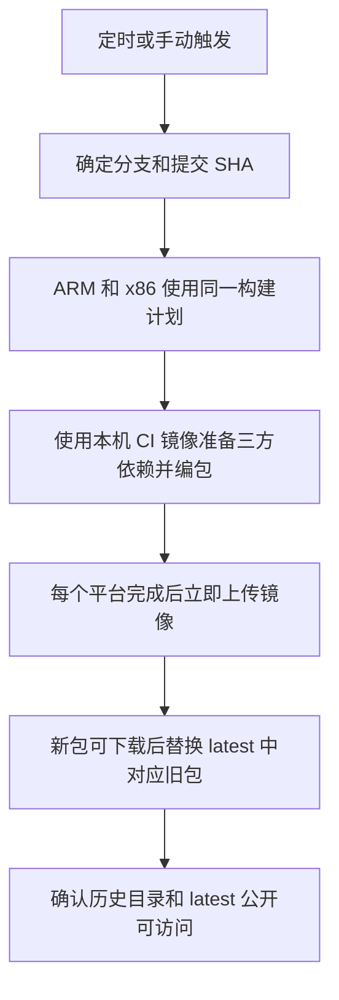

# Daily 构建与镜像发布

本目录收录构建机使用的 daily 发布工程。ARM、x86 部署相同脚本，各自在本机 Docker
内编译 A2/A3/A5。每个平台编好就上传华为云镜像；daily 不创建 GitHub Release。

`../pkg/make_packages.py` 和 `.github/workflows/package.yml` 继续负责 PR 出包与
Actions Artifact。本目录由受信任的构建机定时任务或维护者手动调用，不从 PR 自动发布。
共享驱动保留原有显式 release 模式；默认入口始终是 daily。

## 处理过程



- 默认候选分支为 `main`、`v26.10.0`、`v26.11.0`，由 `FLA_PKG_DAILY_BRANCHES` 配置。
  已正式发布的版本分支会自动退出 daily；查询失败则停止，不猜测发布状态。
- 自动任务使用北京时间当天 01:00 的提交截点。严格双机一致时，在一台机器生成
  plan JSON，将同一文件传到另一台，然后两边使用 `--plan`；不要各自使用当前 HEAD。
- daily 版本示例：`main` 为 `0.dev20261118+main.db989b9`，版本分支为
  `26.11.0.dev20261118+7b0b1b7`。文件名、wheel METADATA 和 manifest 一起校验。
- 每台机器默认覆盖平台清单 `npu_platforms.py` 中的全部平台，使用 `-j64` 和 Docker
  64 核上限。无需为其他 NPU 平台连接另一台同架构机器。
- 同一次构建固定镜像 ID。依赖按**本次源码提交**的声明准备成完整集合；旧镜像缓存
  不匹配时重新获取。无缓存模式也只准备一次，不再串行运行第二个下载器。
- 上传到 `nightly/<项目>/` 和 `nightly/<项目>/latest/`。历史目录保留所有提交；
  新包在两处都可下载后，才清理 latest 中同分支、同 CPU 架构的旧包。
  构建或上传失败时保留旧包；旧计划不能回退 latest。

## 部署

宿主需要 Linux、Python 3.10+、Git、Bash、`flock`、Docker 和 Docker 操作权限。
先按 [CI 部署教程](../../docs/Fla-npu仓CI部署教程.md) 准备本机架构的 CI 镜像。
镜像中包含编包所需 Python/CANN/编译器环境；本目录不会重建或覆盖共享 CI 镜像。
镜像标签沿用旧名称，实际软件版本应检查镜像内容。

下面以 `/srv/fla-npu-publish` 为安装目录；可换成维护者有写权限的目录。
由管理员创建目录并交给构建账号后，以该账号执行：

```bash
cp -a ci/publish/. /srv/fla-npu-publish/
cd /srv/fla-npu-publish
python3 -m venv .venv
.venv/bin/python -m pip install -r requirements-publish.txt
cp .publish.env.example .publish.env
chmod 600 .publish.env
# 在本机填写 .publish.env；不要将凭证提交到 Git。
bash build_docker.sh --check
```

配置也可以放在目录外，通过 `FLA_PKG_ENV_FILE=/安全路径/publish.env` 指定；
或直接 export `OBS_ACCESS_KEY`、`OBS_SECRET_KEY`、可选 `GITHUB_TOKEN`。
兼容已有部署的 `*_B64` 变量，但 Base64 只是编码，不是加密。
GitHub Token 仅用于计划和正式发布状态的只读查询，进入 daily 编译、OBS 上传前会清除。
OBS 凭证需要目标前缀的列举、上传和 latest 删除权限；它们不进入编译容器。

自定义镜像设置 `FLA_PKG_DOCKER_IMAGE` / `FLA_PKG_X86_DOCKER_IMAGE`。
需要代理时设置标准代理环境变量或 `FLA_PKG_PROXY_SCRIPT`，脚本没有预设代理端口、
服务器 IP 或 SSH 账号。正常双机部署不需要配置远程编包 SSH。

## 定时与手动触发

若原来已有 root 定时入口，继续让 root 调用实际构建账号即可。以下是 **cron 使用
Asia/Shanghai 时区**时的 root crontab 示例；两台机器都配置北京时间凌晨 01:00：

```cron
0 1 * * * /usr/sbin/runuser -u <build-user> -- /bin/bash /srv/fla-npu-publish/run_daily.sh
```

若 cron 使用 UTC，时间字段改为 `0 17 * * *`（北京时间次日 01:00）。不要仅在任务
内部 export TZ 就认为改变了 cron 的触发时区。由同一调度入口分发 plan 时，先生成一次
计划，复制到双机各自的 `plans/` 目录，再调用各机 `run_daily.sh --plan <同一计划文件>`。

手动执行与定时任务相同的流程：

```bash
cd /srv/fla-npu-publish
bash run_daily.sh
```

手动构建当前最新 `main`：先在一台机器生成计划，然后将**同一 JSON**传到另一台。
下面的 `--prepare-plan` 只生成计划，不编译、不上传：

```bash
FLA_PKG_DAILY_BRANCHES=main bash run_daily.sh \
  --latest --prepare-plan plans/manual-main.json
# 将 plans/manual-main.json 复制到另一台机器后，分别执行：
bash run_daily.sh --plan plans/manual-main.json
```

只试编、不上传（架构自动识别）：

```bash
bash run_compile.sh --branch main --build-only
```

`run_compile.sh` 直接调用时从进程环境读取凭证；可先用下面命令加载本机配置：

```bash
BASE=$PWD
source ./publish_env.sh
load_publish_env
```

不传 `--build-only` 会真实发布。`run_daily.sh` 持有完整任务锁，`run_compile.sh`
另持有构建锁；退出码 75 表示已有任务。不要删除锁文件来强行并行。

## 查看结果与补传

| 文件 | 用途 |
| --- | --- |
| `logs/cron-daily.log` | 入口、构建、上传和最终公开检查日志 |
| `plans/*.json` | 分支、日期、提交 SHA、跳过原因 |
| `out/daily/<分支>/manifest.json` | 每个平台的构建结果和 wheel 路径 |
| `out/daily/<分支>/publish-manifest.json` | 整批上传结果 |
| `out/daily/<分支>/wheels/<soc>-<arch>/dependency-preparation.json` | 完整三方依赖的版本、来源与 SHA256 |
| `logs/*-latest.json`、`logs/*-public-verify.json` | latest 清理与公开镜像验收结果 |

构建成功但上传失败时复用已有 wheel，加载配置后补传，不必重新编包：

```bash
.venv/bin/python publish_from_manifest.py \
  --manifest out/daily/main/manifest.json --build-type daily --branch main
# 继续按原计划清理本机 latest；x86 使用 --arch x86：
.venv/bin/python publish_latest.py --plan plans/manual-main.json --arch arm
.venv/bin/python verify_daily_public.py --plan plans/manual-main.json --timeout 0
```

OBS 上传成功不代表公开镜像已同步。默认最长等待 6 小时；latest 的等待和最终矩阵
检查各有独立超时。一个分支、两种架构、三个平台，历史和 latest 共检查 **12 项**。
最终退出 0 才表示构建、上传和公开检查都通过。任务失败时先按报告定位缺失项。

## 代码与测试

`run_daily.sh` → `daily_plan.py` → `run_compile.sh` → `make_packages.py`
→ `publish_from_manifest.py` / `obs_publish.py`。`watch_latest.sh` 并行跟踪已上传的包，
`verify_daily_public.py` 最后检查双架构公开矩阵。`prepare_publish_dependencies.py`
统一准备依赖；`ci_git_dependencies.py` 是旧分支的 CI helper 兼容副本。

```bash
python3 -m unittest discover -s ci/publish -p 'test_*.py' -b
for script in ci/publish/*.sh; do bash -n "$script"; done
```

测试不需要真实凭证、Docker 服务或 NPU，不编包、不访问上传接口。CI 契约测试会运行
这些测试；PR 的 NPU 门禁仍按[仓库规则](../../docs/repository-rules.md)执行。
