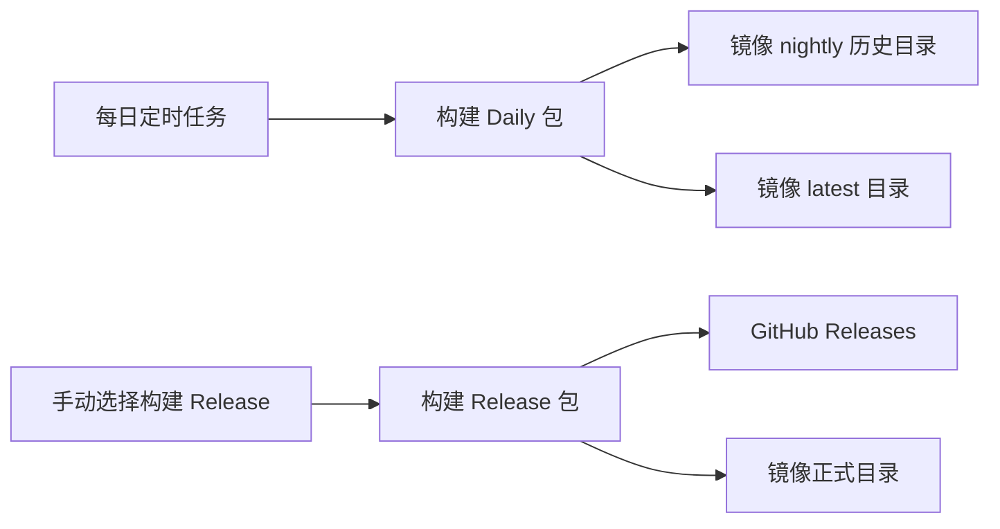

# Daily 和 Release 包发布与安装说明

Daily 用于日常验证，只发布到华为云内源镜像的 [nightly/](https://mirrors.huaweicloud.com/ascend/repos/pypi/nightly/)；Release 用于正式交付，同时发布到 GitHub Releases 和[镜像正式目录](https://mirrors.huaweicloud.com/ascend/repos/pypi/)。

## 1. 发布渠道与流程

| 包类型 | 调整前 | 调整后 | 触发方式 |
| --- | --- | --- | --- |
| Daily | GitHub Releases | 华为云镜像 `pypi/nightly/` | 每日北京时间 01:00 定时构建 |
| Release | GitHub Releases | GitHub Releases、华为云镜像 `pypi/` | 手动选择构建，默认不构建 |

Daily 构建 main 和尚未正式发布的版本分支，当前包括 v26.10.0；覆盖 A2 / A3 / A5 与 ARM / x86。版本分支正式发布后退出 Daily，main 继续构建。



此前安装 Daily 需要从 GitHub Release 选择附件、下载 wheel 再安装。现在可直接用 pip 从镜像选择包、分支和日期。

## 2. 先选择机型

| NPU 产品 | pip 包名 | 镜像项目目录名 |
| --- | --- | --- |
| A2 | `flash-linear-attention-npu-a2` | `flash-linear-attention-npu-a2/` |
| A3 | `flash-linear-attention-npu-a3` | `flash-linear-attention-npu-a3/` |
| A5 | `flash-linear-attention-npu-a5` | `flash-linear-attention-npu-a5/` |

以下命令以 A2 为例。A3 / A5 同时替换包名和 URL 中的 `a2`。pip 根据运行环境自动匹配 Linux ARM（`aarch64`）或 x86（`x86_64`）的 wheel；无需手动修改 CPU 后缀。当前 wheel 使用 `manylinux_2_34` 平台标签，需要兼容的 Linux 环境。

安装前准备与 CANN、Python 配套的 `torch`、`torch_npu`、`triton-ascend` 及其他运行时依赖，并加载 CANN 的 `set_env.sh`。下面使用 `--no-deps`，不会安装或调整依赖。每个环境选择与机器匹配的一个 NPU 包。

## 3. 安装命令

### 3.1 安装正式 Release

正式目录不带 `nightly`。以下以 `26.9.1` 为例，使用其他正式版本时替换版本号：

```sh
python -m pip install --upgrade --no-deps \
  --extra-index-url https://mirrors.huaweicloud.com/ascend/repos/pypi/ \
  "flash-linear-attention-npu-a2==26.9.1"
```

固定正式版本也适用于从 Daily 切换回 Release。正式 wheel 同时可从 [GitHub Releases](https://github.com/flashserve/flash-linear-attention-npu/releases) 下载后本地安装。

### 3.2 按日期安装 Daily（无需知道 SHA）

`20261102` 只是日期示例；将 `DAILY_DATE` 改为镜像中实际存在的构建日期。日期按北京时间每天更新。

```sh
DAILY_DATE=20261102

# main
python -m pip install --upgrade --no-deps \
  --extra-index-url https://mirrors.huaweicloud.com/ascend/repos/pypi/nightly/ \
  "flash-linear-attention-npu-a2==0.dev${DAILY_DATE}"

# v26.10.0
python -m pip install --upgrade --no-deps \
  --extra-index-url https://mirrors.huaweicloud.com/ascend/repos/pypi/nightly/ \
  "flash-linear-attention-npu-a2==26.10.0.dev${DAILY_DATE}"
```

指定 `.dev日期` 时 pip 会接受开发版本，并匹配该日期下的本地版本（`+` 后的部分），无需写完整提交号。同一天有多次不同提交构建时，pip 按版本号排序，SHA 不代表构建时间先后；需要最近一次成功发布的包时使用下一节的 `latest`。

### 3.3 从 latest 安装最近一次成功发布的 Daily

`latest/` 中保留 main、v26.10.0 两个分支及 ARM、x86 两种架构。仍需选择分支，但不必填写日期或 SHA：

```sh
# main
python -m pip install --pre --force-reinstall --no-cache-dir --no-deps --no-index \
  --find-links https://mirrors.huaweicloud.com/ascend/repos/pypi/nightly/flash-linear-attention-npu-a2/latest/ \
  "flash-linear-attention-npu-a2==0.*"

# v26.10.0
python -m pip install --pre --force-reinstall --no-cache-dir --no-deps --no-index \
  --find-links https://mirrors.huaweicloud.com/ascend/repos/pypi/nightly/flash-linear-attention-npu-a2/latest/ \
  "flash-linear-attention-npu-a2==26.10.0.*"
```

这里使用 `--force-reinstall`，确保同日切换提交时也安装 `latest` 当前提供的包；`--no-index` 将候选包限定为该目录。

**为什么这里使用 `--find-links`？** `--extra-index-url` 需要索引根，pip 会在其后追加项目名；当前 `latest/` 已经是直接列出 wheel 的文件目录。因此常规镜像安装继续使用 `--extra-index-url .../nightly/`，只从 `latest/` 取包时使用 `--find-links`。不能把 `.../<项目名>/latest/` 直接作为 `--extra-index-url`。参见 [pip 包来源与索引选项](https://pip.pypa.io/en/stable/cli/pip_install/#finding-packages)。

### 3.4 继续使用 extra-index-url，自动选择最新日期

如果不要求限定在 `latest/`，以下命令从历史目录按版本号选择最新日期：

```sh
# main
python -m pip install --upgrade --pre --no-deps \
  --extra-index-url https://mirrors.huaweicloud.com/ascend/repos/pypi/nightly/ \
  "flash-linear-attention-npu-a2==0.*"

# v26.10.0：仅匹配开发版本，不选正式版或旧的 26.10.0+... 包
python -m pip install --upgrade --pre --no-deps \
  --extra-index-url https://mirrors.huaweicloud.com/ascend/repos/pypi/nightly/ \
  "flash-linear-attention-npu-a2>=26.10.0.dev0,<26.10.0a0"
```

`--pre` 允许选择 Daily 开发版本。上述命令不会进入 `latest/` 子目录；同日多提交的选择仍遵循版本排序。

### 3.5 固定到某次提交

需要复现环境时，写入完整版本。以下日期和 SHA 为格式示例，应替换为镜像中实际发布的版本：

```sh
# main
python -m pip install --no-deps \
  --extra-index-url https://mirrors.huaweicloud.com/ascend/repos/pypi/nightly/ \
  "flash-linear-attention-npu-a2==0.dev20261102+main.fb3d47d"

# v26.10.0
python -m pip install --no-deps \
  --extra-index-url https://mirrors.huaweicloud.com/ascend/repos/pypi/nightly/ \
  "flash-linear-attention-npu-a2==26.10.0.dev20261102+ea56c7a"
```

安装后可查看实际版本：

```sh
python -m pip show flash-linear-attention-npu-a2
python -c "import fla_npu; print('ok')"
```

## 4. 命名与目录

| 类型 / 分支 | 版本格式 | 示例 |
| --- | --- | --- |
| Release | 正式版本号 | `26.9.1` |
| main Daily | `0.dev日期+main.<SHA前7位>` | `0.dev20261102+main.fb3d47d` |
| v26.10.0 Daily | `26.10.0.dev日期+<SHA前7位>` | `26.10.0.dev20261102+ea56c7a` |

日期为北京时间 `YYYYMMDD`；SHA 严格取对应完整提交号的**前 7 位**，不额外增加 `g` 前缀。main 不借用版本分支的基础版本号。wheel 文件名中的项目名使用下划线，pip 包名和镜像目录使用连字符；文件名版本与 wheel 内部版本一致。

完整文件名示例：

```text
flash_linear_attention_npu_a5-0.dev20261102+main.fb3d47d-py3-none-manylinux_2_34_x86_64.whl
flash_linear_attention_npu_a5-26.10.0.dev20261102+ea56c7a-py3-none-manylinux_2_34_x86_64.whl
```

镜像根地址为 `https://mirrors.huaweicloud.com/ascend/repos/pypi/`。以下展开 A2；A3 / A5 结构相同，只替换平台名称。历史目录中的其他日期已省略：

```text
pypi/
├── flash-linear-attention-npu-a2/                 # 正式 Release
├── flash-linear-attention-npu-a3/
├── flash-linear-attention-npu-a5/
└── nightly/
    ├── flash-linear-attention-npu-a2/
    │   ├── flash_linear_attention_npu_a2-0.dev20261102+main.fb3d47d-py3-none-manylinux_2_34_aarch64.whl
    │   ├── flash_linear_attention_npu_a2-0.dev20261102+main.fb3d47d-py3-none-manylinux_2_34_x86_64.whl
    │   ├── flash_linear_attention_npu_a2-26.10.0.dev20261102+ea56c7a-py3-none-manylinux_2_34_aarch64.whl
    │   ├── flash_linear_attention_npu_a2-26.10.0.dev20261102+ea56c7a-py3-none-manylinux_2_34_x86_64.whl
    │   └── latest/
    │       ├── flash_linear_attention_npu_a2-0.dev20261102+main.fb3d47d-py3-none-manylinux_2_34_aarch64.whl
    │       ├── flash_linear_attention_npu_a2-0.dev20261102+main.fb3d47d-py3-none-manylinux_2_34_x86_64.whl
    │       ├── flash_linear_attention_npu_a2-26.10.0.dev20261102+ea56c7a-py3-none-manylinux_2_34_aarch64.whl
    │       └── flash_linear_attention_npu_a2-26.10.0.dev20261102+ea56c7a-py3-none-manylinux_2_34_x86_64.whl
    ├── flash-linear-attention-npu-a3/
    │   └── latest/
    └── flash-linear-attention-npu-a5/
        └── latest/
```

`nightly` 已表示每日包，不再增加日期目录或分支目录。原项目目录保留历史包；每个 `latest/` 按“分支 × CPU 架构”各保留 1 份最近成功包，当前每个 NPU 目录共 4 份。

新包上传并确认公开可下载后，才删除对应组合的旧 `latest` 文件；当天构建或上传失败则保留旧包。因此 `latest` 表示最近一次成功发布，不保证所有组合都来自当天；镜像同步期间可能短暂看到新旧文件并存。

## 5. 调整后的优点

1. **渠道清楚**：Daily 集中到镜像，GitHub Releases 保留正式交付入口。
2. **安装方便**：支持 pip 按分支、日期或完整版本安装，适合脚本和容器部署。
3. **方便追溯**：Daily 名称同时包含日期和提交号；历史目录保留旧包，便于复现。
4. **更新有保障**：`latest` 提供最近成功包；当天失败时保留可用版本。
