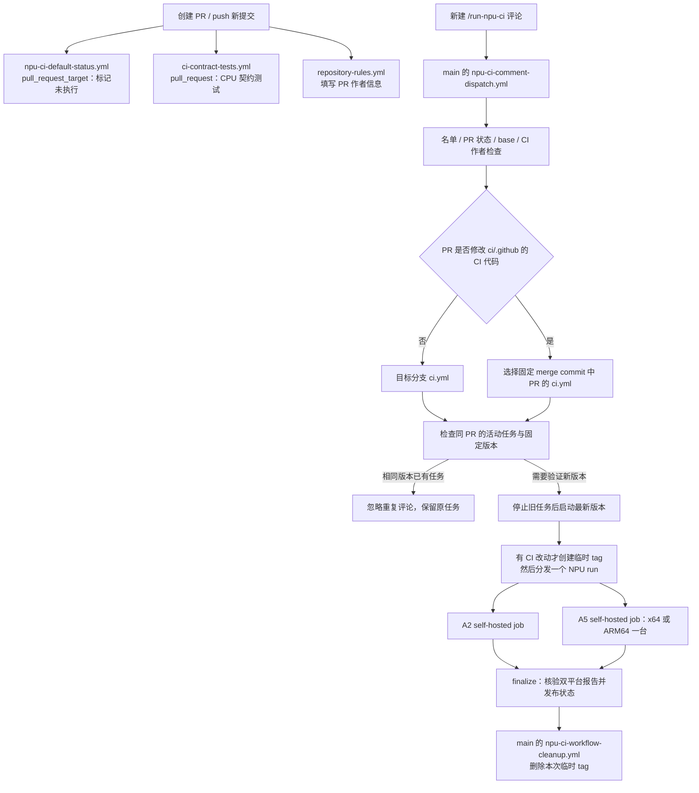

# 从 PR 到 A2/A5：NPU CI 流程与文件说明

本文说明本版本的 `.github/workflows/`、`.github/scripts/` 和 `ci/`。部署与故障处理见 [CI 部署教程](Fla-npu仓CI部署教程.md)，权限和合入要求见 [仓库规则](repository-rules.md)。

这里的 NPU 门禁仍是全量 OPP + torch adapter + GDR Example/ST；不要与其他分支中的部分编译、Daily 底包或 ATK 改造混用。`/package`、PyPI 发布也是独立流程。

## 1. 先区分三个分支和两类源码

以“个人仓库 `fix-op` 向主仓库 `release-old` 提 PR”为例：

| 名称 | 本例 | 用途 |
| --- | --- | --- |
| 默认分支 | 主仓库 `main` | GitHub 从这里运行评论分发器、完成事件清理器；CI 触发名单也从这里读取 |
| 目标分支 / base | 主仓库 `release-old` | PR 要合入的分支，也是通常的 NPU workflow 来源 |
| PR 分支 / head | 个人仓库 `fix-op` | 提交改动的源码；每次新提交产生新的 head SHA |
| 合并预览 / merge commit | 固定 base + 固定 head | 验证合入后的源码；修改 `ci/` 或 `.github/` 的 CI 代码时，也作为实际 workflow 的来源 |

**workflow YAML** 决定有哪些 job、checkout 和代理步骤。GitHub 在运行 job 前就选定它，后面 checkout PR 代码不会替换已经选定的 YAML。

**设备工作目录里的代码** 则在 checkout、fetch、本地 merge 后才形成。设备执行的 `ci/run_checks.sh` 等来自合并后的 PR 源码。本版对 `ci/` 或 `.github/` 的非 Markdown 修改统一选择 PR 合并版本，使设备脚本和 hosted 控制脚本都来自本次 PR。

## 2. 完整事件顺序



### 2.1 创建 PR、重开、转为 ready 或 push 新提交

- `npu-ci-default-status.yml` 使用 `pull_request_target`，采用 **PR 目标分支** 上的定义。新版给当前 head 写入六项 NPU pending，表示“尚未执行”；若非 Admin 作者改了 CI 代码，则拒绝并写失败。旧目标分支仍采用自己的旧版逻辑。仅改标题/说明不重置 NPU 状态，切换 base 时会重新处理。
- `ci-contract-tests.yml` 使用 `pull_request`，在 PR 合并预览上运行 GitHub-hosted 的 Python、Node 和 shell 回归测试，不申请 NPU，不使用分发 Secret。外部贡献者可能受 GitHub 的首次运行审批策略影响。
- `repository-rules.yml` 的 PR job 自动填写 PR 作者字段，不启动设备任务。

**创建 PR 或 push 不会直接启动 A2/A5。** 六项 pending 和 CPU 契约测试是不同的检查。

### 2.2 新建评论 `/run-npu-ci quick` 或 `/run-npu-ci full`

GitHub 的 `issue_comment` 从默认分支运行 `npu-ci-comment-dispatch.yml`。即使目标是 `release-old`，评论分发器仍来自 `main`，不会改为读取 `release-old` 的同名文件。

它先在 GitHub-hosted runner 上执行以下检查，检查通过才分发：

1. 评论必须是 PR 下的新评论，命令及参数合法；编辑旧评论不触发。
2. 初次触发人须在默认分支 `.github/npu-ci-users.json` 中；名单不会授予 GitHub 仓库管理权限。
3. PR 必须 open、非草稿、未合入；目标分支和 base SHA 必须有效且对应当前 PR，不要求预先设置分支保护。
4. 读取完整修改文件列表，包括重命名前后的路径。非 Markdown 的 `ci/` 或 `.github/` 修改只允许仓库 Admin 创建的 PR；检查的是 **PR 作者**，不是评论者。名单内的普通用户可以触发 Admin 作者的 PR；Admin 评论也不能放行非 Admin 作者的 CI 修改。
5. 固定本次 head、base 分支、base SHA 和 workflow SHA，按下面规则选择 YAML。

同一 PR 的评论分发 job 串行处理，并比较评论 ID，只处理最新的合法、名单内请求。分发器使用 `queue: max` 保留等待的控制请求，避免后来的非法评论把合法 pending 分发挤掉；这些等待项不是 NPU 设备任务。较旧评论即使晚排到，也不能反过来取消新请求。非法参数或未授权评论不能取消合法 CI。

`ci_modified=true` 已删除，不再是任何放行条件。

### 2.3 选择目标分支还是 PR 的 YAML

| PR 修改内容 | 实际 NPU YAML | hosted 控制脚本来源 | 设备 `ci/` 来源 |
| --- | --- | --- | --- |
| 没有非 Markdown 的 `ci/`、`.github/` 改动 | 目标分支 `ci.yml`，不创建 tag | 目标分支固定 commit | 固定 base/head 的 PR 合并结果 |
| 只有 `ci/`、`.github/` 内 Markdown 改动 | 目标分支 `ci.yml`，不创建 tag | 目标分支固定 commit | 固定 base/head 的 PR 合并结果 |
| 修改 `ci/` 脚本、`.github/scripts/` 或 workflow 等 CI 代码，含重命名两侧 | 临时 tag 上 PR 合并版本的 `ci.yml` | 同一个固定 merge commit | 固定 base/head 的 PR 合并结果 |

因此，只修改 `.github/scripts/` 也会使用 PR 合并版本，prepare/finalize 的新脚本可以直接验证，不要求故意修改 `ci.yml`。不涉及 CI 代码的普通 PR 直接分发目标分支，不创建临时 tag。

旧目标分支没有声明新版 `expected_*` 输入时，分发器只传它已声明的参数，不要求旧分支升级。旧分支仍执行自己的权限、构建和重跑规则；例如它原来要求触发者为 Admin，就仍有这一要求。兼容入口并不等于替它改写流程。

修改 CI 代码的 PR 必须包含新版 `workflow_source` 与四个 `expected_*` 输入契约。缺少这些输入会明确失败，避免错用旧 YAML。该要求只针对需要执行 PR CI 的路径，普通 PR 的旧目标分支不用升级。

分发器在权限和版本检查通过后，读取同一 PR 的活动 NPU run，核对实际 PR head 和 workflow/base 固定版本。若已有完全相同版本排队或运行，忽略重复命令并保留最新的一个；改变 quick/full 或 ops 参数也不会打断这个任务。历史上若已有多个重复任务，只保留最新的一个，取消其他重复或过期任务。PR head、目标分支或 base commit 变化才需要替换运行。

替换时先取消并等待旧 run 整体结束；超时或取消失败则报明确原因，不并排启动新设备任务。它只匹配本仓库 `ci.yml` 的该 PR，不取消其他 PR、`/package` 或其他 workflow。确定要启动时才重置本次检查项为 pending，不会因忽略重复评论改写原任务状态。没有活动任务时允许重新评论重试，不复用已完成的旧成功。

分发 API 固定使用 `2026-03-10`，取得新 run ID 后确认它已进入运行列表，并新建机器人评论登记 run ID 与 PR head，然后释放分发锁。这样即使旧分支尚未完成 prepare，下一条评论也能正确去重。该登记不新增门禁检查项。确认或登记失败会停止已验证的新任务，不重复分发。升级前遗留且无法确认 PR commit 的活动任务会保留并报明确原因，不能把 Actions 的 workflow SHA 猜成 PR head 后误取消。

### 2.4 `ci.yml` 的 prepare

在 GitHub-hosted runner 上：

1. 检出所选 workflow 固定 commit 的权限及检查项模块到 `ci-control/`。
2. 校验初次请求人、PR 状态、目标分支、固定 head/base/workflow 输入；PR merge 来源还校验 tag 和 merge 的两个 parent。
3. 再检查完整文件列表和 CI 修改作者权限。设备 job 前不再额外联网做重复权限查询。
4. 评论入口已完成活动任务去重；真正分发到 prepare 的请求执行本次验证，不复用已完成的旧成功。
5. 写入本 run 的 pending，创建本次运行的新评论，输出固定版本和设备参数。

每次真正进入 prepare 并产生触发反馈时，都新建评论，不查找并覆盖前一次运行的评论。finalize 可以更新 **本次 prepare 创建的 comment_id** 为最终结果。

同一 PR 的 NPU run 使用同一个 concurrency group，`cancel-in-progress: false`，避免手动或重复请求在版本去重前直接杀掉活动任务。评论入口负责识别版本、忽略重复、取消并等待旧 run；设备锁负责物理卡互斥。取消的旧 run 仍完成 hosted 汇总，分发器等待它结束才重置新状态，避免旧汇总覆盖新状态。历史 Actions 记录保留为 cancelled，不是从历史列表删除。

### 2.5 A2 / A5 设备 job

只有两个设备 job：A2 (`ascend910b`) 和 A5 (`ascend950`) 并行。A5 不限制 CPU 架构，由一台标签匹配且有空闲资源的 x64 或 ARM64 原生 A5 runner 承接，不会同时要求两种架构跑。

两个平台共用同一套源码获取逻辑：

1. 清空代理影响，直连 checkout prepare 固定的 base SHA。
2. 失败则加载 `/home/huangjunzhe/ci/vpn-proxy.sh`，调用 `proxyon`，等待后重试 checkout，必要时第三次重试。
3. Git fetch 目标分支及 `refs/pull/<编号>/head`，验证实际 head；浅克隆缺少祖先时补充历史。fetch 也支持失败后启用代理再重试。
4. 在固定 base 上本地合并固定 head；合并冲突或 ref 已变化则失败。
5. **离线**检查本地 head/base ref、commit 和合并祖先。这里不再请求 GitHub API。
6. `ci/run_ci_container.sh` 检查本机原生镜像、选择并锁定 NPU、挂载源码和缓存，再调用容器内 `ci/run_checks.sh`。

A2 使用 `ci/Dockerfile`，允许镜像缺失时构建；A5 使用 `ci/Dockerfile.ascend950`，要求部署时已预置本机架构镜像。两种 A5 CPU 架构可各自持有相同镜像名，但二进制架构必须匹配，不能通过模拟替代。

设备运行期间每 60 秒检查 PR head Git ref。出现新提交时会停止旧容器；finalize 还会通过 API 检查 PR 当前状态和版本。设备离线检查只能核对本地代码，不能判断 PR 是否刚关闭或切换目标分支。

### 2.6 容器内五个阶段与最终汇总

| 顺序 | 工作 | 入口 |
| --- | --- | --- |
| 01 | 环境、wheel 配置、Stable/ABI/runtime 契约 | `ci/run_checks.sh` 的 `check_environment_contracts` |
| 02 | 处理构建缓存，构建目标 SOC 的 OPP run 包 | `ci/prepare_ci_cache.sh` → `build.sh --pkg --soc=... --vendor_name=fla_npu -j16` |
| 03 | 构建独立 torch_custom wheel，检查 OPP 安装布局 | `check_wheel_install_layouts` → `scripts/check_install_workflows.py` |
| 04 | 安装 OPP、构建 PyTorch adapter；full 额外跑 adapter 测试 | `build_pytorch_adapter` → `torch_custom/fla_npu/test/test.sh`（full） |
| 05 | 执行启用的 GDR Example/ST 精度用例，形成完整报告 | `ci/run_example_st_cases.py` + `ci/example_st_cases.json` |
| 06 | 汇总两个平台、核验报告身份及当前 head/base，发布六项门禁和最终评论 | hosted finalize → `.github/scripts/publish_npu_ci_status.js` |

前置阶段失败，后续阶段标记未执行。一个平台失败会取消另一个平台，汇总仍按失败处理。每个平台上传结构化阶段、精度和诊断报告，不能靠单个平台成功或不完整报告通过门禁。

本版 `quick` 与 `full` 的 OPP 构建命令相同；workflow 强制开启 wheel 布局与 Example/ST，所以两者都执行这些阶段。`full` 在阶段 04 额外运行 `torch_custom/fla_npu/test/test.sh`。不是“quick 用 Daily 底包、full 用 build_wheel.py”的部分编译方案。

带 `ops=...` 是单独的定向编译诊断，只选阶段 01–02，发布独立诊断状态，不满足六项合入门禁。当前入口不支持另一套部分编译方案的 `atk-ops` 或 `device-id` 参数。

## 3. “检出 CI 权限检查脚本”是什么

这是普通 `actions/checkout`，使用 `sparse-checkout` 只取需要的几个模块，不执行完整算子代码，也不是从上一台机器复制文件：

```text
runner 工作目录/
└── ci-control/                  # checkout 自动创建
    └── .github/scripts/
        ├── npu_ci_authorization.js
        ├── npu_ci_workflow.js    # 仅评论分发器需要
        ├── npu_ci_checks.js
        └── npu_ci_checks.json
```

`github.workflow_sha` 表示 **本次正在执行的 YAML 所在的固定 commit**。在评论分发器里是默认分支的该次 commit，在 PR merge 的 `ci.yml` 里则是固定 merge commit，不是永远指 main。

checkout 本身不判断谁有权限；后面的 JS 加载这些模块并执行检查。分发器一定先完成检查，再调用 dispatch。`ci-control/` 不存在会自动创建；只有目录无写权限、Git/网络失败或指定文件在该 commit 不存在等情况才失败。`persist-credentials: false` 表示不把 checkout 凭据留在 Git 配置供后续 PR 脚本使用。

## 4. 临时 tag、清理与 Secret

GitHub 的 workflow dispatch 接受 branch/tag ref，不能仅靠设备 checkout 改变已选定的 YAML。分发器创建轻量 tag，例如：

```text
npu-ci/pr-1234/0123456789abcdef0123456789abcdef01234567
             └── 固定 PR 合并预览 commit
```

它是固定版本的运行入口，不是发布版本或 Release。相同 PR 的同一 merge commit 复用同名引用，不移动它指向其他 commit。

正常运行完成（成功、失败或取消）后，默认分支的 `npu-ci-workflow-cleanup.yml` 收到 `workflow_run.completed`，校验仓库、workflow 路径、tag 格式、commit 以及其他活跃运行，再删除精确 tag。同一 tag 还有运行时暂时保留，最后一个完成后再清理。Actions 历史运行记录仍保留，删除 tag 不删除日志。

有两个例外不能承诺自动清理：

- 清理 YAML 尚未合入默认分支时，它不会接收该事件。
- tag 创建成功但 dispatch API 失败时，没有对应完成事件；故意保留引用供相同版本重试，放弃重试后应确认无活跃运行，再由管理员删除错误信息中的精确 tag。

因此，正常执行不会一直积累历史 tag；上述例外可能留下少量引用，不能说所有失败路径都自动删除。

当前只把 `NPU_CI_DISPATCH_TOKEN` 放在 `npu-ci-dispatch` **Environment Secret**，自定义规则只允许 branch 类型的 `main`，不允许 tag。这是此凭据的配置范围，不是所有 GitHub Secret 都只能给 main 使用。

| 操作 | 使用凭据 |
| --- | --- |
| main 评论分发器读取 PR、检查权限、发 dispatch | GitHub 自动发放的 `GITHUB_TOKEN` |
| main 评论分发器创建带 PR workflow 修改的临时 tag | Environment 中的 `NPU_CI_DISPATCH_TOKEN`，需要 Contents、Workflows 写权限 |
| 目标分支 / PR 临时 tag 的 prepare、A2、A5、finalize | 各 job 的 `GITHUB_TOKEN`；不声明该 Environment，也不需要额外 token |
| 完成事件删除临时 tag | 默认分支清理 workflow 的 `GITHUB_TOKEN` |

所以目标是旧分支，或 Admin 的 PR 要修改 CI，都不需要让 PR job 获得这枚个人凭据。只有 main 上负责建 tag 的分发器使用它。若其他 job 主动声明这个 main-only Environment，GitHub 会按分支/tag 策略阻止那个 job；现有 `ci.yml` 没有这样做。

第一次启用需要把新评论分发器和清理 workflow 合入默认分支。仅配置 Secret 或更新 PR 不会替换 main 正在使用的旧分发器；这与旧目标分支是否升级是两件事。

## 5. 新提交、重复评论和重跑

假设第一次触发固定 `head=A`，随后 push 得到 `head=B`：

- 第一次 run 仍固定 A，不会运行到一半悄悄改用 B。发现 head 改变时会停止或在最终版本校验时失败。
- B 的状态重新显示未执行；新建 `/run-npu-ci` 评论会重新读取 PR，固定最新 B 及当时的 base。若 PR 改了 CI 代码，也会使用包含 B 的新 merge commit/tag。
- 触发期间又 push，快照不一致会拒绝，要求针对最新版本再触发，不会把旧代码结果发布为新提交通过。
- 每条新建评论都属于 `issue_comment.created`，但只有符合 job 条件、语法和权限的 `/run-npu-ci` 才分发 NPU run。普通评论不占用 NPU，编辑评论不触发，机器人反馈不会递归触发。
- 同一版本已有任务排队或运行时，重复评论被忽略，不新建 NPU run，也不打断原任务。版本变化时只保留最新版本；已完成后可重新评论重试。
- Actions 的 `Re-run` 重用原运行及原 workflow，不能用来获取 B 或修复后的 YAML。需要新提交版本时，新建评论创建新 run。

### 5.1 从 main 新建分支是否要修改 CI

- 新分支作为个人 fork 中的 PR 源分支：直接向主仓库 main 提 PR，不需要修改 CI 或配置 Secret。
- 本版合入 main 后，从更新后的 main 新建主仓库目标分支，不需修改 CI 文件、配置专用 Secret 或设置分支保护即可接受 PR 并运行 CI。无 CI 改动时直接用目标分支 workflow，不建 tag。分支创建者仍须满足既有 `repository-rules.yml` 的主仓库分支名单；是否需要审批等合入策略由仓库规则决定。
- 2026-11-05 检查的当前 main 为 `cc9e8dc234f40171018249ed8fa6dc9b2ee540f8`，其旧 prepare 仍要求目标分支受保护。从这个尚未合入修复的 main 派生的未保护分支，依然会被旧代码拒绝。新评论入口不能绕过旧分支自己执行的条件。
- 因此要先把本版合入 main，再从更新后的 main 创建新目标分支。此前已派生的旧分支若坚持不改文件、不建 tag且执行自己的旧 workflow，就仍需满足其原有保护要求。

## 6. 文件清单：什么时候使用，为什么保留

### 6.1 workflow

| `.github/workflows/` 文件 | 事件 / 用途 | 是否属于普通 NPU 主链 |
| --- | --- | --- |
| `npu-ci-default-status.yml` | `pull_request_target`：初始化当前 head 状态和触发提示 | 是，PR 创建/更新时 |
| `ci-contract-tests.yml` | `pull_request` 或手动：CPU 上验证 CI 实现和必要配置 | 是，独立自动门禁 |
| `npu-ci-comment-dispatch.yml` | `issue_comment.created`：NPU 权限检查和版本分发；另有 `/package` job | 是，评论时 |
| `ci.yml` | `workflow_dispatch`：prepare → A2/A5 → finalize | 是，设备运行主体 |
| `npu-ci-workflow-cleanup.yml` | `workflow_run.completed`：安全删除本次临时 tag | 是，设备 run 完成后 |
| `package.yml` | `/package` 分发或手动：多 SOC/CPU 架构出包、上传产物、回复结果 | 否，独立出包 |
| `pypi.yml` | 手动：按 tier 构建验证 wheel，dry-run 或通过 OIDC 发布 PyPI | 否，独立发布 |
| `repository-rules.yml` | `create`：分支创建权限；`pull_request_target`：填 PR 作者 | 否，仓库管理 |
| `close-linked-issues.yml` | PR 合入后关闭关联 Issue | 否，仓库管理 |
| `requirements-index.yml` | Issue 事件、每日定时、手动：维护需求汇总 | 否，需求管理 |
| `version-tags.yml` | 创建版本分支、`/version` 评论、手动：同步 Issue 版本标签 | 否，版本管理 |

后六个文件虽不参与 `/run-npu-ci`，都有独立入口，不能按“这次没运行”判为废文件删除。

### 6.2 权限和控制模块

| 文件 | 用途与调用时间 |
| --- | --- |
| `.github/npu-ci-users.json` | 初次请求时读取默认分支名单；PR 自己改名单不能直接给自己授权 |
| `.github/scripts/npu_ci_authorization.js` | 默认状态、分发、prepare：PR 状态、名单、完整文件列表、Admin 作者、base 和固定版本检查 |
| `.github/scripts/npu_ci_workflow.js` | 仅分发时：解析命令、确认最新授权评论、版本去重、停止过期 run、登记 PR head 与任务、选择 base/PR merge、处理 tag 与分发竞争 |
| `.github/scripts/npu_ci_checks.json` | 六项门禁、诊断检查与阶段映射的唯一数据定义 |
| `.github/scripts/npu_ci_checks.js` | 状态初始化、分发、prepare、发布时加载定义；按固定 base 兼容读取旧分支检查项 |
| `.github/scripts/publish_npu_ci_status.js` | finalize：验证双平台报告、PR 版本并发布状态及本次运行结果评论 |

### 6.3 `ci/` 非测试文件（13 个）

| 文件 | 用途与调用时间 |
| --- | --- |
| `run_ci_container.sh` | 设备主机入口：镜像架构、设备锁、挂载与环境、Docker 启停和本次输出归属清理 |
| `detect_npu.sh` | 宿主机/容器：解析 A2/A5 `npu-smi`，选择设备、健康状态、SOC |
| `run_checks.sh` | 容器总入口：初始化、五阶段顺序执行、失败跳过、复现命令 |
| `cleanup_ci_logs.sh` | 容器初始化：按保留期清理旧日志，不删除 GitHub Actions 历史日志 |
| `prepare_ci_cache.sh` | OPP / PyPI 构建前：比较构建输入签名、清理失效缓存、准备第三方依赖；不是 Daily 底包下载器 |
| `manage_npu_ci_stage_report.py` | 初始化、阶段状态变更和结束时：生成结构化报告及耗时 CSV |
| `example_st_cases.json` | 阶段 05：用例开关、shape 和精度运行行为参数 |
| `run_example_st_cases.py` | 阶段 05：执行用例、检查指标完整性、输出精度报告 |
| `summarize_npu_ci.py` | 每个平台结束，即使失败也运行：读取原始日志和报告，脱敏并形成诊断摘要 |
| `Dockerfile` | A2 镜像部署；普通 CI 镜像缺失时允许自动构建 |
| `Dockerfile.ascend950` | A5 部署时构建 x64/ARM64 原生镜像；普通 A5 CI 不现场构建 |
| `setup_self_hosted_runner.sh` | 管理员手工部署 runner：安装、注册及服务配置；每次 CI 不调用 |
| `pkg/make_packages.py` | `package.yml` 或手工出包：跨 SOC/架构的 wheel 构建；普通 NPU 门禁不调用 |

这些文件均有调用或部署用途，没有发现可按无用文件删除的运行时模块。把它们合成单个长脚本会混合 hosted API、宿主机 Docker、容器测试和手工部署四种环境，不能减少实际工作。

### 6.4 `ci/tests/`

这部分只在 GitHub-hosted 契约测试或本地开发时运行，不会每次在 A2/A5 上运行，也不决定算子精度用例数量。Python 模块由 `unittest discover` 自动发现，两个 shell 脚本由 workflow 显式调用。

保留的重点是可观察行为：权限与版本是否拒绝错误输入，是否执行了代理回退，是否停止本次容器，报告缺失是否拒绝通过。这些不能仅用“文件存在、几个 YAML 字段正确”替代。重复的 workflow 静态断言集中到统一配置测试；不再为一个 runner label 或同一套参数接线分散建立多个文件。

测试目录共 20 个文件：必要配置集中到 `test_workflow_configuration.py` 的七项检查；权限、相同版本去重、新版本替换、未保护新目标分支、固定版本、代理和报告保留行为回归。去重位于分发前，已完成后仍允许重新触发。原来只手工运行的设备检测 shell 测试也接入自动契约测试。

| 测试文件 | 保护内容 / 使用时间 |
| --- | --- |
| `test_workflow_configuration.py` | 七项必要配置：入口、Secret 边界、固定 checkout、两个平台、代理顺序、报告接线、hosted 测试 |
| `test_npu_ci_authorization.py` | 执行 JS 模块/入口：名单、Admin 作者、完整文件列表、固定版本和重跑规则 |
| `test_npu_ci_workflow.py` | 模拟 API：旧分支分发、PR merge/tag、权限错误、分发和清理竞争 |
| `test_npu_ci_workflow_cleanup.py` | 模拟完成事件：只删除精确 tag，其他任务活跃时保留 |
| `test_npu_ci_checks.py` | 唯一检查项定义、旧分支检查项读取及无效数据拒绝 |
| `test_default_status_fail_closed.py` | 初始化状态出错时让旧成功失效，不能默默保留通过 |
| `test_workflow_source_checkout.py` | 真实临时 Git 仓：浅克隆、fetch、代理重试、固定版本及离线检查 |
| `test_workflow_result_presentation.py` | 执行 prepare/publisher：新评论、同版本强制重跑、双平台完整性、最终状态和失败兜底 |
| `test_a5_image_architecture.py` | A5 镜像构建脚本对原生 x64/ARM64 的支持和错误输入 |
| `test_run_ci_container.py` | 模拟 Docker：本机架构、NPU 锁、临时目录和本次容器清理 |
| `test_manage_npu_ci_stage_report.py` | 阶段状态、失败/中断报告和持续时间记录 |
| `test_run_example_st_cases.py` | 用例选择、执行结果、精度指标完整性及异常报告 |
| `test_summarize_npu_ci.py` | 日志脱敏、错误摘录、阶段及精度报告不完整时的失败诊断 |
| `test_install_workflows_wheel_layout.py` | wheel 安装后 OPP 文件列表、内容和环境脚本契约 |
| `test_make_packages_process_control.py` | 独立出包的进程树取消与 Docker 清理，不残留后台编译 |
| `test_workflow_package_dispatch.py` | `/package` 参数、Admin 和固定源码出包规则，与 NPU 命令分开 |
| `test_gdn_forward_output_contract.py` | Example/ATK 消费者与 GDN 输出顺序契约；在 CPU 契约门禁运行 |
| `test_gdn_verify_status.py` | 手工 `gdn-verify.sh` 的阶段退出码、算子映射和诊断，不是普通 NPU job 再跑一遍 |
| `test_run_checks_stage_pipeline.sh` | 不使用真实 NPU 的五阶段调度集成测试：失败停止、后续跳过和阶段复现 |
| `test_detect_npu.sh` | 模拟 A2/A5 `npu-smi` 输出，验证设备号、健康、空闲和 SOC 解析 |

表中全部测试都由 `ci-contract-tests.yml` 执行；不要求 self-hosted NPU 设备。

## 7. GitHub 行为来源

- [事件与 issue_comment / pull_request / pull_request_target / workflow_run 的版本来源](https://docs.github.com/en/actions/reference/workflows-and-actions/events-that-trigger-workflows)
- [workflow dispatch 的 branch / tag ref](https://docs.github.com/en/rest/actions/workflows#create-a-workflow-dispatch-event)
- [Environment 分支/tag 策略根据运行的 GITHUB_REF 匹配](https://docs.github.com/en/actions/reference/workflows-and-actions/deployments-and-environments#deployment-branches-and-tags)
- [Concurrency 的 running/pending 和取消规则](https://docs.github.com/en/actions/how-tos/write-workflows/choose-when-workflows-run/control-workflow-concurrency)
