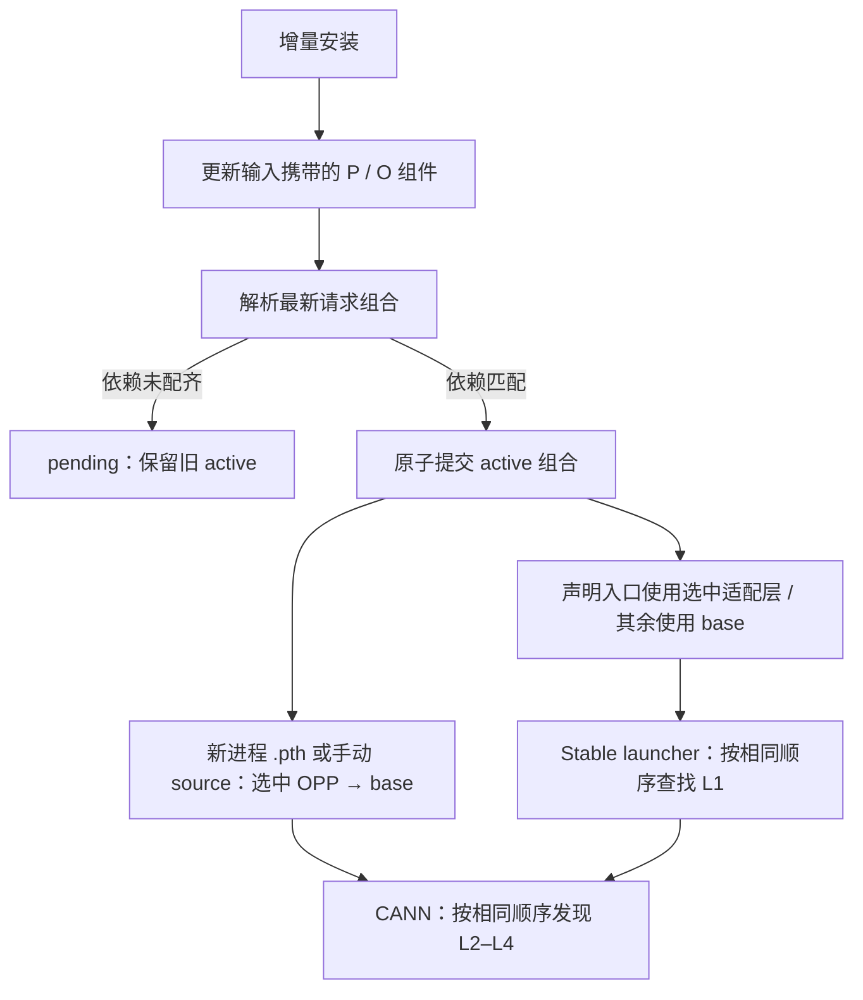

# FLA NPU OPP 增量叠加层设计

作者：zzy1205。本文维护增量安装的组件模型、启动顺序、兼容边界和验收要求。
[PR878](https://github.com/flashserve/flash-linear-attention-npu/pull/878) 引入 run-only overlay；
[PR1177](https://github.com/flashserve/flash-linear-attention-npu/pull/1177) 增加适配层与 OPP 独立组合。
当前组合能力要求 base 支持 layer 协议并包含本节的组件管理器；仅有旧版 layer 协议但仍按整层
安装的 base 也须升级管理代码。旧 wheel 的 vendor 目录安装路径保留兼容。
实现了某项机制不等于全部验收完成，报告须注明对应提交及实测范围。

## 1. 目的与范围

完整 vendor 的 host 库、算子清单和 kernel 索引按算子集聚合。用单算子产物覆盖完整 vendor，
会丢失其余算子的入口和执行资源。overlay 保留 base，将增量产物安装到独立目录。

增量分为两个组件：**适配层 P**（Python wrapper、Stable schema 和 launcher）及
**OPP O**（L1–L4 配套产物）。同一个组件最后安装的优先；输入没有携带的组件保留当前选择。
“最新”按安装提交顺序确定，不比较包的版本号或构建日期。

| 产物 | 更新适配层 P | 更新 OPP O |
| --- | --- | --- |
| run-only overlay | 保留当前选择，未更新过则为 base | 更新 |
| standalone wheel overlay | 更新声明的公共入口；其余入口使用 base | 保留当前选择，未更新过则为 base |
| 携带 OPP 的 wheel overlay | 更新声明的公共入口；其余入口使用 base | 更新 |

先装 P1 再装 O1，与先装 O1 再装 P1，最终均为 P1+O1；完整 wheel 携带 P1+O1 时结果相同。
多个包重复更新同一组件则以最后安装的为准，因此不承诺重叠更新也与顺序无关。
组件本身按整体产物替换：新 P 的入口范围不自动合并旧 P 的范围，新 O 也不叠加旧 O；
未被当前增量提供的入口或 OPP 符号回落 base。只保留另一个未更新的组件。

| 功能 | 必要行为 |
| --- | --- |
| 独立安装与组合 | P/O 可分步或一次更新；base 算子产物不变 |
| 安装与启用分离 | 有效组件允许先安装；组合不兼容时保存 pending，保留旧 active；配齐后原子启用 |
| Stable-only 日落 | 取消 ctypes 算子执行后端、自动回退和 legacy C++ 扩展 |
| 构建取消清理 | 确认本轮进程组和容器停止后才允许清理、重试 |

本设计不提供进程内热更新，不实现通用对象文件增量缓存。KDA host 错误码及 KDA/KKT
测试修正是独立回归事项，不是 overlay 的运行依赖。

**base 与 launcher 的兼容边界**：不支持保留旧 Python/Stable launcher，再手工覆盖 base
为 ABI 不兼容产物，也不承诺自动拦截手工覆盖。新 run 的默认、`--install`、`--full`
均走增量管理器，不再提供直接覆盖 base 共享库的入口。
需使用本管理器安装组件，或通过 pip 安装配套 base wheel。standalone 骨架 wheel 仍可用配套 run
提供 OPP，但 OPP 安装在增量目录，不补写 base vendor 或 RECORD。安装后通过
`python -m fla_npu_opp_manage --status` 确认启用状态，并在新进程中使用。

## 2. 架构与来源顺序



host 与 CANN 必须保持相同的 OPP 顺序：**当前生效 O 组件 → 存在的 base OPP**。
没有增量 O 时只使用 base；P 来自哪个 wheel 不决定 O 的来源。外部 vendor 保留在 CANN
路径中，不作为本包 host 库来源。各 OPP 组件内部的 L1–L4 必须配套，不拆散替换。

| 层 | 查找对象 | 负责方 |
| --- | --- | --- |
| L1 | `libcust_opapi.so` 中的 `aclnnXxx*` 符号 | Stable launcher 的 `Runtime::symbol()` |
| L2 | `aic-<soc>-ops-info.json` 的算子登记 | CANN |
| L3 | `binary_info_config.json` 的 kernel 变体 | CANN |
| L4 | tiling、proto、kernel `.o` 及旁车元数据 | CANN |

L1 按库句柄逐符号查询，custom 全部 miss 后才查 CANN；L2–L4 由 CANN 独立完成。
ABI 一致不能证明 host、tiling 和 kernel 的语义一致，仍需真机回归。

```text
site-packages/
├── fla_npu_opp_env.pth / fla_npu_opp_env.py
├── fla_npu_opp_manage.py                 # 不导入 torch 的管理入口
├── fla_npu_wheel_overlay.py              # 组件存储、组合与路径解析
└── fla_npu/
    ├── libfla_npu_stable.so              # base launcher
    ├── layer_manifest.json              # 公共入口、依赖和 launcher 指纹
    └── opp/
        ├── vendors/fla_npu_transformer/  # base OPP；骨架可无二进制
        └── wheel_layers/
            ├── state.json              # version=2，active / pending 组合 ID
            └── <id>/
                ├── components.json     # adapter / opp 各自引用不可变产物 ID
                ├── installation.json   # 本次安装来源及就绪诊断
                └── fla_npu/            # 本次实际携带的 P、O 或二者
```

base 和增量适配层使用独立的 dispatcher 命名空间、Runtime 句柄和符号缓存。
同一份 P 可以与后来安装的 O 组合，无需重拷贝或重编 P；所有旧 payload 保留至显式移除。
旧格式的完整 wheel 层可读取并继续更新。已有单个 vendor 目录 overlay 在首次组合安装时
复制纳入 O 组件；多个旧 vendor 需先整理成一个，不能猜测其聚合语义。

## 3. 来源选择和启动契约

| 输入 | 组件组合行为 |
| --- | --- |
| `FLA_NPU_OVERLAY_VENDOR` 未设置 | 使用 state.json 的 active；pending 不启用 |
| 包含 `fla_npu_overlay_transformer` 的名称列表 | 启用 active；组件模式使用默认名称，不支持多个组合排序 |
| 显式空值、空白或仅分隔符 | 同时禁用增量 P/O，恢复 base |
| `FLA_NPU_OP_API_LIBS` | 生效 O → 存在的 base，分别固定绑定到所用 launcher |
| `FLA_NPU_OP_API_LIB` | 单库兼容变量，不能替代多库分派 |
| `ASCEND_CUSTOM_OPP_PATH` | 生效 O → 存在的 base → 外部 vendor |
| `FLA_NPU_OPP_PATH` | OPP root 诊断变量，不决定 host 来源 |
| `FLA_NPU_DISABLE_PTH=1` | 跳过启动预置，须提前 source base 环境脚本 |

无 layer 协议的旧 base 保留原 run-only 路径：由 `config.ini` 和合法包内 vendor 目录选择，
支持自定义 `--overlay-name`；它不能单独通过安装增量 wheel 获得组件组合能力。

默认由 `.pth` 在用户代码及通常的 `import torch_npu` 前设置路径。关闭 `.pth` 时，须提前
source base 的 `fla_npu/opp/vendors/fla_npu_transformer/bin/set_env.bash`；不要直接 source
私有组件提取的脚本。骨架 base 若没有脚本，应保留默认 `.pth`。脚本和 `.pth` 均解析同一份
active 组件选择，不根据最后一个输入包是否含 OPP 猜测路径。pending、禁用或移除后不启用旧目录残留。

归一化移除旧的包内 OPP root、`vendor/op_api/lib` 和 vendor 顺序，重复 source 保持幂等。
路径须位于包内；外部 vendor 只保留在 CANN 路径。两套 wheel 构建和 run finalizer 复用
`finalize_wheel_opp.py::_write_set_env`；旧 run 安装器保留对应生成器，存在组合状态时调用
`fla_npu_wheel_overlay.py --shell-env`。

toolkit 的 `set_env.sh` 配置 CANN 工具链；vendor 的 `set_env.bash` 配置自定义 OPP 发现路径。
source 本身不等于设备运行时初始化。

**不支持的时序**：CANN 已初始化后安装、移除、启用、禁用或调整组件，或依赖晚到的
`import fla_npu` 补齐路径。须停止业务进程，完成安装及环境配置后重启；不承诺自动检测或
硬失败拦截错误时序。仅告警或 import 成功均不能证明 host/kernel 来源一致。

### 3.1 仓内 ATK 用例的兼容方式

ATK 不负责识别旧 vendor 的 `fla_npu_overlay_*` 目录或组件的 `wheel_layers/<id>`，
也不自行合并 base 与增量。两种模式均由启动脚本提前准备 OPP 路径，executor 调用 FLA 公共入口：

1. `tests/atk/run_test_cpu.sh` 依次激活 `ATK_ENV`、source `CANN_ENV`，再 source `FLA_NPU_ENV`（兼容旧名 `FLA_NPU_OPP_ENV`）指定的 vendor `bin/set_env.bash`。调用方已在外层 shell 完成这些动作时，脚本直接继承现有环境。
2. `set_env.bash` 在旧 run-only 路径按环境变量和 vendor 配置选择 OPP；组件模式统一由 base
   脚本读取 active 的 OPP 选择，不区分最后输入的是 run 还是 wheel。两者都生成一致的来源顺序：
   - `ASCEND_CUSTOM_OPP_PATH=overlay...:base:external...`，供 CANN 在启动时发现 L2–L4；
   - `FLA_NPU_OP_API_LIBS=overlay_lib...:base_lib`，供 Stable launcher 在 L1 逐库查找符号。
   active 组合没有增量 O 时不添加增量 vendor；standalone 可复用先前安装的 O。
3. `atk node` 及本机 worker 继承环境，executor 调用公开的 `fla_npu.ops.ascendc`：run-only
   保留当前 wrapper/launcher 并更新 OPP；wheel 的指定入口使用增量 wrapper/launcher，
   未覆盖入口保持 base。两者在 import 时按各自规则复核契约。非法描述符负向用例通过
   `load_ascendc_opapi_libraries()` 取得同一顺序的库句柄；wheel 接口变化后，executor、golden
   和负向描述符也必须与新接口配套，不能仅凭 OPP 路径正确就宣称原用例可用。
4. 安装 wheel 后，`fla_npu_opp_env.pth` 是解释器启动阶段的第二道准备机制：只要 ATK worker 使用能够看到该 wheel 的 Python 环境且未设置 `FLA_NPU_DISABLE_PTH=1`，它会在 executor 或 `torch_npu` 导入前写入 overlay-first 的 `ASCEND_CUSTOM_OPP_PATH`。正式执行仍建议显式 source `FLA_NPU_ENV`，不把 worker 是否加载 `.pth` 当作唯一前提。

推荐从仓库根目录按以下方式启动本机 ATK：

```bash
FLA_NPU_OVERLAY_VENDOR=fla_npu_overlay_transformer \
ATK_ENV=<atk-venv> \
CANN_ENV=<cann-set_env.sh> \
FLA_NPU_ENV=<site-packages>/fla_npu/opp/vendors/fla_npu_transformer/bin/set_env.bash \
bash tests/atk/run_test_cpu.sh -op=<op> -scope=accuracy
```

`FLA_NPU_OVERLAY_VENDOR` 显式空值表示只使用 base。overlay 的选择、安装或移除必须发生在 `atk node`、本机 worker 或常驻 Celery worker 初始化 CANN 之前；修改后须重启相应进程。远程或预先启动的 worker 不会继承控制端后来 source 的环境，必须在 worker 所在机器安装同一 wheel/overlay，并在启动 worker 的服务环境中准备上述变量。若 ATK 虚拟环境看不到安装 wheel，`run_test_cpu.sh` 不会替调用方修改 `PYTHONPATH`，应先修正 Python 环境；否则即使 CANN 能看到 L2–L4，executor 仍无法导入匹配的 Stable wrapper 和 launcher。

以上是两种模式的调用约束。run-only 的 ATK 实测见 PR878；wheel overlay 尚未完成全量 ATK，
其定向真机验证和未完成项见 PR1177，不能沿用 run-only 的历史结果作为 wheel 模式验收。

## 4. ABI 门禁与错误处理

**安装接收与组合启用是两步。** ABI 不匹配不阻止有效组件落盘；它阻止该组合启用。

| 阶段 | 检查与结果 |
| --- | --- |
| OPP 构建 | CPack 枚举真实导出，检查公共头和两阶段配对，生成 abi_manifest；源码 adapter 与头文件的构建检查保留 |
| wheel 构建 | 生成 layer manifest；骨架不要求完整 OPP snapshot |
| 产物接收 | 校验 wheel tag、依赖、RECORD、layer 协议、档位、launcher 元数据及 OPP 清单；损坏产物拒绝且不改变已有选择 |
| 组合解析 | 新 P 的依赖按选中 O → base 查找；仍使用 base adapter、但 OPP 来源被更新的入口也检查其契约 |
| 组合不就绪 | 保存 pending，安装命令返回 0 并明确提示待配齐；旧 active 不变，无旧 active 则继续使用 base |
| 组合就绪 | 原子切换 active 并清空 pending，新进程使用新组合 |
| import / launcher 加载 | 复核 active 绑定、清单、指纹和必要能力；损坏时报错，不启用 pending，不回退 ctypes |

OPP 的 `abi_manifest.json` 校验 host 库及头文件哈希、真实 ELF 导出和接口配对。
增量 OPP 必须有清单；旧 base OPP 没有清单时可从头文件与 ELF 获取契约。
读取只用 Python 标准库，不执行 vendor、不调用 nm；构建期仍使用 nm。
清单证明产物一致性，不是数字签名，也不证明数值正确性。

类型解析保留指针层级，拒绝未知声明，不比较参数名和 cv 限定。
保留 SolveTri 的已核对冻结契约，以及 CausalConv1d/Bwd Tensor 变体共用执行入口的显式例外。

- 新 P 与新 O 可同时改变接口；不要求它们等于 base 的旧接口。
- standalone 与当前 O 不兼容、或 run-only 与当前 P 不兼容，均可先安装为 pending。
- O 改动影响共享算子 B 时，检查仍在使用的 B adapter。接口匹配则允许复用，不强制重装 B adapter；
  不匹配则等待配齐。`affected_base_operators` 明确列出 O 更新影响的 base 入口。
- O 可以携带 P 声明范围外的算子；只安装 O 不会自动增加 Python wrapper。
- 未被 O 触及的 base 接口不增加全量 adapter/OPP 匹配门禁。未安装的算子不会凭空可用。
- 不提供 ABI bypass；`--force` 不绕过检查。组件模式接受旧命令中的 `--force`，但正常替换无需它。

无 layer 协议的旧 base 使用原 run-only 安装器，仍要求与 base 同名 ACLNN ABI 一致，
不兼容直接拒绝。升级 base 控制器后才能使用上述分步组合语义。

## 5. 安装、卸载与恢复

装卸前停止业务进程，完成后重新启动。三类产物可以连续安装，不再互斥：

```bash
# 仅更新适配层；OPP 保持当前选择
python -m fla_npu_opp_manage --overlay --source /path/to/standalone.whl

# 仅更新 OPP；适配层保持当前选择，可在上一条之前或之后执行
python -m fla_npu_opp_manage --overlay --source /path/to/update.run
# 也接受已解包的 vendor 目录或只含一个 vendor 的父目录

# 同时更新两部分
python -m fla_npu_opp_manage --overlay --source /path/to/with-opp.whl
# 显式配套 OPP 优先于同一个 wheel 内的 OPP
python -m fla_npu_opp_manage --overlay --source /path/to/standalone.whl \
  --opp-source /path/to/matching.run

python -m fla_npu_opp_manage --status
python -m fla_npu_opp_manage --remove-overlay
```

构建入口、三类产物和覆盖范围详见第 9 节及 [Wheel 增量安装指南](Wheel增量安装指南.md)。
旧 base 的 run-only 安装仍先提取 vendor，按旧规则使用 `--force` / `--overlay-name`。

| 行为 | 组件组合规则 |
| --- | --- |
| 最新安装选择 | 从 pending（如有）否则 active 继承；只替换本次实际携带的组件 |
| 生效选择 | 仅使用 active；一次原子提交 P/O 的组合，避免两者各自切换形成混源 |
| 缺依赖 / ABI 不匹配 | 安装成功、pending；状态中列出 errors，须补齐后才可运行该组合 |
| 格式 / 复制 / 提交失败 | 拒绝或报错，原 active 和 pending 保持；未提交新目录可清理 |
| 提交后中断 | 已被状态引用的目录保留，不误删其组件依赖 |
| 旧产物 | 不修改和删除被历史组合引用的 payload；显式移除时统一回收 |
| 移除 / 损坏恢复 | 独立管理入口不导入 torch；清空 active/pending，删除保存的组件及已接管旧 vendor，恢复 base |

管理操作共用 `opp/.overlay.lock`。所有文件属于独立 overlay 状态，不写入 base wheel 的 RECORD。
不要用 pip 卸载某个组件；升级或卸载 base 前先移除 overlay。没有进程内热切换保证。

## 6. Stable-only 日落与兼容

| 修改项 | 结果与迁移要求 |
| --- | --- |
| ctypes 算子执行后端及自动回退 | 删除；默认和唯一产品执行路径为 Stable |
| legacy C++ 扩展、codegen/YAML | 删除，相应 torchnpugen 依赖和构建选项不再有效 |
| 无 launcher 构建/发布豁免 | 删除 `--without-launcher` 路径；wheel 必须含匹配 launcher 和构建戳 |
| 旧环境开关 | `FLA_NPU_STABLE_ABI=ctypes` 等旧模式报迁移错误；不能关闭必需 launcher |
| 公开 wrapper | run-only 保留当前适配层的签名与契约；wheel 的指定入口取增量 Stable wrapper 的签名、默认值及副作用契约，其余入口保持 base |
| 旧调用方 | 迁移到公开 `fla_npu` 入口；显式 `install_torch_npu_ops_compat()` 仍可提供兼容名称 |
| 覆盖检查 | 当前 wrapper/schema/adapter 必须连通；已有公开调用兼容性受保护，新增接口不受历史清单限制 |

标准库 `ctypes` 仍服务 Stable 路径：

| 保留用途 | 例子 | 不使用 ctypes 的替代方向 |
| --- | --- | --- |
| 动态库加载 | `ctypes.CDLL` 加载 CANN/custom host 库并控制加载模式 | C++ `dlopen` 或统一交给 launcher；须保留错误诊断与句柄生命周期 |
| stream 诊断回读 | 调用 `fla_npu_stable_last_launch_stream()` 核对实际提交 stream；当前 stream 获取本身走 torch_npu accessor | 将回读暴露为 C++/torch dispatcher 查询接口，保留多 stream 回归 |
| 能力查询 | 调用 `fla_npu_stable_overlay_order_version()` | 暴露 C++/torch dispatcher 查询接口 |
| 构建指纹查询 | 读取 launcher 导出的源码指纹，与 `_stable_hash.py` 比较 | C++ bridge 返回指纹，或在加载时执行同等校验 |

这些替代需要单独验证，不属于执行后端日落的必要工作。包外 `tests/atk/common/aclnn_error_probe.py` 使用 ctypes 构造公开 dispatcher 无法表达的非法描述符，只测试 GetWorkspaceSize 拒绝路径，不执行第二阶段，不随 wheel 发布。

## 7. 构建取消与重试

本地命令以独立进程组启动，取消时依次尝试 SIGINT、SIGTERM、SIGKILL，并确认整个组没有活跃进程，不能只检查组长退出。远程使用 `setsid` 和 `timeout --foreground` 保持构建子树同组，记录 PGID 与启动时间，发信号前检查进程身份。

Docker 进程由 daemon 管理，除本地客户端进程组外，还要按本次唯一容器名检查归属并停止容器。未确认清理完成时抛出不可重试的 `BuildCleanupError`，停止后续重试和 SoC 组合。只有确认写入者退出后，才能清理共享 build 目录并开始下一轮。

这些规则不承诺终止主动逃离进程组的任意外部程序，也不以 mock 测试替代真实 Docker 取消验收。

## 8. 检视入口与验收要求

| 检视组 | 主要文件 | 必查条件 |
| --- | --- | --- |
| 来源顺序 | `fla_npu_opp_env.py`、`fla_npu/__init__.py`、`csrc/src/runtime.cpp`、`_wheel_layer_runtime.py` | run-only 的 vendor 顺序与 base 回落；wheel 的 provider/launcher/OPP 一致、骨架复用；两者启动前预置及显式禁用 |
| ABI/恢复 | `_op_abi.py`、`install_opp.py`、`fla_npu_opp_manage.py`、`fla_npu_wheel_overlay.py` | P/O 独立安装顺序、最新组件覆盖、实际 ABI 匹配、共享依赖、pending、损坏恢复与移除 |
| 日落/构建 | `_stable.py`、`ops/ascendc/__init__.py`、`stable_build_policy.py`、两套 setup | 无回退，实际 launcher 校验，旧选项拒绝，完整 wheel 检查 |
| 测试迁移 | `test_stable_only_runtime.py`、`stable_coverage.py`、仓内调用方 | 当前公开入口与 wrapper 一致；已有参数及分派相对顺序兼容，新增接口及可选参数放行；行为、精度仍由实际测试覆盖 |
| ATK 增量调用 | `tests/atk/run_test_cpu.sh`、ATK executor、生成的 `set_env.bash` | 两种模式的 worker 启动环境和来源选择；wheel 接口变化后用例需匹配，不能沿用 run-only 验收结论 |
| 取消清理 | `ci/pkg/make_packages.py` | 组长退出但子进程存活、信号忽略、PID 身份变化、清理失败不重试 |
| KDA/KKT 修复 | KDA host 返回码、ATK executor/golden | 旧库/新库负例差异、独立标杆、原用例保留、无容差放宽 |

路径以 `torch_custom/fla_npu/` 为相关包前缀；具体实现与测试清单见 PR diff。

```bash
python docs/agents/skills/operator-review/scripts/check_issue_coverage.py
python torch_custom/fla_npu/tools/stable_coverage.py --strict
python torch_custom/fla_npu/tools/op_abi_parity.py
python -m pytest -q tests/test_opp_overlay.py tests/test_opp_abi_contract.py \
  tests/test_stable_only_runtime.py tests/test_stable_build_policy.py \
  tests/test_stable_gates.py ci/tests/test_make_packages_process_control.py
```

静态覆盖、mock 单测和局部 A5 回归各有边界，不相互替代。算子数、导出数或退出码为零都不能单独证明全量数值正确。数值、性能、确定性、MSS、A2/A3/A5 支持矩阵、发布工具链与正式 CI/审批要求按[仓库规则](repository-rules.md)、[开发者指南](开发者指南.md)和[迁移指南](兼容与迁移指南.md)执行。PR 应按当前提交分别列出通过、已有失败、未执行与阻塞，禁止累计历史轮次充当当前结果。

## 9. 增量安装

本节面向支持 layer 协议的新 base。三类产物共同更新一个 P/O 组合，可以分步安装，也可以一次配套交付。

### 9.1 产物与覆盖范围

| 产物 | 交付内容 | 更新范围 | 保留内容 | 启用条件 |
| --- | --- | --- | --- | --- |
| run-only overlay | `.run` 或解包后的 vendor | 更新 OPP L1–L4 | 当前 P；未装增量 P 时使用 base adapter | 被更新 O 影响的适配层与它匹配 |
| standalone wheel overlay | wrapper、Stable launcher、layer manifest；不带 OPP 的骨架 wheel | 更新 P 声明的公共入口 | 当前 O；未装增量 O 时复用 base OPP | 新 P 与选中 OPP 匹配 |
| 携带 OPP 的 wheel overlay | 适配层及内嵌 OPP | 同时更新 P 和 O | base 算子产物；未覆盖入口或符号回落 base | 新组合的所有受影响依赖匹配 |

standalone 指实际不含 `libcust_opapi.so` 的产物，不能只按构建命令名称分类。
`FLA_NPU_OVERLAY_OPS` 决定 P 的公共入口范围，未设置为全部公共 Ascend C 入口；
`FLA_NPU_OPS` / `--ops` 决定 O 的编译范围。两个范围不要求相同，OPP 的共享依赖可能影响 base adapter。
base 可带 OPP 或为骨架，骨架缺失的未覆盖算子仍不可用。

### 9.2 共同规则

1. **最后安装的同类组件优先**：P1+O1 之后安装 P2 得到 P2+O1；再安装 O2 得到 P2+O2。
   完整 wheel 携带 P3+O3 时同时替换两者。不用版本号推断优先级。
2. **最新请求与生效组合分离**：pending 保存最新未配齐请求，active 保存上一份可运行组合。
   下一次安装从 pending 继承未携带组件，避免丢失之前已安装但未启用的修改。
3. **安装成功不等于已启用**：有效但不兼容的组件返回安装成功（退出码 0），明确输出 pending。
   状态查询列出原因；补齐后自动提交 active，须重启业务进程。
4. **失败不破坏当前组合**：损坏包直接拒绝，复制或状态提交失败保留此前选择；提交后中断不能误删已引用文件。
5. **共同启动与恢复**：三类产物共用锁、状态、显式禁用、查询和移除入口，base 文件及 RECORD 不变。
   普通 pip install 仍更新 base，不是增量安装。

独立组件引用保存在每次安装的不可变 `components.json` 中，例如：

```json
{"version": 1, "adapter": "<P产物ID或null>", "opp": "<O产物ID或null>"}
```

实际 ID 为 32 位十六进制字符串；null 表示使用 base。`state.json` 的 active/pending 指向组合 ID，
不是按安装目录排序猜测版本。旧完整 wheel 层没有 components.json 时，按原布局识别其 P 和可选 O。
不重复复制未更新组件，状态提交后所需文件不会随下一次安装被删除。

两类 wheel 均校验 layer 协议、档位、launcher 元数据、tag、依赖、RECORD 和安全路径。
仅提取 `fla_npu`，支持根目录及 `.data/purelib` / `platlib` 布局；不执行输入 wheel 顶层初始化、
`.pth` 或安装钩子，不替换顶层框架、Triton 或第三方依赖。普通 Stable launcher 的旧加载兼容保留，
但只有支持 layer 协议和显式注册的 base 才能进行组件组合。

公共模块替换 P 声明的入口、别名和副作用元数据；增量 Python 与 dispatcher 使用私有命名空间。
`_stable.load()` 调用 `fla_npu_stable_register(namespace, paths)`，按当前 active 组合固定库列表。
仅 `torch.ops.load_library()` 不完成新 launcher 的 schema 注册。P 和 O 来自不同安装也遵循同一流程。

### 9.3 run-only overlay

只更新 OPP，保留已安装的 P，包括还在 pending 的 P：

```bash
python -m fla_npu_opp_manage --overlay --source /path/to/update.run
# 或已解包目录
python -m fla_npu_opp_manage --overlay --source /path/to/staging/vendors
```

run 文件先解到临时目录，校验并复制为独立 O 组件，不执行对 base 的直接覆盖。
已安装 base wheel 时，新构建的 run 裸执行或传 `--install` / `--full`，也将解出的 vendor 交给同一
增量管理器，无需用户传 `--overlay`；只更新 O，保留当前 P 和 base 文件。失败不回退到
覆盖 base。`--full` 与 `--install` 保持等价；CANN 和指定解包目录模式不变。
仅有 O 且不匹配当前 P 时也可保存为 pending，稍后安装匹配的 standalone wheel 即可补齐。
新增 OPP 接口不会自动新增 wrapper。共享算子继续用已有 adapter 时，其契约也须匹配。

### 9.4 standalone wheel overlay

只更新 P，不丢弃已经选择的 O；包括 O 先安装为 pending 的情况：

```bash
python -m fla_npu_opp_manage --overlay --source /path/to/standalone-update.whl
# 需要新 O 时，可稍后独立安装，无需再次提供 wheel
python -m fla_npu_opp_manage --overlay --source /path/to/matching.run
```

也可以反过来先装 run，再装 standalone。当前 P/O 匹配后启用，未配齐前保持旧 active 或 base。
骨架 base 加骨架增量、且未装 O 时保持 pending。构建方法见 [Wheel 增量安装指南](Wheel增量安装指南.md)。

### 9.5 携带 OPP 的 wheel overlay

一次更新两部分；两部分可以相对旧版本同时改变接口：

```bash
python -m fla_npu_opp_manage --overlay --source /path/to/with-opp-update.whl
```

若同时指定 `--opp-source`，该显式 OPP 替代本次 wheel 内的 OPP。以后再装 standalone 时保留 O，
再装 run 时保留 P。带 OPP 不等于依赖完整，组合仍可能 pending；不强行启用不兼容的 C 调用。
同一组件的新包整体替换旧包，不在两个历史 OPP 之间继续逐符号回退；缺失符号仅回落 base。

### 9.6 验收范围

共同场景为 base 有 A+B、增量只更新 A：A 使用预期 P/O，B 未被 O 更新时来源和数值不变，
禁用及 remove 后恢复 base。OPP 明确更新共享依赖时，须另测受影响 B 的契约和行为。

| 验证准则 | 必须覆盖的结果 |
| --- | --- |
| 独立安装顺序 | P1→O1、O1→P1、完整 P1+O1 的最终适配层、OPP 与结果一致 |
| 同组件优先级 | P1+O1→P2 保留 O1；再装 O2 保留 P2；完整包替换两部分 |
| 不兼容先安装 | standalone 或 run 均成功保存 pending；旧 active 不变；后续补齐继承最新 pending 并启用 |
| 真实适配层更新 | 新 Python 参数、默认值、C++ schema 生效；仅更新 O 时原适配层不变 |
| OPP L1–L4 | P/O 分步后四层同源；不同组件目录不导致 host/kernel 混源 |
| 共享依赖 | 兼容的已有 adapter 可复用；不兼容保持 pending；列出受影响 base 入口 |
| 启动路径 | .pth 与手动 source 选择相同 O；禁用、pending、remove 不残留过时路径 |
| 恢复与迁移 | 旧完整 wheel 状态及单个 run vendor 可继续更新；坏包、坏引用、原子提交失败及提交后中断可恢复 |
| 产物完整性 | RECORD、路径、档位、ABI 清单、launcher 指纹、显式注册隔离保持检查 |

真机报告须区分 P/O 顺序验证、真实 C ABI 变化验证及单测夹具，不把此前整层安装的历史结果
直接计为当前组件组合通过。完整 ATK、性能和产品矩阵的未执行范围仍需单独列明。
