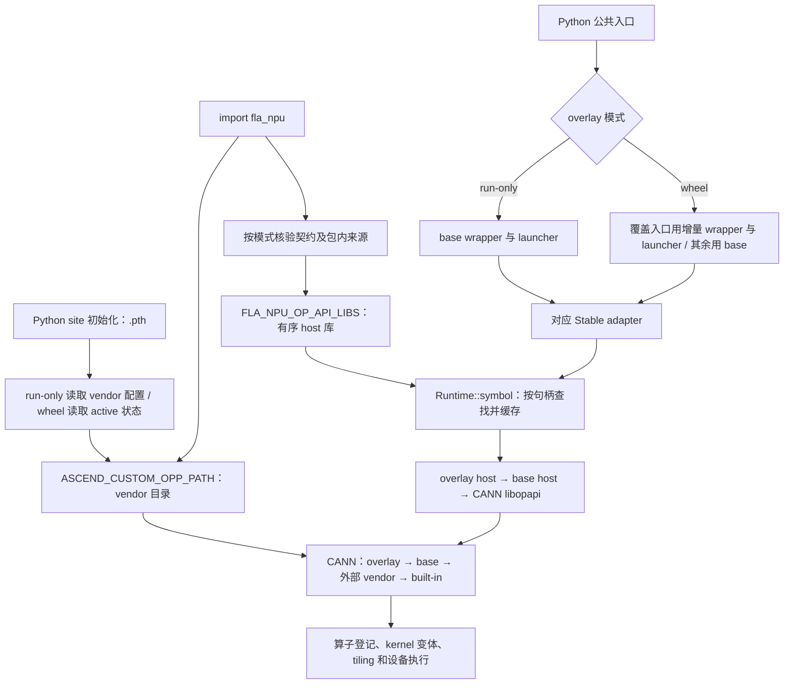

# FLA NPU OPP 增量叠加层设计

作者：zzy1205。run-only overlay 适用于带完整内嵌 OPP 的 FLA wheel；wheel overlay
同时支持骨架与带 OPP 的 wheel，要求双方具备第 9 节的 layer 协议。

本文维护两种 overlay 的架构、接口、兼容边界和验收要求。run-only overlay 的验证见
[PR878](https://github.com/flashserve/flash-linear-attention-npu/pull/878)，wheel overlay 的验证见
[PR1177](https://github.com/flashserve/flash-linear-attention-npu/pull/1177)。实现了某项机制不等于全部验收完成。

## 1. 目的与范围

完整 vendor 的 host 库、算子清单和 kernel 索引按算子集聚合。用单算子产物覆盖完整 vendor，
会同时丢失其余算子的入口和执行资源。overlay 保留 base，将增量产物独立安装：

| 模式 | 更新内容 | 未覆盖算子 |
| --- | --- | --- |
| run-only overlay | 安装从 run 包提取的增量 OPP，复用 base 的 Python wrapper 和 Stable launcher | 回落 base OPP |
| wheel overlay | 更新指定入口的 Python wrapper、Stable schema 和 launcher；OPP 可随 wheel 携带、配套补入或复用 base | 保持 base wrapper、launcher 和原有 OPP 来源；骨架 base 原来缺失的算子仍不可用 |

本次交付包含四类功能：

| 功能 | 必要行为 |
| --- | --- |
| 增量安装与查找 | run-only 更新增量 OPP；wheel 更新指定 Python/Stable 入口及可选 OPP；就绪的新 overlay 替换旧 active，base 算子产物不变 |
| ABI 门禁与恢复 | run-only 比较 overlay/base ACLNN 契约；wheel 比较新 adapter 与实际选中 OPP；两种模式均可独立查询和移除 |
| Stable-only 日落 | 取消 ctypes 算子执行后端、自动回退和 legacy C++ 扩展，迁移构建、调用方与测试 |
| 构建取消清理 | 确认本轮进程组和容器停止后才允许清理、重试 |

KDA host 错误码及 KDA/KKT 测试修正是单独的回归修复，不是 overlay 的运行依赖。它们没有改算子 kernel、tiling 或 Stable adapter 的计算实现。

本设计不提供进程内热更新，不实现通用对象文件增量缓存。run-only overlay 保持 Python/schema
不变；wheel overlay 可发布新入口及接口变化。两种模式当前互斥，切换前须移除已安装的 overlay。
下文按同一主题并列说明两种模式，第 9 节补充 wheel layer 协议和内部实现。

**base 与 launcher 的兼容边界**：不支持保留旧 Python/Stable launcher，仅通过 `.run --install`、
`--full` 或手工覆盖将 base 换成 ACLNN ABI 不兼容的产物，也不承诺自动拦截这种混装。
run-only overlay 仍须与 base 的同名 ACLNN 接口兼容；wheel overlay 则允许接口变化，前提是新
wrapper、adapter 与实际使用的 OPP 配套。也可以重建配套 wheel，通过 pip 整体更新 base。
standalone 骨架由匹配 run 包补齐 base 的原流程仍支持；wheel overlay 的骨架组合见第 9 节。

## 2. 架构与来源顺序



两种模式的 host 库与 CANN 路径都须保持 **overlay/base 的相对顺序一致**。run-only 携带的 OPP
优先于 base；wheel 携带 OPP 时也按此顺序，不携带 OPP 时复用匹配的 base OPP，不创建虚假的
overlay vendor。外部 custom vendor 只保留在 CANN 路径中，不作为本包 host 库来源。

| 层 | 查找对象 | 负责方 |
| --- | --- | --- |
| L1 | `libcust_opapi.so` 中的 `aclnnXxx*` 符号 | Stable launcher 内的 `Runtime::symbol()` |
| L2 | `aic-<soc>-ops-info.json` 中的算子登记 | CANN |
| L3 | `binary_info_config.json` 中的 kernel 变体 | CANN |
| L4 | tiling、proto、kernel `.o` 及旁车元数据 | CANN |

L1 按库句柄逐符号查询，custom 全部 miss 后才查 CANN。L2–L4 由 CANN 独立完成。run-only
只切换这些 OPP 层；wheel 同时选择 Python/Stable 层，骨架增量复用 base 时 L1–L4 仍来自 base。
两种模式都不能仅凭 ABI 一致证明 host、tiling 和 kernel 语义一致，仍需真机回归。

```text
site-packages/
├── fla_npu_opp_env.pth / fla_npu_opp_env.py
├── fla_npu_opp_manage.py                 # 独立管理入口
├── fla_npu_wheel_overlay.py              # wheel 状态、契约及路径解析
└── fla_npu/
    ├── libfla_npu_stable.so              # base launcher
    ├── ops/ascendc/_stable_hash.py       # launcher 源码指纹
    ├── layer_manifest.json              # wheel 模式需要
    └── opp/
        ├── vendors/
        │   ├── config.ini
        │   ├── fla_npu_transformer/     # base OPP 或骨架
        │   └── fla_npu_overlay_transformer/ # run-only 模式
        └── wheel_layers/                # wheel 模式，与 run-only 互斥
            ├── state.json
            └── <id>/fla_npu/            # 独立 Python、launcher、可选 OPP
```

run-only 复用 base launcher；wheel 的指定入口使用私有层 launcher，其余入口使用 base launcher。
各 OPP vendor 内部均包含 `op_api`、`op_impl`、`op_proto` 等资源；增量 OPP 还须带有效 ABI 清单。

## 3. 来源选择和启动契约

| 输入 | run-only overlay | wheel overlay |
| --- | --- | --- |
| `FLA_NPU_OVERLAY_VENDOR` 未设置 | 按 `config.ini` 及包内合法目录发现 overlay | 使用 `state.json` 中的 active；pending 不启用 |
| 显式名称列表 | 按 `os.pathsep` 分隔，选择存在的合法 vendor，保持顺序 | 列表包含默认名称 `fla_npu_overlay_transformer` 时启用 active；不支持多个 wheel 层排序 |
| 显式空值、空白或仅分隔符 | 禁用增量 OPP，使用 base | 同时禁用增量 Python/Stable 和 OPP，使用 base |
| `FLA_NPU_OP_API_LIBS` | 生成 `overlay_lib... → base_lib` | 生成实际存在的 `overlay_lib → base_lib`；骨架增量可只有 base，并为各 launcher 固定绑定 |
| `FLA_NPU_OP_API_LIB` | 单库兼容变量，指向 base host | runtime 优先指向存在的 base host，无 base host 时指向选中库；不能替代多库分派 |
| `ASCEND_CUSTOM_OPP_PATH` | overlay vendor → base → 外部 vendor | active 层实际携带的 vendor → 存在的 base vendor → 外部 vendor |
| `FLA_NPU_OPP_PATH` | OPP root 诊断变量，不决定 host 库来源 | 同样用于诊断，不代替 active 层解析 |
| `FLA_NPU_DISABLE_PTH=1` | 跳过启动阶段预置，须提前 source 包内 vendor 脚本 | 跳过启动阶段预置，须提前 source base 脚本，由它读取 active 层 |

归一化会移除当前包遗留的 OPP root、`vendor/op_api/lib` 和旧 vendor 排序，再写入选定顺序；不应把 CANN built-in 填进 `ASCEND_CUSTOM_OPP_PATH`。vendor 及 host 库解析后的路径必须位于包内，拒绝通过软链把 host 来源引到包外。

两种模式默认都由 `.pth` 在用户代码及通常的 `import torch_npu` 前设置 OPP 路径。关闭 `.pth`
时，run-only 可 source 包内 vendor 的 `set_env.bash`；wheel 须 source base 构建生成的脚本，
不直接 source 私有层提取出的脚本。骨架 base 若没有环境脚本，应保留默认 `.pth` 启动方式。
路径和选择已提前配置正确后，随后 `import fla_npu` 属于支持的启动流程。

**不支持的时序**：CANN 已按旧路径或缺失的 OPP 路径初始化后，再安装、移除 overlay，改变其启用状态、名称或优先级，或依赖晚到的 `import fla_npu` 补齐路径。此时修改环境变量不能刷新已经加载的索引、动态库句柄和符号缓存，存在 host/kernel 来源不一致风险；须停止使用该安装目录的进程，完成安装和路径配置后启动新进程。不承诺自动检测或硬失败拦截这些时序，错误时序的自动拦截不属于验收要求；仅告警或 import 成功均不能证明来源一致。

toolkit 的 `set_env.sh` 配置 CANN 工具链与运行依赖；vendor 的 `bin/set_env.bash` 配置本份自定义 OPP 的发现路径。两者均是环境准备，source 本身不等于设备运行时初始化。

`set_env.bash` 的生成入口包括根目录 wheel 构建、standalone wheel 构建、run-only 安装和 run 包
finalizer。两套 wheel 构建复用 `finalize_wheel_opp.py::_write_set_env`，run-only 安装器保留对应实现。
run-only 由脚本解析 vendor 配置；存在 wheel layer 状态时，脚本调用随 base wheel 发布的
`fla_npu_wheel_overlay.py --shell-env`，取得与 `.pth` 相同的 active 选择。

两种模式都在启动前确定选择、清理遗留包内路径并生成有序列表，重复 source 保持幂等。
run-only 显式禁用时，即使 source 增量 vendor 脚本也只登记 base；wheel 显式禁用时，base
脚本只登记可用的 base OPP，公共入口也恢复 base。无 FLA base 的独立外部 vendor 保留原
source 导出能力，不因此成为 Python host 库来源。

### 3.1 仓内 ATK 用例的兼容方式

ATK 不负责识别 run-only 的 `fla_npu_overlay_*` 目录或 wheel 的 `wheel_layers/<id>`，
也不自行合并 base 与增量。两种模式均由启动脚本提前准备 OPP 路径，executor 调用 FLA 公共入口：

1. `tests/atk/run_test_cpu.sh` 依次激活 `ATK_ENV`、source `CANN_ENV`，再 source `FLA_NPU_ENV`（兼容旧名 `FLA_NPU_OPP_ENV`）指定的 vendor `bin/set_env.bash`。调用方已在外层 shell 完成这些动作时，脚本直接继承现有环境。
2. `set_env.bash` 在 run-only 模式下按环境变量和 vendor 配置选择 OPP；wheel 模式下由 base
   脚本读取 active 层。两者都生成一致的来源顺序：
   - `ASCEND_CUSTOM_OPP_PATH=overlay...:base:external...`，供 CANN 在启动时发现 L2–L4；
   - `FLA_NPU_OP_API_LIBS=overlay_lib...:base_lib`，供 Stable launcher 在 L1 逐库查找符号。
   wheel 层没有 OPP 时不添加增量 vendor，使用匹配的 base OPP。
3. `atk node` 及本机 worker 继承环境，executor 调用公开的 `fla_npu.ops.ascendc`：run-only
   使用 base wrapper/launcher 和增量优先的 OPP；wheel 的指定入口使用增量 wrapper/launcher，
   未覆盖入口保持 base。两者在 import 时按各自规则复核契约。非法描述符负向用例通过
   `load_ascendc_opapi_libraries()` 取得同一顺序的库句柄；wheel 接口变化后，executor、golden
   和负向描述符也必须与新接口配套，不能仅凭 OPP 路径正确就宣称原用例可用。
4. 安装 wheel 后，`fla_npu_opp_env.pth` 是解释器启动阶段的第二道准备机制：只要 ATK worker 使用能够看到该 wheel 的 Python 环境且未设置 `FLA_NPU_DISABLE_PTH=1`，它会在 executor 或 `torch_npu` 导入前写入 overlay-first 的 `ASCEND_CUSTOM_OPP_PATH`。正式执行仍建议显式 source `FLA_NPU_ENV`，不把 worker 是否加载 `.pth` 当作唯一前提。

推荐从仓库根目录按以下方式启动本机 ATK：

```bash
FLA_NPU_OVERLAY_VENDOR=fla_npu_overlay_transformer \
ATK_ENV=<atk-venv> \
CANN_ENV=<cann-set_env.sh> \
FLA_NPU_ENV=<site-packages>/fla_npu/opp/vendors/fla_npu_transformer/bin/set_env.bash \
bash tests/atk/run_test_cpu.sh -op=<op> -scope=accuracy
```

`FLA_NPU_OVERLAY_VENDOR` 显式空值表示只使用 base。overlay 的选择、安装或移除必须发生在 `atk node`、本机 worker 或常驻 Celery worker 初始化 CANN 之前；修改后须重启相应进程。远程或预先启动的 worker 不会继承控制端后来 source 的环境，必须在 worker 所在机器安装同一 wheel/overlay，并在启动 worker 的服务环境中准备上述变量。若 ATK 虚拟环境看不到安装 wheel，`run_test_cpu.sh` 不会替调用方修改 `PYTHONPATH`，应先修正 Python 环境；否则即使 CANN 能看到 L2–L4，executor 仍无法导入匹配的 Stable wrapper 和 launcher。

以上是两种模式的调用约束。run-only 的 ATK 实测见 PR878；wheel overlay 尚未完成全量 ATK，
其定向真机验证和未完成项见 PR1177，不能沿用 run-only 的历史结果作为 wheel 模式验收。

## 4. ABI 门禁与错误处理

| 阶段 | run-only overlay | wheel overlay |
| --- | --- | --- |
| OPP 构建 | CPack 枚举真实 ACLNN 导出，检查公共头覆盖和两阶段配对，生成 ABI 清单；`build.sh --pkg` 比较源码 adapter 与 public 头 | 携带或配套 OPP 时执行同样的 OPP 构建检查；骨架构建不要求完整 OPP snapshot |
| wheel 构建 | base 必须有匹配的 launcher | base 与增量都生成 layer manifest，记录导出入口、依赖、档位及 launcher 指纹 |
| 安装暂存与校验 | 校验 OPP 清单、host/头文件哈希，以及 overlay/base 同名两阶段接口 | 校验 wheel tag、Python/依赖、RECORD、layer 协议及 OPP 清单；比较新 adapter 与实际选中 OPP，检查共享依赖 |
| 安装结果 | ABI 不兼容或清单损坏拒绝安装，旧 overlay 保留 | 包损坏拒绝安装；依赖缺失、不匹配或覆盖冲突保持 pending，旧 active 保留 |
| import、加载 vendor 前 | 再验证 active vendor 清单及其与 base 的契约 | 再解析 active 层及其实际 OPP 绑定，失效则报错，不激活 pending |
| Stable launcher 加载 | 校验 base launcher 指纹；多库时要求有序查找能力版本 ≥1 | 分别校验所用 launcher 指纹和显式注册能力；多库时同样检查有序查找能力 |

类型解析保留每级指针，区分 `double`/`double*`、`aclTensor*`/`aclTensor**`，不猜测未知类型。参数名及 cv 限定不参与 C 调用 ABI 比较。仅保留两个显式例外：SolveTri 已核对源码的冻结契约；CausalConv1d 及 Bwd 的 Tensor 变体共用对应执行入口。

两种模式的 OPP 都使用 `abi_manifest.json` 记录导出契约及 host 库、公共头的哈希。旧 base OPP
无清单时允许从公共头和真实 ELF 导出取契约；增量 OPP 必须携带有效清单。wheel 骨架没有增量
OPP，因此不要求它提供 OPP 清单，但双方仍须有 `layer_manifest.json`。运行时直接读取 ELF
动态符号表，要求 OPP 清单覆盖实际 ACLNN 导出；未实际导出的额外头文件声明不要求写入清单。

| 契约场景 | run-only overlay | wheel overlay |
| --- | --- | --- |
| 新增 ACLNN 导出 | 允许，但 base 必须已有匹配的调用方；安装 OPP 不会自动补 Python/Stable 入口 | 可同时交付新入口、adapter 和 OPP |
| 改变既有同名 ACLNN 原型 | 拒绝，仍由旧 base adapter 调用 | 允许选中入口的接口变化，须保证新 adapter 与实际 OPP 匹配 |
| 共享依赖影响未覆盖算子 | 同名 ABI 一致仍不代表业务语义不变，需回归 | 要求将受影响入口纳入增量范围并配齐 adapter，防止 B 静默切换来源 |
| 更换增量版本 | 新 overlay 与 base 比较，不与即将移除的旧 overlay 比较 | 新层与实际选择的 OPP 比较，不要求新旧 adapter 相同；不增加未触及 base 接口的全量 ABI 门禁 |

两种模式成功替换后都只使用新 overlay 与 base；旧层不作为第二级补充。需要保留旧增量功能时，
必须将它包含在新包中。run-only 成功后删除旧 vendor；wheel 切换 active 指针，旧 payload
保留至显式移除，但不再参与新进程的来源选择。

历史环境或手工拷贝可能留下多个 run-only vendor，查询和 import 会核验实际激活集合的同名
符号；wheel 模式只启用状态文件记录的一个 active，并拒绝与 run-only 混装。两种模式的增量
OPP 均拒绝缺头、漏导出、阶段不配对和哈希失效等损坏产物。

两种模式都使用已安装 base wheel 中的管理器和运行时策略。仅更新源码或增量包不能升级旧
base 的能力：run-only 依赖 base 的 ABI 检查实现；wheel 还要求 base 支持 layer 协议和显式
注册。partial CI 若使用已下载的 base，也须满足对应条件。任何一种模式都不承诺任意混装
旧 launcher 与不兼容的 base OPP。

两种模式的 OPP 契约读取仅依赖 Python 标准库，不加载 vendor 代码或运行 `nm`；构建期仍使用
`nm`。wheel 安装另使用 `packaging`（或 pip 内置版本）检查 tag 和依赖。清单检查完整性，
不是数字签名，也不证明内部 tiling ABI 或 kernel 正确性；启用任一模式都有启动核验开销。

能力检查针对 `_stable.load()` 实际加载的库。run-only 仍支持 `FLA_NPU_STABLE_LIB` 覆盖路径；
wheel active 时按层选择各自 launcher，不使用该全局覆盖。两种模式缺库、指纹不匹配或必要
能力缺失均报错，不回退 ctypes。

## 5. 安装、卸载与恢复

装卸前停止使用该目录的进程，完成后重启。下面两条安装路径二选一，切换模式前先移除旧 overlay。

### 5.1 run-only overlay

```bash
# 构建既有算子；修改内嵌依赖时显式把依赖方加入 --ops
bash build.sh --pkg --soc=<soc> --ops=<op>[,<dependent>...] -j16

# 将对应 run 包安装到隔离目录，不覆盖 wheel 的 base
<run-package>.run --install-path=<staging-dir> --quiet

# 安装从 run 包提取的 vendor；已有同名目标时需要 --force
python -m fla_npu_opp_manage --overlay --source <staging-dir>/vendors --force
```

### 5.2 wheel overlay

骨架与带 OPP 的 wheel 使用同一入口；完整构建步骤见 [Wheel 增量安装指南](Wheel增量安装指南.md)。

```bash
python -m fla_npu_opp_manage --overlay --source <update.whl>

# 骨架需要新 OPP 时配套安装；已存在 active/pending 时用 --force
python -m fla_npu_opp_manage --overlay --source <update.whl> \
  --opp-source <matching.run或vendor目录> --force
```

### 5.3 两种模式的查询、移除与失败恢复

```bash
python -m fla_npu_opp_manage --status
# run-only 自定义名称时追加 --overlay-name <name>；wheel 使用默认名称
python -m fla_npu_opp_manage --remove-overlay
```

| 行为 | run-only overlay | wheel overlay |
| --- | --- | --- |
| 名称与选择状态 | `--overlay-name` 须匹配 `fla_npu_overlay_[A-Za-z0-9][A-Za-z0-9_.-]*`，更新 `config.ini` | 只支持默认名称，通过 `state.json` 记录 active/pending |
| `--force` | 同名目标存在时需要；成功后替换全部旧 overlay vendor | 已有 active 或 pending 时需要；新层就绪才替换 active |
| 复制或校验失败 | 保留旧目录；切换或配置更新失败时恢复备份 | 保留旧 active；依赖不满足保存 pending 并返回 2 |
| 旧产物回收 | 切换成功后删除旧 vendor 备份 | 替换时保留旧 payload，显式移除时回收所有历史层 |
| 移除 | 删除指定 vendor 并刷新配置 | 清空 active/pending，再删除各层目录 |
| 独立恢复 | 查询可见 `ABI: INVALID`，可移除坏 vendor | 查询 active/pending、errors 或 damaged，可移除坏状态及 payload |
| Linux 管理锁 | 与 wheel 模式共用锁，竞争时拒绝本次操作 | 与 run-only 模式共用锁，等待当前持有者完成后继续 |

两种模式都不重写 pip `RECORD`、不替换 base 的 Python/Stable 和 OPP 算子产物；管理状态分别
写入 vendor 配置或 wheel 状态文件，不改变 `.run --install` 直接替换 base 的原有语义。
升级或卸载 base 前先移除 overlay。run-only 若显式绑定了已删除的名称，须清除
绑定或改为新名称；wheel 使用默认名称，禁用时设置空值。两者都需在重新启动前完成选择。

两种模式共用顶层 `fla_npu_opp_manage`，管理时不执行 `fla_npu.__init__`、不加载 vendor 动态库。
旧 `python -m fla_npu.install_opp` 保留健康环境兼容，不用作损坏恢复入口。

run-only 采用暂存、备份和目录/配置切换；回滚自身失败时保留恢复目录并报错。wheel 将产物
存入独立身份目录，再原子切换状态文件；指针提交后收到中断也保留已被引用的 payload。
两种模式的暂存或历史目录都不自动成为当前 overlay。

该保护针对单次管理操作中可处理的异常，不承诺并发运行进程看到无间隙切换，也不提供断电或强制杀进程后的自动事务恢复。装卸前停止使用该安装目录的进程，完成后重新启动。外部 `--install-path` 的既有拷贝流程不在本次改造范围内。

两种模式使用 `--pkg --jit` OPP 时都不能套用 AOT 的 `.o`/binary-info 验收规则。wheel 骨架
不携带 OPP；其实际复用或补入的 OPP 仍须满足目标环境的执行契约。

## 6. Stable-only 日落与兼容

| 修改项 | 结果与迁移要求 |
| --- | --- |
| ctypes 算子执行后端及自动回退 | 删除；默认和唯一产品执行路径为 Stable |
| legacy C++ 扩展、codegen/YAML | 删除，相应 torchnpugen 依赖和构建选项不再有效 |
| 无 launcher 构建/发布豁免 | 删除 `--without-launcher` 路径；wheel 必须含匹配 launcher 和构建戳 |
| 旧环境开关 | `FLA_NPU_STABLE_ABI=ctypes` 等旧模式报迁移错误；不能关闭必需 launcher |
| 公开 wrapper | run-only 保持 base 的签名与契约；wheel 的指定入口取增量 Stable wrapper 的签名、默认值及副作用契约，其余入口保持 base |
| 旧调用方 | 迁移到公开 `fla_npu` 入口；显式 `install_torch_npu_ops_compat()` 仍可提供兼容名称 |
| 覆盖检查 | 当前 wrapper/schema/adapter 必须连通；已有公开调用兼容性受保护，新增接口不受历史清单限制 |

标准库 `ctypes` 仍服务 Stable 路径：

| 保留用途 | 例子 | 不使用 ctypes 的替代方向 |
| --- | --- | --- |
| 动态库加载 | `ctypes.CDLL` 加载 CANN/custom host 库并控制加载模式 | C++ `dlopen` 或统一交给 launcher；须保留错误诊断与句柄生命周期 |
| stream 诊断回读 | 调用 `fla_npu_stable_last_launch_stream()` 核对实际提交 stream；当前 stream 获取本身走 torch_npu accessor | 将回读暴露为 C++/torch dispatcher 查询接口，保留多 stream 回归 |
| 能力查询 | 调用 `fla_npu_stable_overlay_order_version()` | 暴露 C++/torch dispatcher 查询接口 |
| 构建指纹查询 | 读取 launcher 导出的源码指纹，与 `_stable_hash.py` 比较 | C++ bridge 返回指纹，或在加载时执行同等校验 |

这些替代需要单独验证，不属于执行后端日落的必要工作。包外 `tests/atk/common/aclnn_error_probe.py` 使用 ctypes 构造公开 dispatcher 无法表达的非法描述符，只测试 GetWorkspaceSize 拒绝路径，不执行第二阶段，不随 wheel 发布。

## 7. 构建取消与重试

本地命令以独立进程组启动，取消时依次尝试 SIGINT、SIGTERM、SIGKILL，并确认整个组没有活跃进程，不能只检查组长退出。远程使用 `setsid` 和 `timeout --foreground` 保持构建子树同组，记录 PGID 与启动时间，发信号前检查进程身份。

Docker 进程由 daemon 管理，除本地客户端进程组外，还要按本次唯一容器名检查归属并停止容器。未确认清理完成时抛出不可重试的 `BuildCleanupError`，停止后续重试和 SoC 组合。只有确认写入者退出后，才能清理共享 build 目录并开始下一轮。

这些规则不承诺终止主动逃离进程组的任意外部程序，也不以 mock 测试替代真实 Docker 取消验收。

## 8. 检视入口与验收要求

| 检视组 | 主要文件 | 必查条件 |
| --- | --- | --- |
| 来源顺序 | `fla_npu_opp_env.py`、`fla_npu/__init__.py`、`csrc/src/runtime.cpp`、`_wheel_layer_runtime.py` | run-only 的 vendor 顺序与 base 回落；wheel 的 provider/launcher/OPP 一致、骨架复用；两者启动前预置及显式禁用 |
| ABI/恢复 | `_op_abi.py`、`install_opp.py`、`fla_npu_opp_manage.py`、`fla_npu_wheel_overlay.py` | run-only 同名 ABI 一致；wheel 新 adapter 与实际 OPP 匹配、共享依赖、pending；两者损坏检查及独立移除 |
| 日落/构建 | `_stable.py`、`ops/ascendc/__init__.py`、`stable_build_policy.py`、两套 setup | 无回退，实际 launcher 校验，旧选项拒绝，完整 wheel 检查 |
| 测试迁移 | `test_stable_only_runtime.py`、`stable_coverage.py`、仓内调用方 | 当前公开入口与 wrapper 一致；已有参数及分派相对顺序兼容，新增接口及可选参数放行；行为、精度仍由实际测试覆盖 |
| ATK 增量调用 | `tests/atk/run_test_cpu.sh`、ATK executor、生成的 `set_env.bash` | 两种模式的 worker 启动环境和来源选择；wheel 接口变化后用例需匹配，不能沿用 run-only 验收结论 |
| 取消清理 | `ci/pkg/make_packages.py` | 组长退出但子进程存活、信号忽略、PID 身份变化、清理失败不重试 |
| KDA/KKT 修复 | KDA host 返回码、ATK executor/golden | 旧库/新库负例差异、独立标杆、原用例保留、无容差放宽 |

路径以 `torch_custom/fla_npu/` 为相关包前缀；具体实现与测试清单见 PR diff。

```bash
python docs/agents/skills/operator-review/scripts/check_issue_coverage.py
python torch_custom/fla_npu/tools/stable_coverage.py --strict
python torch_custom/fla_npu/tools/op_abi_parity.py
python -m pytest -q tests/test_opp_overlay.py tests/test_opp_abi_contract.py \
  tests/test_stable_only_runtime.py tests/test_stable_build_policy.py \
  tests/test_stable_gates.py ci/tests/test_make_packages_process_control.py
```

静态覆盖、mock 单测和局部 A5 回归各有边界，不相互替代。算子数、导出数或退出码为零都不能单独证明全量数值正确。数值、性能、确定性、MSS、A2/A3/A5 支持矩阵、发布工具链与正式 CI/审批要求按[仓库规则](repository-rules.md)、[开发者指南](开发者指南.md)和[迁移指南](兼容与迁移指南.md)执行。PR 应按当前提交分别列出通过、已有失败、未执行与阻塞，禁止累计历史轮次充当当前结果。

## 9. wheel 携带适配层的增量安装

操作命令见 [Wheel 增量安装指南](Wheel增量安装指南.md)。此模式解决仅替换 OPP 无法改变
Python 参数、Stable schema 和 adapter 的限制，不改变原有 run-only 安装语义。

### 9.1 产物与覆盖范围

两套 wheel 构建入口均生成 `fla_npu/layer_manifest.json`：记录协议版本、产品档位、
launcher 源码指纹、公共算子到 ACLNN 契约的依赖，以及本层导出范围。
`FLA_NPU_OVERLAY_OPS` 指定导出范围，未设置时为全部公共 Ascend C 入口；它不决定 OPP 编译范围。
manifest 从 Python 调用链、Stable adapter 和公共头生成，不要求 wheel 有完整 OPP snapshot。

```text
site-packages/
├── fla_npu_wheel_overlay.py         # 不导入 torch 的安装、状态与路径解析器
└── fla_npu/
    ├── layer_manifest.json
    ├── libfla_npu_stable.so         # base launcher
    └── opp/
        ├── vendors/fla_npu_transformer/
        └── wheel_layers/
            ├── state.json         # active / pending 的不可变目录身份
            └── <id>/fla_npu/      # 增量 Python、launcher、可选 OPP
```

wheel 解包支持根目录以及 `.data/purelib` / `platlib`，校验平台 tag、Python/依赖版本和
payload 的 RECORD；拒绝路径穿越、重复映射及 zip 软链。只提取 `fla_npu`，不执行输入 wheel 的
顶层初始化、`.pth` 或安装钩子，不覆盖 base 文件，也不自动安装第三方依赖。

### 9.2 安装与启动链

1. 管理器取得与 run overlay 共用的安装锁，将 wheel 提取到独立目录。可用 `--opp-source`
   将配套 vendor 或 `.run` 补入该目录。
2. 按实际 `libcust_opapi.so` 判断是否携带 OPP。新 adapter 的每个依赖按 overlay → base
   解析并比较 ACLNN 契约，缺少或不兼容则进入 pending。不会因 A 的新契约不同于旧 A 而拒绝。
3. overlay OPP 若覆盖了未选入范围的入口或 base B 所用的共享符号，则要求补齐相关 adapter。
   base 中未被本层触及的旧接口不增加全量 ABI 验收门禁。
4. 就绪后原子切换 active 指针；pending 或失败保留旧 active。旧目录保留至显式移除，避免安装
   过程中删除旧映射文件；这不代表支持进程内热切换。
5. 新进程的 `.pth` 或 base `set_env.bash` 先配置 CANN 的 OPP 顺序。`import fla_npu`
   解析并复核 active 层，然后为 base 与增量 launcher 确定不再改变的库列表。
6. 增量 Python 以独立包命名空间导入，公共模块只替换指定入口、别名及副作用元数据。
   `_stable.load()` 调用 launcher 的 `fla_npu_stable_register(namespace, paths)`，base 使用
   `fla_npu_stable`，增量使用独立 dispatcher 命名空间。因此两个版本可以注册不同 schema，
   不共享 Runtime 句柄和符号缓存。未覆盖的 B 保持 base wrapper 与 launcher。

新 launcher 不在 `dlopen` 时自动注册固定 schema；调用公共 wrapper 时显式注册。
仅直接 `torch.ops.load_library()` 不是 wheel overlay 的公开加载入口。原有不声明 layer 协议的
launcher 保留普通 Stable 加载兼容，但不能作为 wheel 层使用。

### 9.3 边界与验收

骨架不是损坏的完整 wheel：能复用匹配 base OPP 时可直接 active，无法复用时等待
`--opp-source`；骨架 base 也可接受带 OPP 的增量 wheel。未安装的算子仍不可执行。
当前支持单个 wheel 层，与 run-only overlay 互斥；支持查询、显式禁用、替换失败保留旧层、
损坏状态独立移除。不提供 ABI bypass，不替换 base 顶层框架、Triton 或 Python 依赖。

验收按本次修改范围执行：

- base 有 A+B、overlay 仅 A：修改 A 的 Python 参数及 C++ schema，证明新调用实际进入新 adapter，
  B 的入口与结果不变；remove 后 A 的签名、默认值和结果恢复。
- 骨架 / 带 OPP 的组合：依赖配齐才 active；缺失或不匹配进入 pending，旧 active 保持可用。
- 带 OPP 层的 L1–L4 顺序与 Python provider 一致；共享依赖不能让 B 静默切换来源。
- RECORD 损坏、路径穿越、跨产品、替换失败、状态损坏、手动 source 与显式禁用均有回归。
- 构建、原有 run overlay、公共签名和 Stable 契约测试保持通过；真机报告单独标明覆盖的组合及未测范围。
