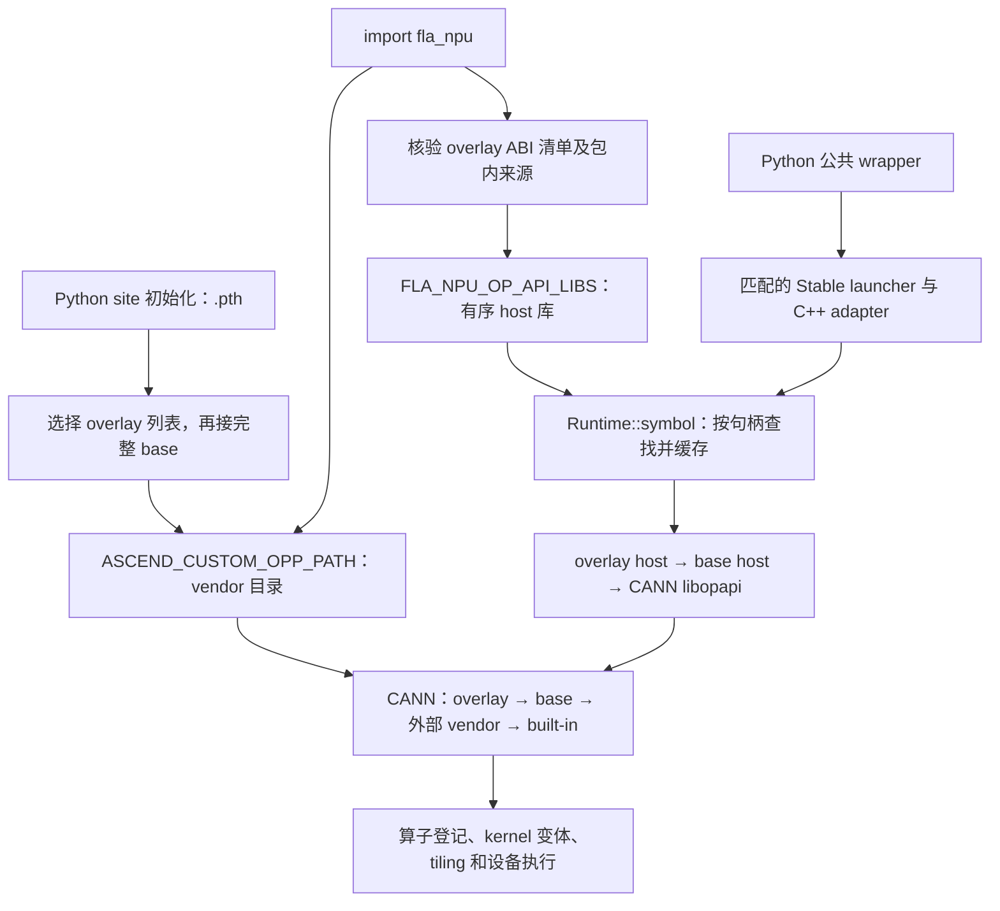

# FLA NPU OPP 增量叠加层设计

作者：zzy1205。适用对象：带完整内嵌 OPP 和 Stable launcher 的 FLA wheel。

本文维护最终架构、接口、兼容边界和验收要求。逐轮实验、机器信息、日志和历史图示已本地归档；提交对应的实测结果、失败项和未完成门禁见 [PR878](https://github.com/flashserve/flash-linear-attention-npu/pull/878)。实现了某项机制不等于全部验收完成。

## 1. 目的与范围

完整 vendor 的 host 库、算子清单和 kernel 索引按算子集聚合。用单算子产物覆盖完整 vendor，会同时丢失其余算子的入口和执行资源。因此保留完整 base，在同级目录安装只包含增量算子的 overlay：命中 overlay 时使用新实现，未命中时回落 base。

本次交付包含四类功能：

| 功能 | 必要行为 |
| --- | --- |
| OPP 增量安装与查找 | 多个 overlay 按序覆盖；base 不因 overlay 安装、移除而改变 |
| ABI 门禁与恢复 | 构建、安装、加载检查契约；损坏时可独立查询和移除 |
| Stable-only 日落 | 取消 ctypes 算子执行后端、自动回退和 legacy C++ 扩展，迁移构建、调用方与测试 |
| 构建取消清理 | 确认本轮进程组和容器停止后才允许清理、重试 |

KDA host 错误码及 KDA/KKT 测试修正是单独的回归修复，不是 overlay 的运行依赖。它们没有改算子 kernel、tiling 或 Stable adapter 的计算实现。

本设计不提供进程内热更新，不实现通用对象文件增量缓存，不以 overlay 发布新 Python 算子入口或修改公共 schema。KDA `implementation="legacy"` 是算法实现选项，保留为遗留事项，不属于本次删除的 legacy 扩展。

## 2. 架构与来源顺序



图中两条查找链需要保持 **overlay/base 的相对顺序一致**。外部 custom vendor 只保留在 CANN 的 OPP 路径中，不作为本包 host 库来源。

| 层 | 查找对象 | 负责方 |
| --- | --- | --- |
| L1 | `libcust_opapi.so` 中的 `aclnnXxx*` 符号 | Stable launcher 内的 `Runtime::symbol()` |
| L2 | `aic-<soc>-ops-info.json` 中的算子登记 | CANN |
| L3 | `binary_info_config.json` 中的 kernel 变体 | CANN |
| L4 | tiling、proto、kernel `.o` 及旁车元数据 | CANN |

L1 按库句柄逐符号查询，custom 全部 miss 后才查 CANN。L2–L4 由 CANN 独立完成；ABI 原型一致并不能证明 host、tiling 和 kernel 的业务语义一致，仍需真机回归。

```text
site-packages/
├── fla_npu_opp_env.pth / fla_npu_opp_env.py
├── fla_npu_opp_manage.py                 # 独立管理入口
└── fla_npu/
    ├── libfla_npu_stable.so              # wheel 级 launcher
    ├── ops/ascendc/_stable_hash.py       # launcher 源码指纹
    └── opp/vendors/
        ├── config.ini
        ├── fla_npu_overlay_transformer/ # 默认增量 vendor
        │   ├── abi_manifest.json
        │   ├── op_api/{include,lib}/
        │   ├── op_impl/                 # 登记、索引、tiling、kernel
        │   └── op_proto/
        └── fla_npu_transformer/         # 原有完整 base，名称不变
```

overlay 不携带另一份 launcher。接口不变的 host/tiling/kernel 更新复用 wheel 的 launcher；aclnn、schema、adapter 参数编组或公共返回契约发生变化时，须更新并重建完整 wheel。

## 3. 来源选择和启动契约

| 输入 | 语义 |
| --- | --- |
| `FLA_NPU_OVERLAY_VENDOR` 未设置 | 按 `config.ini` 顺序及包内合法目录发现 overlay |
| 显式名称列表 | 按 `os.pathsep` 分隔，只选存在且合法的名称，保持给定顺序 |
| 显式空值、空白或仅分隔符 | 禁用全部 overlay，使用 base |
| `FLA_NPU_OP_API_LIBS` | Python runtime 生成的有序 `overlay_lib... → base_lib` 列表 |
| `FLA_NPU_OP_API_LIB` | Python runtime 设为完整 base，保留单库兼容输入 |
| `ASCEND_CUSTOM_OPP_PATH` | 仅登记 vendor 目录；当前包 `overlay... → base` 在前，外部条目保持相对顺序 |
| `FLA_NPU_OPP_PATH` | 当前包 OPP root，供诊断使用 |
| `FLA_NPU_DISABLE_PTH=1` | 跳过解释器启动阶段的环境预置，调用方负责提前准备路径 |

归一化会移除当前包遗留的 OPP root、`vendor/op_api/lib` 和旧 vendor 排序，再写入选定顺序；不应把 CANN built-in 填进 `ASCEND_CUSTOM_OPP_PATH`。vendor 及 host 库解析后的路径必须位于包内，拒绝通过软链把 host 来源引到包外。

默认 `.pth` 在用户代码及通常的 `import torch_npu` 之前设置 OPP 路径。`import fla_npu` 重复选择与校验，并准备 host 库。若检测到 `torch_npu`/CANN 已加载而当前包内 vendor 顺序与目标顺序不同，import 必须在改写环境和加载 host 库之前失败，不能只告警后继续。CANN 初始化以后改变路径、安装或移除 overlay，都不能刷新已加载的索引、动态库句柄和符号缓存；必须启动新进程。

toolkit 的 `set_env.sh` 配置 CANN 工具链与运行依赖；vendor 的 `bin/set_env.bash` 配置本份自定义 OPP 的发现路径。两者均是环境准备，source 本身不等于设备运行时初始化。

wheel 构建、run 包收尾和 overlay 安装三处 `set_env.bash` 生成路径与 `.pth`/Python runtime 使用相同的 overlay 选择规则；wheel 构建直接复用 run 包收尾的纯生成函数，并由同一组行为用例对拍。显式禁用时即使 source overlay 脚本也只登记 base；重复 source 不改变结果。单数库变量固定指向 base，复数变量按选定顺序生成。关闭 `.pth` 时，在初始化 CANN 前 source 对应 vendor 脚本；环境选择必须在此之前确定。无 FLA base 的独立外部 vendor 保留原 source 导出能力，不因此成为 Python host 库的外部来源。

### 3.1 仓内 ATK 用例的兼容方式

ATK 不直接识别 `fla_npu_overlay_*` 目录，也不负责合并 base 与 overlay。仓内用例能够命中增量算子，是因为统一启动脚本在 ATK 进程创建前准备发现环境，而 executor 使用 FLA 的公共 Python 入口：

1. `tests/atk/run_test_cpu.sh` 依次激活 `ATK_ENV`、source `CANN_ENV`，再 source `FLA_NPU_ENV`（兼容旧名 `FLA_NPU_OPP_ENV`）指定的 vendor `bin/set_env.bash`。调用方已在外层 shell 完成这些动作时，脚本直接继承现有环境。
2. 当前版本生成的 `set_env.bash` 不只登记被 source 的单个 vendor。它读取 `FLA_NPU_OVERLAY_VENDOR`；未显式设置时读取 `opp/vendors/config.ini` 并发现合法 overlay，然后生成两条一致的有序列表：
   - `ASCEND_CUSTOM_OPP_PATH=overlay...:base:external...`，供 CANN 在启动时发现 L2–L4；
   - `FLA_NPU_OP_API_LIBS=overlay_lib...:base_lib`，供 Stable launcher 在 L1 逐库查找符号。
   `FLA_NPU_OP_API_LIB` 仍固定为完整 base，供只接受单库变量的兼容调用方使用。
3. `atk node` 及其本机 NPU worker 继承上述环境。仓内 NPU executor 调用公开的 `fla_npu.ops.ascendc` wrapper；`import fla_npu` 会再次按相同规则归一化路径、校验 overlay/base ABI，并把有序 host 库交给 Stable launcher。overlay 提供的算子在 L1–L4 均命中 overlay，未提供的算子在同一进程内回落完整 base。需要构造非法描述符的负向用例通过 `load_ascendc_opapi_libraries()` 取得相同顺序的库句柄，不另建一套查找规则。
4. 安装 wheel 后，`fla_npu_opp_env.pth` 是解释器启动阶段的第二道准备机制：只要 ATK worker 使用能够看到该 wheel 的 Python 环境且未设置 `FLA_NPU_DISABLE_PTH=1`，它会在 executor 或 `torch_npu` 导入前写入 overlay-first 的 `ASCEND_CUSTOM_OPP_PATH`。正式执行仍建议显式 source `FLA_NPU_ENV`，不把 worker 是否加载 `.pth` 当作唯一前提。

推荐从仓库根目录按以下方式启动本机 ATK：

```bash
FLA_NPU_OVERLAY_VENDOR=fla_npu_overlay_transformer \
ATK_ENV=<atk-venv> \
CANN_ENV=<cann-set_env.sh> \
FLA_NPU_ENV=<site-packages>/fla_npu/opp/vendors/fla_npu_transformer/bin/set_env.bash \
bash tests/atk/run_test_cpu.sh -op=<op> -scope=accuracy
```

`FLA_NPU_OVERLAY_VENDOR` 显式空值表示只使用 base。overlay 的选择、安装或移除必须发生在 `atk node`、本机 worker 或常驻 Celery worker 初始化 CANN 之前；修改后须重启相应进程。远程或预先启动的 worker 不会继承控制端后来 source 的环境，必须在 worker 所在机器安装同一 wheel/overlay，并在启动 worker 的服务环境中准备上述变量。若 ATK 虚拟环境看不到安装 wheel，`run_test_cpu.sh` 不会替调用方修改 `PYTHONPATH`，应先修正 Python 环境；否则即使 CANN 能看到 L2–L4，executor 仍无法导入匹配的 Stable wrapper 和 launcher。

## 4. ABI 门禁与错误处理

| 阶段 | 检查 |
| --- | --- |
| CPack staging 后 | `nm -D` 枚举真实 aclnn 导出；检查公共头覆盖和两阶段配对；生成清单 |
| `build.sh --pkg` 完成后 | 对生成的 public 头与 Stable adapter 调用参数做 ABI 比较；scoped 构建不能零检查成功 |
| overlay 安装写盘前 | 校验清单、host 库/公共头 SHA256，以及 overlay/base 两阶段接口 |
| import、加载 vendor 前 | 再次验证清单和契约，拒绝手工替换造成的漂移 |
| Stable launcher 加载 | 检查构建戳；启用 overlay 时要求实际加载库的有序多库能力版本 ≥1 |

类型解析保留每级指针，区分 `double`/`double*`、`aclTensor*`/`aclTensor**`，不猜测未知类型。参数名及 cv 限定不参与 C 调用 ABI 比较。仅保留两个显式例外：SolveTri 已核对源码的冻结契约；CausalConv1d 及 Bwd 的 Tensor 变体共用对应执行入口。

`abi_manifest.json` 记录导出契约及 host 库、公共头的哈希。构建 wheel 时还会把 base 公共契约固化为 vendor 树之外的 `_base_opp_contract.json`；运行时同时验证 base 清单和这份不可随 `.run` 覆盖的契约快照。完整 `.run` 写入 wheel 前必须携带有效清单并与快照精确一致；局部构建不得替换共享 base，必须走 overlay。缺头、未覆盖导出、阶段不配对、哈希不符、base 未声明接口或签名漂移均拒绝。

运行校验仅依赖 Python 标准库，不运行 `nm`。清单是完整性检查，不是数字签名，也不覆盖内部 tiling ABI 或 kernel 正确性。启用 overlay 会增加启动时读取头文件、计算 host 库哈希的开销。

能力检查针对 `_stable.load()` 实际选择的 launcher，包括 `FLA_NPU_STABLE_LIB` 覆盖路径；缺库、构建戳不匹配、缺多库能力或注册不完整均报错，不回退 ctypes。

## 5. 安装、卸载与恢复

```bash
# 构建既有算子；修改内嵌依赖时显式把依赖方加入 --ops
bash build.sh --pkg --soc=<soc> --ops=<op>[,<dependent>...] -j16

# 将对应 run 包安装到隔离目录，不覆盖 wheel 的 base
<run-package>.run --install-path=<staging-dir> --quiet

# 安装到当前 wheel 的默认 overlay；已有同名目录时才需要 --force
python -m fla_npu_opp_manage --overlay --source <staging-dir>/vendors --force
python -m fla_npu_opp_manage --status

# 恢复到 base；自定义名称时追加 --overlay-name <name>
python -m fla_npu_opp_manage --remove-overlay
```

`--overlay-name` 必须匹配 `fla_npu_overlay_[A-Za-z0-9][A-Za-z0-9_.-]*`，不能指定 base、路径分隔符或配置注入内容。安装、卸载只管理目标 overlay 和 `config.ini`，不重写 pip `RECORD`，不改变 run 包原有全量安装语义。overlay 的生命周期由管理命令维护。

`fla_npu_opp_manage` 是顶层模块，加载管理器时不执行 `fla_npu.__init__`、不加载 vendor 动态库。损坏 overlay 使正常 import 失败时，仍可查询 `ABI: INVALID` 或移除；旧 `python -m fla_npu.install_opp` 保留健康环境兼容，不用作损坏恢复入口。

`--force` 先在 OPP root 的暂存目录复制、验证产物并生成环境脚本，再备份旧 overlay、切换目录和更新配置；复制或校验失败时旧版本不变，切换或配置更新失败时恢复旧目录与原配置。暂存及备份不进入 vendor 发现范围。若回滚本身失败，报错给出保留的恢复目录，不清除旧备份。Linux 安装与移除共用管理锁，相互冲突时明确拒绝。

该保护针对单次管理操作中可处理的异常，不承诺并发运行进程看到无间隙切换，也不提供断电或强制杀进程后的自动事务恢复。装卸前停止使用该安装目录的进程，完成后重新启动。外部 `--install-path` 的既有拷贝流程不在本次改造范围内。

`--pkg --jit` 省略预编译 kernel，不能直接用 AOT wheel 的 `.o`/binary-info 验收规则宣布通过；普通增量工作流使用满足目标 wheel 产物契约的包。

## 6. Stable-only 日落与兼容

| 修改项 | 结果与迁移要求 |
| --- | --- |
| ctypes 算子执行后端及自动回退 | 删除；默认和唯一产品执行路径为 Stable |
| legacy C++ 扩展、codegen/YAML | 删除，相应 torchnpugen 依赖和构建选项不再有效 |
| 无 launcher 构建/发布豁免 | 删除 `--without-launcher` 路径；wheel 必须含匹配 launcher 和构建戳 |
| 旧环境开关 | `FLA_NPU_STABLE_ABI=ctypes` 等旧模式报迁移错误；不能关闭必需 launcher |
| 公开 wrapper | 签名取 Stable wrapper，保留参数名、默认值、关键字及返回/原地修改契约 |
| 旧调用方 | 迁移到公开 `fla_npu` 入口；显式 `install_torch_npu_ops_compat()` 仍可提供兼容名称 |
| 覆盖检查 | 冻结公共契约约束 wrapper、schema、adapter 及分派参数；不再以 ctypes 实现目录为清单 |

标准库 `ctypes` 仍服务 Stable 路径：

| 保留用途 | 例子 | 不使用 ctypes 的替代方向 |
| --- | --- | --- |
| 动态库加载 | `ctypes.CDLL` 加载 CANN/custom host 库并控制加载模式 | C++ `dlopen` 或统一交给 launcher；须保留错误诊断与句柄生命周期 |
| stream 诊断回读 | 调用 `fla_npu_stable_last_launch_stream()` 核对实际提交 stream；当前 stream 获取本身走 torch_npu accessor | 将回读暴露为 C++/torch dispatcher 查询接口，保留多 stream 回归 |
| 能力查询 | 调用 `fla_npu_stable_overlay_order_version()` | 暴露 C++/torch dispatcher 查询接口 |
| 构建指纹查询 | 读取 launcher 导出的源码指纹，与 `_stable_hash.py` 比较 | C++ bridge 返回指纹，或在加载时执行同等校验 |

这些替代需要单独验证，不属于执行后端日落的必要工作。包外 `tests/atk/common/aclnn_error_probe.py` 使用 ctypes 构造公开 dispatcher 无法表达的非法描述符，只测试 GetWorkspaceSize 拒绝路径，不执行第二阶段，不随 wheel 发布。

## 7. 构建取消与重试

本地命令以独立进程组启动，取消时依次尝试 SIGINT、SIGTERM、SIGKILL，并确认整个组没有活跃进程，不能只检查组长退出。远程使用 `setsid` 和 `timeout --foreground` 保持构建子树同组，记录 PGID 与启动时间，发信号前检查进程身份。

Docker 进程由 daemon 管理，容器以宿主调用用户的 UID/GID 运行，避免留下宿主用户无法清理的 root-owned 构建产物；除本地客户端进程组外，还要给容器写入 managed/workspace label。新一轮在清理前持有工作区锁，并只移除同时满足 label 与 `/workspace/repo` 挂载校验的同工作区孤儿容器。顶层控制器接收 SIGTERM 时设置统一 stop 事件并等待 worker 完成清理。远程 `ps` 查询开启 `pipefail` 且查询失败按清理失败处理，不能当成“进程已退出”。未确认清理完成时抛出不可重试的 `BuildCleanupError`，停止后续重试和 SoC 组合。只有确认写入者退出后，才能清理共享 build 目录并开始下一轮。

这些规则不承诺终止主动逃离进程组的任意外部程序，也不以 mock 测试替代真实 Docker 取消验收。

## 8. 检视入口与验收要求

| 检视组 | 主要文件 | 必查条件 |
| --- | --- | --- |
| 来源顺序 | `fla_npu_opp_env.py`、`fla_npu/__init__.py`、`csrc/src/runtime.cpp` | 默认、禁用、多 overlay、缺项回落、CANN 初始化时序 |
| ABI/恢复 | `_op_abi.py`、`install_opp.py`、`fla_npu_opp_manage.py` | 两阶段类型漂移、缺/坏清单、哈希损坏、包外软链、独立移除 |
| 日落/构建 | `_stable.py`、`ops/ascendc/__init__.py`、`stable_build_policy.py`、两套 setup | 无回退，实际 launcher 校验，旧选项拒绝，完整 wheel 检查 |
| 测试迁移 | `stable_public_api.json`、`stable_coverage.py`、仓内调用方 | 签名与调用参数、返回及 mutation、枚举、负例和真实 NPU 结果 |
| ATK 增量调用 | `tests/atk/run_test_cpu.sh`、ATK executor、生成的 `set_env.bash` | worker 启动前路径顺序、公共 wrapper、overlay 命中与 base 回落、远程 worker 环境 |
| 取消清理 | `ci/pkg/make_packages.py` | 组长退出但子进程存活、信号忽略、PID 身份变化、清理失败不重试 |
| KDA/KKT 修复 | KDA host 返回码、ATK executor/golden | 旧库/新库负例差异、独立标杆、原用例保留、无容差放宽 |

路径以 `torch_custom/fla_npu/` 为相关包前缀；具体实现与测试清单见 PR diff。

```bash
python docs/agents/skills/operator-review/scripts/check_issue_coverage.py
python torch_custom/fla_npu/tools/stable_coverage.py --strict
python torch_custom/fla_npu/tools/op_abi_parity.py
python -m pytest -q tests/test_opp_overlay.py tests/test_opp_abi_contract.py \
  tests/test_stable_only_runtime.py tests/test_stable_build_policy.py \
  tests/test_stable_gates.py ci/tests/test_make_packages_process_control.py
```

静态覆盖、mock 单测和局部 A5 回归各有边界，不相互替代。算子数、导出数或退出码为零都不能单独证明全量数值正确。数值、性能、确定性、MSS、A2/A3/A5 支持矩阵、发布工具链与正式 CI/审批要求按[仓库规则](repository-rules.md)、[开发者指南](开发者指南.md)和[迁移指南](兼容与迁移指南.md)执行。PR 应按当前提交分别列出通过、已有失败、未执行与阻塞，禁止累计历史轮次充当当前结果。
