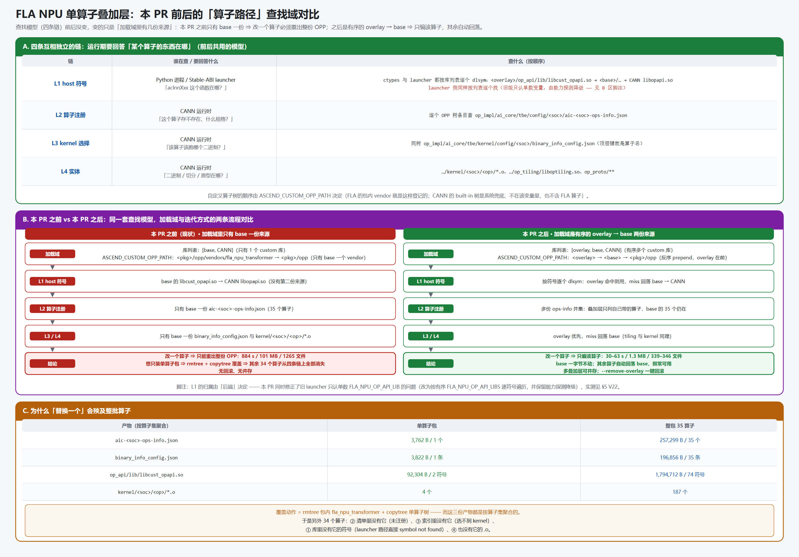
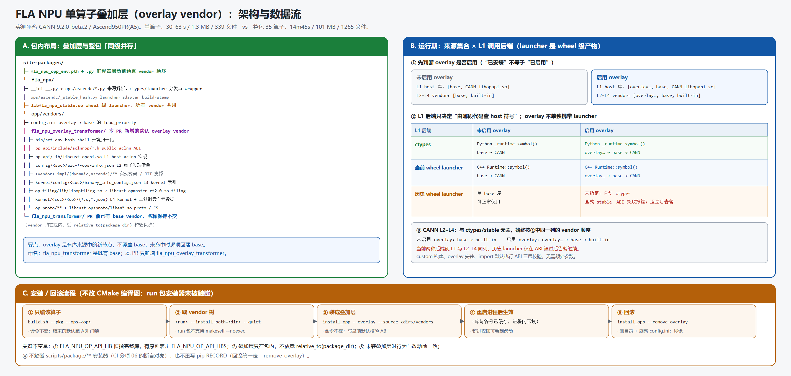

# FLA NPU 算子包「单算子叠加层」增量设计

- **作者**：zzy1205
- **状态**：已实现；A5（Ascend950PR）与 A2（Ascend910B3）已完成行为验证
- **适用范围**：`flash-linear-attention-npu` wheel 内嵌 OPP 的单算子或少量算子迭代
- **过程归档**：[《OPP 叠加层设计过程记录》](OPP叠加层增量设计-过程记录.md)
- **兼容性准则**：[《FLA 构建兼容性验证准则》](FLA构建兼容性验证准则.md)

> 本文是规范性设计文档，只描述最终架构、接口、约束和验收结论。实验环境、失败排查、阶段性判断、完整验证矩阵及未采用的细碎方案均移入过程记录。两篇文档冲突时，以本文和代码为准。

## 1. 背景与问题

`fla_npu` 将自定义 OPP 内嵌在 wheel 中：

```text
site-packages/fla_npu/opp/vendors/fla_npu_transformer/
```

一份 vendor 同时包含 host 入口库、算子清单、kernel 索引、tiling/proto 和 device kernel。现有全量包适合作为发布基线，但不适合单算子迭代：用只含一个算子的包覆盖完整 vendor 后，未包含的算子会同时失去 host 符号、算子清单条目和 kernel 实体。

问题不在于构建命令能否过滤算子，而在于**过滤后的聚合产物如何与完整基线共存**。设计必须同时满足：

1. 改动算子优先使用增量实现；
2. 增量未提供的算子自动回落到完整 base；
3. L1 host aclnn 入口与 CANN 侧 L2 自定义算子发现/登记、L3-L4 tiling/kernel 查找遵循一致的 `overlay -> base` 来源优先级；
4. 安装和卸载不修改 base vendor；
5. 进程能明确知道实际加载了哪些来源。

### 1.1 运行期查找模型



一次自定义算子调用涉及四条查找链：

| 层 | 查找对象 | 产物 | 选择方 |
|---|---|---|---|
| L1 | host aclnn 符号 | `op_api/lib/libcust_opapi.so` | ctypes 或 Stable-ABI launcher（wheel 内的高性能 C++ aclnn 调用库 `libfla_npu_stable.so`） |
| L2 | 自定义算子发现与登记 | `aic-<soc>-ops-info.json` | CANN |
| L3 | kernel 变体 | `binary_info_config.json` | CANN |
| L4 | tiling/proto/kernel 实体 | `op_tiling/**`、`op_proto/**`、`kernel/<soc>/<op>/*.o` | CANN |

这里的“发现与登记”不是 Python/torch 接口注册。CANN 初始化自定义 OPP 时，会按 vendor 优先级读取 `aic-<soc>-ops-info.json`，确认某个自定义算子存在并把它的实现元数据纳入运行时查找；后续调用才能继续进入该算子的 tiling 与 kernel 变体选择。

这里有两个关键事实：

- **查找按符号或算子逐项发生**：当前来源没有该项时，可以继续查下一个来源。
- **产物按算子集聚合**：一份 `libcust_opapi.so` 或索引文件承载多个算子，不能把单算子聚合产物当作完整包替换。

## 2. 方向选择

设计阶段只保留一个需要长期理解的方向选择：

| 方向 | 核心做法 | 主要代价 |
|---|---|---|
| 单一来源 | 覆盖或合并进 base，使运行期始终只看到一棵 vendor 树 | 覆盖会丢算子；合并需要修改 base、合并聚合索引并处理回滚 |
| **有序多来源 + 逐项回落** | 保留完整 base，把增量作为更高优先级 vendor；每层按相同顺序逐项查找 | 需要统一 L1 与 L2-L4 的来源顺序，并管理旧 launcher 兼容 |

本设计选择第二个方向。原因是它直接利用现有运行时能力：

- `dlsym` 可以按句柄顺序逐符号查找；
- CANN 可以按 vendor 顺序逐算子查找算子清单、tiling 和 kernel；
- 单算子增量只覆盖自己携带的项，其他项自然回落 base；
- base 保持只读，安装、审计和回滚边界清晰。

这个选择形成全文的核心不变量：

> **L1 与 L2-L4 必须使用同一个有序来源列表：`overlay... -> base -> CANN`；每一项由第一个提供它的来源承载。**

## 3. 目标与非目标

### 3.1 目标

- 支持只构建一个或少量算子，并安装为包内 overlay vendor。
- overlay 中存在的算子覆盖 base，不存在的算子自动回落 base。
- ctypes 与当前 Stable-ABI launcher 使用相同的 host 库顺序。
- CANN 侧用于确认“自定义算子存在”的算子清单，以及后续 tiling、kernel 的查找顺序，与 L1 host aclnn 库保持同一 `overlay -> base` 优先级。
- 支持多个 overlay，顺序明确、可审计、可单独卸载。
- base vendor 在 overlay 安装和卸载过程中保持不变。
- 为旧版 launcher、overlay 启用规则和已有错误路径定义可验证的兼容行为。

| 兼容场景 | 业务含义与代码出处 | 确定行为 |
|---|---|---|
| 旧版 Stable-ABI launcher | wheel 内的高性能 C++ aclnn 调用库 `libfla_npu_stable.so`；旧版 `Runtime::symbol()` 只查 `FLA_NPU_OP_API_LIB` 指向的一个 custom 库 | 未指定后端时改走 ctypes；显式 stable 时先完成 ABI 校验，失败则报错，通过后告警“L1 只能命中 base”并继续 |
| `FLA_NPU_OVERLAY_VENDOR` | `fla_npu/__init__.py` 与 `.pth` 启动钩子读取的环境变量，用于选择启用哪些 overlay 及其优先级 | 未设置时按 `config.ini`/目录自动发现；显式名称列表按给定顺序；显式空值时禁用全部 overlay，只使用 base |
| 已有错误 OPP 路径 | shell 可能已把 base 放在 overlay 前面，或遗留 `<pkg>/opp`、`vendor/op_api/lib` 条目 | 自动清理当前包的旧条目并归一化为 `overlay -> base -> external`；实际发生修正时告警一次 |

### 3.2 非目标

- 不提供进程内热更新；安装或卸载后必须启动新进程。
- 不把 CMake 对象缓存改造成通用对象级增量构建系统。
- 不放宽 host 库只能从当前 wheel 包内加载的边界。
- 不修改算子的 `def`、aclnn 或 torch schema。
- 不改变既有 run 包的 `--full` 覆盖安装语义。

## 4. 总体架构



```text
site-packages/fla_npu/
├── libfla_npu_stable.so               # wheel 级 launcher，不属于任何 vendor
└── opp/vendors/
    ├── config.ini
    ├── fla_npu_overlay_transformer/   # 本 PR 新增的默认 overlay vendor
    │   ├── op_api/lib/libcust_opapi.so
    │   ├── op_impl/.../config/<soc>/aic-<soc>-ops-info.json
    │   ├── op_impl/.../kernel/<soc>/<op>/*.o
    │   ├── op_impl/.../op_tiling/
    │   └── op_proto/
    └── fla_npu_transformer/           # PR 前已有的完整 base，名称保持不变
```

`fla_npu_transformer` 不是本 PR 新起的名称：既有构建流程使用逻辑 vendor 名 `fla_npu`，打包时追加固定 `_transformer` 后缀形成这个物理目录。本设计不重命名 base，只新增带 `overlay` 标识的 `fla_npu_overlay_transformer`。

`libfla_npu_stable.so` 由 wheel 构建流程生成并放在 `fla_npu/` 包根目录，是所有 vendor 共用的 Stable-ABI 调用库。单算子 overlay 只携带 OPP vendor 产物，不重复携带 launcher。

`config.ini` 的优先级示例：

```ini
load_priority=fla_npu_overlay_transformer,fla_npu_transformer
```

### 4.1 wheel launcher 的内部组成与调用关系

`wheel launcher` 指 wheel 中的共享库文件 `fla_npu/libfla_npu_stable.so`；`C++ Runtime::symbol()` 不是另一个产物，而是编译在这个共享库内部的成员函数。launcher 的逻辑组成如下：

```text
fla_npu/libfla_npu_stable.so              # wheel launcher 产物
├── 每个算子的 C++ adapter                # stable_<op>.cpp 编入同一 .so
│   └── torch 参数 -> aclnn 参数/描述符
└── fla_npu_stable::Runtime               # runtime.cpp 编入同一 .so
    ├── Runtime::init()
    │   └── 按 FLA_NPU_OP_API_LIBS dlopen overlay/base，再打开 CANN libopapi.so
    └── Runtime::symbol(name)
        └── 按 overlay -> base -> CANN dlsym，并缓存首个命中的函数地址
```

三者职责不同：

| 组件 | 职责 | 不负责什么 |
|---|---|---|
| wheel launcher：`libfla_npu_stable.so` | 承载所有 C++ adapter 和 `Runtime`，通过 torch dispatcher 暴露稳定调用入口 | 不携带某个 overlay 的 host/tiling/kernel 实现 |
| 算子 C++ adapter | 把 torch Tensor、可选参数和标量编组成对应 `aclnnXxxGetWorkspaceSize` / `aclnnXxx` 调用 | 不决定符号来自 overlay 还是 base |
| `Runtime::symbol()` | 根据有序库句柄查找并缓存 `aclnnXxx*` 函数地址 | 不实现算子，也不直接选择 tiling 或 device kernel |
| vendor `libcust_opapi.so` | 提供实际的 custom `aclnnXxx*` host 实现 | 不包含 wheel launcher |

Stable-ABI 路径的一次完整调用为：

```text
Python npu_xxx(...)
  -> fla_npu 后端分发选择 stable
  -> torch.ops.fla_npu_stable.npu_xxx
  -> libfla_npu_stable.so 中该算子的 C++ adapter
  -> Runtime::symbol("aclnnXxxGetWorkspaceSize" / "aclnnXxx")
  -> overlay/base 的 libcust_opapi.so，最后回落 CANN libopapi.so
  -> 命中的 aclnn host 实现发起算子执行
  -> CANN 按同一 vendor 优先级完成 L2 算子发现、L3 kernel 变体选择和 L4 tiling/kernel 执行
```

因此，launcher 决定“如何从 torch 调用 aclnn”，adapter 决定“参数如何编组”，`Runtime::symbol()` 决定“实际调用哪一份 aclnn host 符号”；CANN 再独立完成 tiling 和 kernel 选择。`Runtime::symbol()` 会缓存函数地址，这也是安装/卸载 overlay 后必须启动新进程的原因之一。

### 4.2 行为相关产物清单

| 产物 | 所在位置 | 作用与归属 |
|---|---|---|
| `.pth` 启动钩子 | `site-packages/fla_npu_opp_env.pth` + `.py` | 在 CANN 初始化前选择并排列 vendor |
| Python 分发与 wrapper | `fla_npu/__init__.py`、`fla_npu/ops/ascendc/*.py` | 解析来源、选择 ctypes/launcher、组织调用参数 |
| launcher build-stamp | `fla_npu/ops/ascendc/_stable_hash.py` | 确认 launcher 二进制与同 wheel adapter 源码匹配 |
| Stable-ABI launcher | `fla_npu/libfla_npu_stable.so` | wheel 级 L1 C++ 调用入口，内含算子 adapter 与 `Runtime::symbol()`，所有 vendor 共用 |
| vendor 优先级 | `opp/vendors/config.ini` | 记录 overlay 到 base 的默认顺序 |
| shell 环境脚本 | `<vendor>/bin/set_env.bash` | source 时归一化 `ASCEND_CUSTOM_OPP_PATH` |
| public aclnn 头 | `<vendor>/op_api/include/aclnnop/*.h` | 编译、安装和运行期可检查的 L1 ABI 契约 |
| custom host 库 | `<vendor>/op_api/lib/libcust_opapi.so` | L1 aclnn 实现 |
| 算子发现清单 | `<vendor>/op_impl/.../config/<soc>/aic-*-ops-info.json` | L2：CANN 确认自定义算子存在 |
| 实现源码/JIT 支撑 | `<vendor>/op_impl/.../<vendor>_impl/{dynamic,ascendc}/**` | 随包携带的实现源码、公共头和动态/JIT 支撑文件；不单独决定 overlay 顺序 |
| kernel 索引 | `<vendor>/op_impl/.../kernel/config/<soc>/binary_info_config.json` | L3：选择 kernel 变体 |
| tiling 库 | `<vendor>/op_impl/.../op_tiling/lib/liboptiling.so` 等 | host 侧生成 tiling data |
| device kernel 与旁车元数据 | `<vendor>/op_impl/.../kernel/<soc>/<op>/{*.o,*.json}` | L4：NPU 执行实体及其二进制描述 |
| proto/ES | `<vendor>/op_proto/**`、`libcust_opsproto_rt2.0.so`、`libes*.so` | 算子原型、proto 与表达式相关产物 |
| CANN 兜底 | CANN 安装目录中的 `libopapi.so` 与 `opp/built-in` | wheel 外部的最后一级 L1、L2-L4 回落来源 |

架构图独立展示上述会参与来源选择、ABI 检查或实际执行的产物；README、`version.info`、pip 元数据等不改变查找决策的文件不展开。

### 4.3 各层的有序来源

| 层 | 最终顺序 | miss 行为 |
|---|---|---|
| ctypes host 符号 | `overlay_lib... -> base_lib -> libopapi.so` | 继续下一个句柄 |
| Stable-ABI host 符号 | `FLA_NPU_OP_API_LIBS` 中的 `overlay_lib... -> base_lib -> libopapi.so` | 继续下一个句柄 |
| CANN 自定义算子清单/tiling/kernel | `ASCEND_CUSTOM_OPP_PATH` 中的 `overlay_vendor... -> base_vendor`，最后由 CANN built-in 兜底 | 继续下一个 vendor |

同名算子由最高优先级 overlay 覆盖；overlay 未携带的算子在 base 命中。多个 overlay 时，靠前者优先。

### 4.4 关键数据与环境变量

| 名称 | 语义 |
|---|---|
| `vendor_dirs` | 当前 wheel 内的有序 vendor 列表：`[overlay..., base]` |
| `FLA_NPU_OVERLAY_VENDOR` | 可选的 `os.pathsep` 分隔 overlay 名称列表；设置后覆盖自动发现顺序 |
| `FLA_NPU_OP_API_LIBS` | 当前 launcher 使用的有序 host 库列表：`overlay... -> base` |
| `FLA_NPU_OP_API_LIB` | 旧 launcher 的兼容输入，始终指向完整 base 库 |
| `ASCEND_CUSTOM_OPP_PATH` | CANN 自定义 OPP vendor 目录列表，只登记 vendor 目录 |
| `FLA_NPU_OPP_PATH` | 当前 wheel 的 OPP root，供诊断使用，不参与 `ASCEND_CUSTOM_OPP_PATH` 查找 |
| `FLA_NPU_STABLE_ABI` | 后端选择；`ctypes` 强制参考路径，其他值选择 launcher |
| `FLA_NPU_DISABLE_PTH` | 禁用解释器启动阶段的 `.pth` 环境预置 |

`FLA_NPU_OVERLAY_VENDOR` 的状态必须严格区分：

| 状态 | 行为 |
|---|---|
| 未设置 | 从 `config.ini` 和包内合法的 `fla_npu_overlay_*` 目录自动发现 |
| 显式名称列表 | 仅使用列表中存在且合法的 overlay，保持用户给定顺序 |
| 显式空字符串、纯空白或纯分隔符 | 禁用所有 overlay，只使用 base |

`.pth` 启动钩子、`import fla_npu` 和安装工具必须遵守同一套 `FLA_NPU_OVERLAY_VENDOR` 选择规则。

### 4.5 `ASCEND_CUSTOM_OPP_PATH` 语义与归一化

`ASCEND_CUSTOM_OPP_PATH` 的每个条目是一个 **vendor 目录**。以下内容不应写入该变量：

- 当前 wheel 的 `<pkg>/opp` root；
- `vendor/op_api/lib`；
- CANN 的 `opp/built-in`。

当前 wheel 只接管自己 `<pkg>/opp/` 下的路径。写入前先移除当前包已有的 root、vendor 和 `op_api/lib` 条目，再按 `overlay... -> base` 一次性放到最前面。

**external 条目**指进程原有变量中所有不位于当前 wheel `<pkg>/opp/` 下的其他自定义 vendor，例如其他算子包的 `/opt/other_ops/vendor_a`。归一化不删除这些条目，也不改变它们彼此的相对顺序：

```text
归一化前：external_a -> base -> external_b -> overlay
归一化后：overlay -> base -> external_a -> external_b
```

CANN built-in 不属于 external；它不写入 `ASCEND_CUSTOM_OPP_PATH`，仍由 CANN 自身查找链在 custom vendor 之后兜底。

当已有包内条目确实被重排或清理时，启动钩子打印一次 `RuntimeWarning`；干净环境首次登记不告警。生成的 `set_env.bash` 同样读取 `config.ini` 并重建完整顺序，因此 source base/overlay 的先后不会改变结果。

### 4.6 包内来源边界

overlay 与 base 都必须位于当前 wheel 的 `opp/vendors/` 下。运行时对 vendor 和 `libcust_opapi.so` 分别执行 `resolve()` 与 `relative_to(package_dir)` 校验，因此包内软链指向包外也会被拒绝。

这个边界保证：

- host 本地代码来源可审计，不随外部 CANN 目录漂移；
- CANN 的 vendor 发现与 Python 的 host 库加载使用同一份包内 OPP；
- 外部 vendor 不能仅靠环境变量替换当前 wheel 的 host 实现。

## 5. 运行时设计

### 5.1 启动阶段

随 wheel 安装的 `fla_npu_opp_env.pth` 在 site 初始化阶段执行，早于用户代码和通常的 `import torch_npu`：

```text
Python site 初始化
  -> fla_npu_opp_env.py
       -> 解析 FLA_NPU_OVERLAY_VENDOR
       -> 得到 [overlay..., base]
       -> 归一化 ASCEND_CUSTOM_OPP_PATH
       -> 设置 FLA_NPU_OPP_PATH
```

提前设置路径是必要条件：CANN 初始化后再修改 `ASCEND_CUSTOM_OPP_PATH`，已经载入的自定义算子清单和 tiling/kernel 索引不会自动刷新。

### 5.2 `import fla_npu`

```text
import fla_npu
  -> 运行版本与产品 guard
  -> 检查启动阶段是否已预置 OPP 路径
  -> _resolve_vendor_dirs()               # [overlay..., base]
  -> 再次归一化 ASCEND_CUSTOM_OPP_PATH    # 幂等
  -> 设置 FLA_NPU_OP_API_LIB(S)
  -> 应用旧 launcher 兼容策略
  -> 加载 libopapi.so 与各 custom libcust_opapi.so
  -> 缓存 [overlay_lib..., base_lib, cann_lib]
```

ctypes 侧按缓存列表逐符号查找。当前 launcher 读取复数变量 `FLA_NPU_OP_API_LIBS`，逐个 `dlopen` 并按相同顺序 `dlsym`；custom 全部 miss 后才落 CANN。

### 5.3 overlay 状态与 L1 后端组合

overlay 是否启用与 L1 使用哪个调用后端是两个独立维度：

- overlay 状态决定可查找的来源集合；
- ctypes 或 Stable-ABI launcher 决定由 Python 还是 C++ 执行 L1 host 符号查找。

下表中的 `C++ Runtime::symbol()` 即 §4.1 所述的 launcher 内部成员；它由当前算子的 C++ adapter 调用，不是独立于 launcher 的第三种后端。

| L1 调用后端 | 未启用 overlay | 启用 overlay |
|---|---|---|
| ctypes | Python `_runtime.symbol()`：`base -> CANN` | Python `_runtime.symbol()`：`overlay... -> base -> CANN` |
| 当前 wheel launcher（支持有序多库，默认） | C++ `Runtime::symbol()`：`base -> CANN` | C++ `Runtime::symbol()`：`overlay... -> base -> CANN` |
| 历史 wheel launcher（只支持单个 custom 库） | 单 base 库可正常使用 | 未指定后端时自动切换 ctypes；显式 stable 时 ABI 失败则报错，ABI 通过后告警 L1 从 base 查找并继续 |

“启用 overlay”不等同于“目录已经安装”。例如 overlay 目录存在但 `FLA_NPU_OVERLAY_VENDOR=""` 时，overlay 被显式禁用，应走“未启用 overlay”列。

CANN 的 L2-L4 不区分 ctypes/stable：未启用 overlay 时按 `base -> built-in` 查找；启用 overlay 时按 `overlay... -> base -> built-in` 查找。当前两种 L1 后端都使用同一列的来源顺序，从而避免 host 入口与 tiling/kernel 来自不同 vendor。

这里的“当前/历史 launcher”描述的是**安装中的 wheel 所携带的 `libfla_npu_stable.so` 能力版本**，不是“base 算子包/overlay 算子包”各自带了一份 launcher。

### 5.4 Launcher 选择与兼容原则

launcher 相关设计收敛为三条原则，按顺序执行：

1. **接口安全优先**：先判断 overlay 与 wheel launcher/wrapper 的 aclnn 契约是否一致；不一致直接失败，不能通过回落 base 掩盖问题。
2. **接口不变就复用 wheel launcher**：普通 overlay 只修改已有算子的 host 内部逻辑、tiling 或 kernel 时，继续使用 wheel 根目录中的 `libfla_npu_stable.so`，不需要在 overlay 中复制或重编 launcher。
3. **历史 launcher 只处理查找能力不足**：历史版本只识别单数 `FLA_NPU_OP_API_LIB`，问题是不能按 overlay 到 base 查多个 host 库，不代表 ABI 必然不兼容；默认切换到 ctypes，用户强制 stable 时仅在 ABI 通过后告警继续。

完整决策树如下：

```text
启用 overlay
  │
  ├─ overlay 与 wheel 的 aclnn 接口是否一致？
  │    ├─ 否 -> 报错；必须重编并发布完整 wheel
  │    └─ 是
  │
  ├─ wheel launcher 是否支持有序多库？
  │    ├─ 是 -> 使用 launcher
  │    │        L1: overlay -> base -> CANN
  │    │        L2-L4: overlay -> base -> built-in
  │    │
  │    └─ 否（历史 launcher）
  │         ├─ 用户未强制 stable -> 自动使用 ctypes
  │         │    L1/L2-L4 都按 overlay -> base 回落
  │         │
  │         └─ 用户强制 stable
  │              ├─ ABI 未通过 -> 报错，不执行算子
  │              └─ ABI 已通过 -> 告警后继续
  │                   L1: base -> CANN
  │                   L2-L4: overlay -> base -> built-in
```

ABI 通过后允许强制历史 launcher，是因为 base host 入口与 overlay tiling/kernel 的参数契约一致，不会发生参数错位或结构布局不兼容；但这不是完整的 overlay 生效状态：

- overlay 的 **host 实现修改不会生效**，因为 L1 仍命中 base；
- overlay 的 tiling/kernel 修改仍可能生效；
- 因此这是“可能部分生效，必须告警”，不是“接口不安全，必须报错”。

决策树只依赖三类证据：

| 决策依据 | 检查位置 | 结果如何使用 |
|---|---|---|
| aclnn 接口是否一致 | 构建期 `op_abi_validate.py`；安装/import 时 `_op_abi.py` 比较 overlay/base public aclnn 头 | 不一致直接失败；一致才继续判断 launcher 能力 |
| launcher 是否支持多库 | `fla_npu/__init__.py::_launcher_supports_overlay_order()` | 支持则使用 launcher 的 `overlay -> base` 查找；不支持则进入历史 launcher 分支 |
| wheel launcher 自身是否完整 | build stamp 与 `_get_stable_op()` | 二进制/adapter 不匹配或算子未注册时，按既有规则报错或回落 ctypes |

对应到改动类型：

- **已有算子的实现改动，接口不变**：复用 wheel launcher，不需要重编；
- **aclnn/schema/adapter 契约变化**：构建、安装或 import 失败；必须更新 launcher/wrapper 并发布完整 wheel，不能只发布 overlay；
- **全新算子且 base wheel 从未声明**：仅复制 OPP overlay 不足以增加 Python 公共入口，需要同步更新 wheel 的算子清单、wrapper 和 launcher/ctypes 承载。

overlay 没有携带 launcher 是正常设计，不会因为“缺少 launcher”而告警，也不存在从 base vendor 再取一份 launcher 的动作；进程始终使用 wheel 根目录中的那一份 `libfla_npu_stable.so`。

## 6. 安装、卸载与审计

### 6.1 增量工作流

```bash
# 1. 只构建受影响算子
bash build.sh --pkg --soc=<soc> --ops=<op>[,<dependent>...] \
  -j64

# 2. 将 run 包解到隔离目录
build_out/fla_npu_*.run --install-path=<dir> --quiet

# 3. 安装为当前 wheel 内的 overlay
python -m fla_npu.install_opp \
  --overlay \
  --source <dir>/vendors \
  --force

# 4. 审计或回滚
python -m fla_npu.install_opp --status
python -m fla_npu.install_opp --remove-overlay
```

安装或卸载后必须启动新进程。

ABI 校验是 overlay 流程的默认安全步骤，不增加命令参数：custom 包在原构建命令结束前运行 `op_abi_validate.py`，overlay 安装和 import 分别进行 vendor 契约比对。

### 6.4 构建调度、中断与重试

构建调度的进程边界也属于产物正确性的一部分：

- `build.sh -jN` 负责一次构建内部的并行编译；`ci/pkg/make_packages.py` 可并行运行 arm/x86 队列，同一架构内的多个 SoC 仍串行使用独占的 build 目录；
- 本地 Docker 构建和远程 x86 构建都必须放在独立 process group 中；用户中断时向整个进程组转发 `SIGINT`，必要时升级到 `SIGTERM`/`SIGKILL`；
- 进程组退出后才清理 `build/`、`build_out/`、`third_party/` 和本轮 wheel 输出；没有 `.run`/wheel 的完整产物不得进入成功结果；
- `build.sh` 单次调用不负责自动重试，CI 调度器默认最多重试三次；每次重试都从清理后的目录重新开始；用户中断会停止后续组合，不把中断当成自动重试。

这条边界避免顶层 shell 已退出但 CMake、make 或 `asc_opc` 子进程仍继续写共享目录，导致下一次重试读到半成品。

### 6.2 CLI

| 参数 | 行为 |
|---|---|
| `--overlay --source <vendor-or-parent>` | 安装一个包内 overlay |
| `--overlay-name <name>` | 指定名称；默认 `fla_npu_overlay_transformer` |
| `--remove-overlay [--overlay-name <name>]` | 删除指定 overlay 并刷新 `config.ini` |
| `--status` | 输出 vendor 顺序、类型、文件数和算子列表 |
| `--install-path <dir> [--force]` | 保留原有外部 OPP 拷贝能力 |

### 6.3 写盘与安全边界

overlay 名称必须匹配：

```text
fla_npu_overlay_[A-Za-z0-9][A-Za-z0-9_.-]*
```

安装器同时执行以下保护：

1. 拒绝绝对路径、路径分隔符、`..`、配置分隔符和 base 名称；
2. 解析后再次确认目标仍位于 `opp/vendors/` 下；
3. 只创建或替换目标 overlay 目录，不修改 base；
4. 删除操作只允许命中合法 overlay；
5. 移除自定义 vendor 中可能遮蔽 CANN 的 `libopapi.so` 别名；
6. overlay 不写入 pip `RECORD`，由 `--remove-overlay` 管理生命周期。

正常安装只新增 `vendors/<overlay_name>/` 并更新 `config.ini`。base 内容和指纹保持不变。

## 7. 构建范围与依赖闭包

本方案的“增量”是**算子范围裁剪**，不是复用旧对象文件：每次仍从干净构建状态生成指定算子的完整 vendor 产物。

`--pkg --jit` 是另一种产物契约：它省略预编译 device kernel `.o`，依赖运行环境完成首次 JIT。当前 wheel staging 校验器要求 AOT 的 kernel `.o` 与 binary-info，因此 JIT run 包不能直接按 AOT wheel 规则验收。A5/CANN 9.2 的实测中，PR 前 `7e39f966` 与当前 PR 的同算子 JIT vendor 文件集合仅差 README，二者首调都返回 `161001`；该结果记录为既有 JIT 路径边界，不作为 overlay 逻辑回归。

| 改动类型 | `--ops` 范围 |
|---|---|
| 算子内部 host/tiling/kernel 实现，公开接口不变 | 只构建该算子 |
| 导出的公共头或 aclnn 接口签名变化 | 同时构建所有依赖方，并更新 schema、ctypes/launcher 适配器和测试 |
| 依赖方内嵌了被改算子的实现拷贝，且希望该拷贝同步变化 | 显式加入依赖方 |
| 仅算子内部使用的 kernel 常量或结构 | 不扩展到其他算子 |

Stable-ABI adapter 不属于 vendor overlay。只要 aclnn 接口不变，修改 host/tiling/kernel 不需要重编 launcher；接口、输出或参数编组发生变化时，必须同步更新并重编 launcher（见 §5.4）。

## 8. 关键不变量

实现和评审必须维持以下不变量：

1. **完整 base 始终存在且不被 overlay 生命周期修改。**
2. **所有 custom 来源都位于 wheel 包内，并通过解析后的路径边界校验。**
3. **L1 与 L2-L4 的 overlay/base 顺序一致。**
4. **当前 launcher 与 ctypes 都逐符号回落；旧 launcher 不允许静默混用来源。**
5. **`ASCEND_CUSTOM_OPP_PATH` 只含 vendor 目录，包内条目由代码整体归一化。**
6. **未设置 `FLA_NPU_OVERLAY_VENDOR` 表示自动发现，显式空值表示禁用 overlay。**
7. **安装和卸载后需要新进程，不能承诺热更新。**

## 9. 兼容性与回滚

| 场景 | 行为 |
|---|---|
| 未安装 overlay | 只使用 base，与原行为一致 |
| 安装 overlay、未设置 `FLA_NPU_OVERLAY_VENDOR` | 按 `config.ini` 与目录自动发现 |
| `FLA_NPU_OVERLAY_VENDOR` 显式为空 | 禁用全部 overlay，只使用 base |
| 多个 overlay | 环境变量已设置时按其中的名称顺序；未设置时按 `config.ini` 顺序逐项覆盖、逐项回落 |
| 旧 launcher | 未显式选择时自动走 ctypes；显式 stable 时先校验 ABI，失败报错，通过后告警 L1 从 base 查找并继续 |
| `pip install --force-reinstall` / wheel 升级 | wheel 可能恢复 base 内容；通过 `--status` 审计并重新安装 overlay |
| 回滚单个 overlay | `--remove-overlay --overlay-name <name>`，然后重启进程 |
| 回滚全部 overlay | 逐个移除；`config.ini` 回到仅 base |

本设计不改变算子公开接口和 run 包的全量覆盖入口，因此既有非 overlay 用户不需要迁移。

## 10. 验收结论

详细脚本、日志、digest 和逐轮排障见[过程记录](OPP叠加层增量设计-过程记录.md)。规范性结论如下：

| 维度 | 验收结论 |
|---|---|
| 覆盖与回落 | overlay 算子的 host 与 kernel 改动可观察；未携带算子继续从 base 运行 |
| base 完整性 | A5/A2 安装、卸载和多 overlay 生命周期中 base 指纹保持不变 |
| 多 overlay | 可并存、可排序、可独立卸载；同名算子由最高优先级来源承载 |
| 两种后端 | ctypes 与当前 launcher 均按 overlay 到 base 逐符号解析；端到端输出一致 |
| 路径归一化 | 干净、已有反序路径和旧 root/lib 条目都收敛为 `overlay...:base:external` |
| `FLA_NPU_OVERLAY_VENDOR` 显式为空 | `.pth` 与 runtime 均只选择 base；不会出现 base host 搭配 overlay kernel |
| 生成脚本 | source overlay/base 的先后顺序不影响最终优先级 |
| 安全边界 | 非法 overlay 名称、路径逃逸和 base 删除均被拒绝 |
| ABI 安全 | custom/scoped 构建默认检查所选 adapter/header；安装与 import 默认拒绝 overlay/base 公共 aclnn 原型漂移；强制历史 launcher 仅在 ABI 通过后告警继续 |
| 构建范围 | 单算子包只包含目标算子；A5/A2 已完成原生构建与运行，A3 已完成交叉编译 |
| 回滚 | 卸载后输出和 vendor 顺序回到基线；新进程生效 |
| 构建中断与重试 | 本地/远程进程组终止后清理半成品，再从干净目录重试；单次 `build.sh` 不自动重试 |
| JIT | 只确认 JIT 包布局不含 `.o`；当前 AOT wheel staging 和 A5 首调不通过，不能宣称 JIT wheel/运行支持 |

与本次路径修复直接相关的回归结果：

- `tests/test_opp_overlay.py`：12/12 PASS；
- `tests/test_stable_gates.py`：26 PASS、1 个既有 build-stamp 前置条件 SKIP；
- `tests/test_wheel_environment.py`：34/34 PASS；
- scoped ABI 工具对 base3/delta1 实际头文件检查 3 个 call site，0 mismatch；注入 `bool`/`int64_t` 漂移时按预期返回失败；
- A5 3 base + 1 overlay：干净与遗留反序路径均为 4/4 PASS；
- A5 精简 base3 未声明 overlay 独有符号时 import 按预期硬错误；把该符号加入 base 契约后 3 base + 1 overlay 为 4/4 PASS；
- 显式空 overlay：3/3 base PASS，overlay 独有符号不可见；
- 双向 source：均得到 `overlay:base:external`。

## 11. 风险与约束

| 风险/约束 | 处理 |
|---|---|
| CANN 初始化和动态库句柄会缓存来源 | 明确要求安装、卸载后启动新进程 |
| 旧 launcher 不支持多库 | 未显式选择时自动 ctypes；显式 stable 时 ABI 失败报错，通过后告警混合来源并继续 |
| overlay 改变 aclnn 参数契约 | 编译期优先由 scoped gate 拦截，安装期比较 overlay/base 公共头，运行期再次校验；任一不一致均失败 |
| pip 不管理 overlay 文件 | 使用 `--status` 与 `--remove-overlay`；wheel 重装后重新审计 |
| 其他 CANN 版本的多 vendor 行为可能变化 | 新 CANN 版本需要复跑“覆盖 + 回落 + 多 overlay”验收 |
| A3 尚无真机运行验证 | 保留交叉编译证据，真机接入后补运行验收 |
| interface/schema 变化超出普通单算子实现改动 | 按 §7 扩展依赖闭包并同步两种后端适配器 |

## 12. PR 前行为兼容性自查

自查基线为上游提交 `7e39f9668eed285fc91cde0502f46cd48686a681`。审计范围覆盖命令行与环境变量、CMake/编译目标、产物名称与目录、安装写盘边界、运行时后端选择、退出条件、性能开销、算子源码和 CI 调用链。

结论使用四种标记：

- **不变**：相同输入得到相同命令路径、产物位置和默认选择；
- **兼容扩展**：旧用法不需修改，新能力只在 overlay 场景出现；
- **有意变化**：为修复路径或接口安全问题而新增的顺序/失败条件；
- **不适用**：该路径不生成 overlay 所需的完整 custom OPP，不执行 overlay 门禁。

### 12.1 构建命令与目标

| PR 前命令/开关 | 本设计后的行为 | 兼容性判定 |
|---|---|---|
| `bash build.sh --pkg --soc=<soc> -jN` | 参数解析、clean、CMake 配置、`package` 目标和 `.run` 生成顺序不变；package 成功后默认增加 stable adapter/public aclnn 头门禁 | **命令兼容，有意新增失败条件**：接口不一致时返回非零 |
| `bash build.sh --pkg --ops=<op>[,<op>...] ...` | 仍按原过滤器只编指定算子；门禁使用同一 `--ops` 集合，只检查对应 adapter/header | **命令兼容**，无需新增参数 |
| `bash build.sh --ops=<op> ...`（不带 `--pkg`） | 仍只执行非打包 custom 构建；`ENABLE_BUILD_PKG=FALSE`，不运行 post-package ABI 门禁 | **不变** |
| `--opkernel`、`--ophost`、`--opapi` | 仍进入各自编译目标，不生成完整 custom run 包，不运行 overlay ABI 门禁 | **不变/不适用** |
| `-u/--test`、各类 `--*_test`、`--run_example` | 仍在测试/example 分支提前退出，不运行 package ABI 门禁 | **不变** |
| `--static` / static package | 保持原 static 构建与打包分支，不经过 `build_package()` 中的 overlay 门禁 | **不变/不适用** |
| `--jit`（不带 `--pkg`） | 不满足完整 custom package 条件，不运行门禁 | **不变/不适用** |
| `--pkg --jit --ops=...` | 保持 host-only/JIT package 构建；若生成 public aclnn 头，则 package 后按 scoped adapter 校验 | **命令兼容**，接口漂移新增失败 |
| 多 SoC `--soc=a,b,...` | 每个 SoC 仍按原循环配置和打包；每份 custom package 完成后执行同一 ABI 门禁 | **产物流程不变**，增加逐包校验 |
| `FLA_NPU_BUILD_STABLE_ABI=0` | 继续构建 pure-ctypes wheel；`build.sh` 明确跳过 Stable-ABI adapter/header 门禁 | **不变**，不会因未构建 launcher 被误伤 |
| 非法 `--ops` 名称 | 仍由既有前置校验在 CMake 前拒绝 | **不变** |
| 直接调用 CMake/Make 目标 | 未接入 `build.sh` 的 post-package 门禁 | **不变**；但不属于文档推荐的 overlay 构建入口 |

新增门禁只解析已生成的源码/头文件，不增加 CXX、opc 或 kernel 编译次数，也不改变 CMake 依赖图；它会增加一次 package 后的确定性检查耗时。

### 12.2 构建产物与包布局

| 产物/契约 | PR 前 | 本设计后 | 判定 |
|---|---|---|---|
| base vendor 物理目录 | `fla_npu_transformer` | 名称和位置不变 | **不变** |
| run 包名称与格式 | `fla_npu_linux-<arch>.run` | 不变；仍由原 CPack/run package 流程生成 | **不变** |
| wheel 名称、tier、platform tag | 既有 A2/A3/A5 分发规则 | 不因 overlay 改名；仍为原 tier/platform 规则 | **不变** |
| wheel launcher | `fla_npu/libfla_npu_stable.so` | 文件名和位置不变；内部 `Runtime` 新增 `FLA_NPU_OP_API_LIBS` 多句柄能力，并保留单数变量兼容 | **兼容扩展** |
| pure-ctypes wheel | 不携带 launcher | 仍可通过 `FLA_NPU_BUILD_STABLE_ABI=0` 生成 | **不变** |
| wheel Python 文件 | 原运行模块 | 新增 `_op_abi.py`，用于 overlay public aclnn 原型比较 | **兼容扩展**；不改变公开算子 API |
| base OPP 内容 | 完整聚合 host/索引/tiling/kernel | overlay 安装器不修改 base；完整 wheel/run 包仍走原 base 产物 | **不变** |
| overlay vendor | 不存在 | 新增 `fla_npu_overlay_*` 同级目录，只含增量算子 | **新增功能** |
| torch/aclnn/schema | 既有公开接口 | 本 PR 不修改算子 `def`、aclnn 参数或 torch schema | **不变** |
| 原算子 kernel 源码 | PR 分支原有内容 | 本 PR 净 diff 不包含 `fla/ops/ascendc`；验证期间为对照 `7e39f966` 引入的 4 个 GDN/KDA 文件已移出本 PR | **不变** |

### 12.3 安装、卸载与写盘边界

| 安装路径 | 本设计后的默认行为 | 判定 |
|---|---|---|
| 既有 run 包 `--full`/默认安装 | 主安装器流程与算子支持状态输出不因 overlay CLI 改写 | **不变** |
| run 包 `--install-path=<dir>` | 仍解出 `<dir>/vendors/fla_npu_transformer`；不执行 overlay/base ABI 比对 | **不变** |
| `python -m fla_npu.install_opp --install-path` | 保持外部 OPP 拷贝语义，不进入 overlay 校验 | **不变** |
| `python -m fla_npu.install_opp --overlay` | 新命令；写入独立 overlay 目录和 `config.ini`，写盘前默认比较 overlay/base public aclnn 原型 | **新增功能 + 安全条件** |
| `--remove-overlay` | 只删除合法 overlay 并刷新 `config.ini`，拒绝 base 名称和路径逃逸 | **新增功能** |
| pip `RECORD` | 完整 wheel/run 覆盖流程仍按既有 finalizer 刷新；独立 overlay 不写入 pip 账本 | base 流程**不变**；overlay 由专用 CLI 管理 |
| `libopapi.so` 别名 | 旧包可能遗留 custom alias | 继续由既有安装/import 清理逻辑移除，避免遮蔽 CANN `libopapi.so` | **不变** |

### 12.4 环境变量与启动脚本

| 项目 | 无 overlay 时 | 有 overlay 时 | 判定 |
|---|---|---|---|
| `ASCEND_CUSTOM_OPP_PATH` | 当前 wheel 的 base vendor 位于最前，外部 vendor 保持相对顺序 | `overlay... -> base -> external` | vendor-only 和确定性顺序是**有意修复** |
| `<pkg>/opp` 条目 | 不再写入 | 不再写入 | 该 root 对此变量不必要且不充分，删除是**有意修复** |
| `vendor/op_api/lib` 条目 | 不再写入 `ASCEND_CUSTOM_OPP_PATH` | 同左 | host 库由绝对路径加载，不依赖该错误条目 |
| `LD_LIBRARY_PATH` | 本设计不因 OPP overlay 注入 custom op_api/lib | 同左 | 保持包内绝对路径加载边界 |
| `FLA_NPU_OP_API_LIB` | 指向完整 base | 仍指向完整 base，兼容历史 launcher | **不变** |
| `FLA_NPU_OP_API_LIBS` | `[base]` | `[overlay..., base]` | **新增环境变量**，当前 launcher 消费 |
| `FLA_NPU_OVERLAY_VENDOR` 未设置 | 无目录时只用 base | 从 `config.ini`/合法目录自动发现 | **新增功能** |
| `FLA_NPU_OVERLAY_VENDOR=""` | 只用 base | 显式禁用全部 overlay，只用 base | **确定语义**，`.pth` 与 runtime 一致 |
| `FLA_NPU_DISABLE_PTH=1` | 继续跳过启动钩子 | 同左 | **不变** |
| `set_env.bash` 重复/source 顺序 | 归一化当前包条目，重复执行幂等 | base/overlay 任意 source 顺序均收敛到配置优先级 | **有意修复**，不影响编译产物 |

注意：路径归一化会把原先错误的 `base -> overlay` 修正为 `overlay -> base`，并把当前 wheel 的 vendor 放在 external 前；这属于功能正确性修复，不应标记为“行为完全不变”。

### 12.5 Python import 与后端选择

| 场景 | 本设计后的行为 | 判定 |
|---|---|---|
| 无 overlay，默认 stable | 仍使用 wheel launcher，L1 为 `base -> CANN`，L2-L4 为 `base -> built-in` | **不变** |
| 无 overlay，`FLA_NPU_STABLE_ABI=ctypes` | 仍强制 Python ctypes 路径 | **不变** |
| 无 launcher/pure-ctypes wheel | 有 ctypes wrapper 的算子继续运行；launcher-only 算子按既有规则报错 | **不变** |
| 当前 launcher + overlay | stable 保持默认后端，L1/L2-L4 均按 overlay 到 base | **新增功能** |
| 历史 launcher + overlay，未强制 stable | 自动置为 ctypes，使 L1/L2-L4 都按 overlay 到 base | **新增兼容策略** |
| 历史 launcher + overlay，强制 stable | 先执行 ABI 比对；失败报错，通过后告警 L1 使用 base、L2-L4 使用 overlay 优先 | **有意的显式降级行为** |
| overlay public aclnn 契约漂移 | 安装阶段拒绝；手工绕过安装器时 import 再次拒绝 | **新增失败条件** |
| overlay 不存在或显式禁用 | `_validate_overlay_abi()` 不遍历 overlay，不读取 overlay 头 | base-only 选择**不变** |
| 安装/卸载后同一进程 | 已加载句柄和符号缓存不热切换 | **既有动态库约束**；仍要求新进程 |

### 12.6 失败条件、开销与可观测性

| 维度 | 变化 |
|---|---|
| 新增构建失败 | stable adapter 与本次 custom 包 public aclnn 头在参数数量、顺序或类型上不一致；非 custom 和 pure-ctypes 构建不受影响 |
| 新增安装/import 失败 | overlay 新增 base wheel 未声明的 aclnn 符号，或同名符号 public 原型不同 |
| 保留的已知缺口 | 没有 public aclnn 头的已登记算子需已知缺口/人工确认；“类型相同但业务语义变化”仍需 schema 和行为测试 |
| 构建开销 | package 后增加文本解析和比较，不增加 CXX/opc 次数，不重配 CMake |
| import 开销 | base-only 不解析 overlay 头；启用 overlay 时读取 public aclnn 头做一次进程级检查 |
| 诊断 | 路径被归一化时告警一次；launcher fallback 可通过 `FLA_NPU_STABLE_TRACE=1` 查看；ABI 错误列出具体符号和参数类型差异 |

### 12.7 源码、CI 与验证结论

- 本 PR 净 diff 不包含 `fla/ops/ascendc`；验证期间为对照 `7e39f966` 临时同步的 4 个 GDN/KDA 文件已移除，不借 overlay 设计修改已有 kernel 实现。
- ABI gate 位于 `build.sh`，CI 复用同一入口，不在 `ci/run_checks.sh` 外层重复执行。
- 相关本地/A5 回归为 72 PASS、1 个既有 build-stamp 前置条件 SKIP；实际 base3/delta1 public 头检查 3 个 call site、0 mismatch；注入类型漂移按预期失败；契约完整的 A5 3+1 为 4/4 PASS。
- `ci/tests/test_run_checks_stage_pipeline.sh` 的 mock 安装路径失败可在未修改的 `f17dbc1` 同样复现，判定为既有测试夹具问题，不是本轮 ABI/兼容性改动引入。
- 尚未重跑完整 NPU CI 7 分项；A3 仍只有交叉编译证据，没有真机运行结论。

## 13. 实现位置

| 文件 | 职责 |
|---|---|
| `torch_custom/fla_npu/fla_npu/__init__.py` | overlay 解析、包内边界、路径归一化、host 库列表、旧 launcher 策略 |
| `torch_custom/fla_npu/fla_npu/_op_abi.py` | 解析 public aclnn 原型并比较 overlay/base ABI |
| `torch_custom/fla_npu/fla_npu_opp_env.py` | `.pth` 启动阶段解析 `FLA_NPU_OVERLAY_VENDOR` 并预置路径 |
| `torch_custom/fla_npu/fla_npu/install_opp.py` | overlay 安装、卸载、状态与 `config.ini` 维护 |
| `torch_custom/fla_npu/csrc/src/runtime.cpp` | 当前 launcher 的多句柄加载与逐符号回落 |
| `torch_custom/fla_npu/csrc/include/stable/runtime.h` | launcher 多句柄状态 |
| `setup.py` | wheel 内 base OPP 的环境脚本生成 |
| `scripts/package/ops_transformer/scripts/finalize_wheel_opp.py` | run 包写入 wheel 后刷新环境脚本与 `RECORD` |
| `tests/test_opp_overlay.py` | overlay 环境变量、自动发现、顺序和安装安全回归 |
| `tests/test_wheel_environment.py` | wheel 环境、生成脚本和运行时加载契约回归 |
| `build.sh` | 全量与 `--ops` scoped 包构建后的 Stable-ABI adapter/header 门禁 |
| `ci/run_checks.sh` | ABI、环境与构建验收接入 |
| `ci/pkg/make_packages.py` | 本地/远程构建 process group、信号转发和清理后重试 |

## 14. 术语

| 术语 | 含义 |
|---|---|
| base vendor | wheel 内完整算子包 `fla_npu_transformer` |
| overlay vendor | 与 base 同级、只包含本次改动算子的高优先级 vendor |
| 逐项回落 | 当前来源没有某个符号/算子时继续查下一个来源，而不是替换整棵树 |
| 聚合产物 | 一份文件承载多个算子，例如 `libcust_opapi.so` 与两个索引 JSON |
| Stable-ABI launcher | `libfla_npu_stable.so`，当前版本支持有序多 custom 句柄 |
| external 条目 | `ASCEND_CUSTOM_OPP_PATH` 中不属于当前 wheel `<pkg>/opp/` 的其他 custom vendor |
