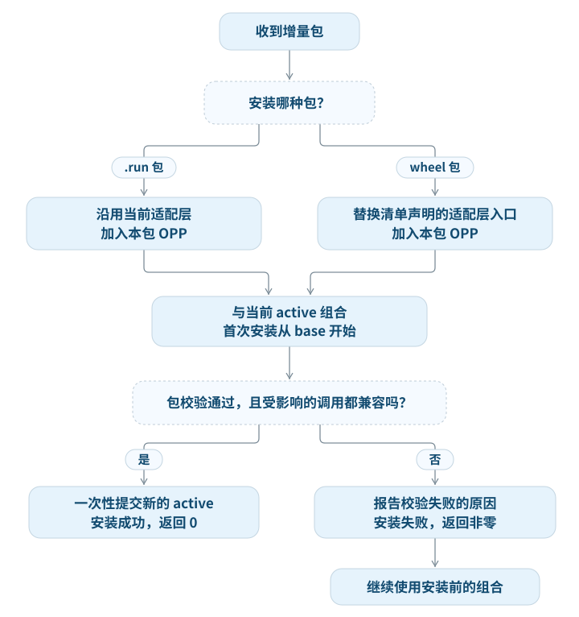

# 增量安装指南：run 与 wheel

增量安装用于更新部分算子，同时保留 base 和此前增量包中未被覆盖的内容。
本文先说明“安装一次、再安装一次会发生什么”，再给出构建命令和状态规则。

## 1. 准备 base

先激活实际使用的 Python 环境，并初始化对应的 CANN 环境，再安装 base wheel：

```bash
python -m pip install --force-reinstall --no-deps /path/to/base.whl
```

基础 wheel 包提供 OPP 和增量管理器。安装器会检查包内的
`fla_npu/opp/vendors/fla_npu_transformer/op_api/lib/libcust_opapi.so`。缺少它时，安装 `.run` 或增量 wheel 均会报错。
旧 base 需要先升级，安装增量包不会升级 base 的管理器。

**安装或移除前停止业务进程，完成后重新启动。** 增量内容在新 Python 进程中生效，
不支持在已初始化 CANN 的进程内热切换。默认保留 wheel 安装的 `.pth` 启动配置。

## 2. 两种增量包分别更新什么

算子由两部分配合工作：**适配层**负责 Python 接口及参数传递，**OPP** 提供 NPU 执行产物。

| 增量包 | 本次更新 | 保留什么 |
| --- | --- | --- |
| run-only（`.run`） | 包内算子的 OPP | 已有适配层，以及未覆盖的 OPP |
| wheel 包 | 声明的适配层入口和包内 OPP | 未覆盖的适配层入口及 OPP |

**普通 `pip install 新wheel` 更新整个 base。** 要把 wheel 作为增量安装，使用下文的
`python -m fla_npu_opp_manage --overlay --source ...`。

### 2.1 增量安装流程

每次安装都从上次成功的组合（`active`）开始。首次安装从基础 wheel（`base`）开始。如果本次失败，后续安装仍从同一个起点继续，失败的包需要修正后重新安装。



## 3. 安装、查询和移除

以下各场景均从一个含算子 A、B 的完整 base 开始。A0、B0 表示 base 版本；
A1、B1 表示增量版本。假设 A1 包只更新 A，B1 包只更新 B，且依赖齐全、接口匹配。

示例路径请替换为实际产物路径，wheel 保留构建时生成的文件名。
**wheel 只更新 A 时，构建必须声明 `FLA_NPU_OVERLAY_OPS=A的入口名`**；
不声明会默认覆盖全部公共入口，不能按文件名或“只改过 A 的源码”推断范围。

### 3.1 安装一次 run，再安装第二次 run

```bash
# 第一次：安装只含 A1 的 OPP
bash /path/to/A1.run

# 第二次：继续安装只含 B1 的 OPP
bash /path/to/B1.run
```

| 安装到哪一步 | A 使用的 OPP | B 使用的 OPP |
| --- | --- | --- |
| 仅有 base | A0 | B0 |
| 安装 A1.run 后 | A1 | B0 |
| 再安装 B1.run 后 | **A1，继续保留** | **B1** |

两次安装都不更新适配层，A、B 仍使用 base 的适配层。
OPP 查找顺序为 **B1 → A1 → base**：B1 中没有 A，就继续查找 A1，A 不会退回 A0。

上述裸执行适用于支持默认增量安装的新 run。也可以明确使用管理入口：

```bash
python -m fla_npu_opp_manage --overlay --source /path/to/A1.run
```

### 3.2 连续安装两个 wheel 包

```bash
python -m fla_npu_opp_manage --overlay --source /path/to/A1.whl
python -m fla_npu_opp_manage --overlay --source /path/to/B1.whl
```

| 安装到哪一步 | A 使用的版本 | B 使用的版本 |
| --- | --- | --- |
| 安装 A1 wheel 后 | A1 适配层 + A1 OPP | B0 适配层 + B0 OPP |
| 再安装 B1 wheel 后 | **A1 适配层 + A1 OPP，均保留** | **B1 适配层 + B1 OPP** |

适配层入口和 OPP 分别按 **B1 → A1 → base** 查找。
即使 A1 的接口与 A0 不同，只要最终选中的适配层与 OPP 匹配，也可以使用。

### 3.3 混合安装与重复更新

假设 base 提供 A0、B0，依次安装三个包，每一步均通过 ABI 检查：

| 安装顺序 | A 的适配层 / OPP | B 的适配层 / OPP |
| --- | --- | --- |
| ① A1.run | base / A1 | base / B0 |
| ② B1 wheel 包 | base / A1 | B1 / B1 |
| ③ A2 wheel 包 | A2 / A2 | B1 / B1 |

若把 A1.run 放在 A2 wheel 之后，A 将使用 A2 适配层。只有 A1 OPP 仍满足它的 ABI，安装才成功。
若第二包失败，第三包直接接在第一包上。修正第二包后需要显式重装它。

**同名内容以后安装的为准，不比较版本号。** 例如已有 A1.run、B1.run，再安装 A2.run，
A 使用 A2，B 仍使用 B1。wheel 同理，但只替换它声明的入口。
如果 B 的包实际也携带了 A 或共享依赖，这部分同样参与覆盖；以包的实际内容为准。
同名 OPP 接口不匹配时，不会跳过新包去调用旧实现，处理规则见第 5 节。

### 3.4 查询结果与移除

```bash
python -m fla_npu_opp_manage --status

# 移除全部增量包，保留 base；当前不支持只移除其中一层
python -m fla_npu_opp_manage --remove-overlay
```

安装成功时会打印产物类型，以及 base、此前增量、本次安装的 OPP 路径，例如：

```text
[fla-npu] Installation successful: mode=overlay, artifact=run
[fla-npu] installed OPP: /.../wheel_layers/<本次层ID>/fla_npu/opp/vendors/fla_npu_transformer
```

wheel 包显示 `artifact=wheel`。在新进程运行相同输入的算子用例，
检查是否得到新版本的预期结果。移除后再开新进程，A、B 均恢复 base 版本。

升级或卸载 base 前，先执行上述移除命令。

## 4. 如何构建这两类包

**跨协议版本的 wheel overlay 只支持全量构建。** 当基础 wheel 和增量 wheel 的 `layer_manifest.json` 协议版本不同（v1 与 v2）时，不支持将 `FLA_NPU_OPS` 或 `FLA_NPU_OVERLAY_OPS` 设为部分算子。构建这类 wheel 时请取消设置这两个变量。下面按算子构建 wheel 的示例适用于双方协议版本相同的情况。

例如，源码中同时有依赖私有接口的 GDN 和只用公开接口的 `chunk_fwd_o`。即使两个变量都只选 `chunk_fwd_o`，生成器仍按源码中全部适配入口的依赖生成 v2 清单。只支持 v1 的基础安装器会拒绝 v2 wheel，即使对方是全量包。此时应先按第 1 节通过 pip 安装支持 v2 的基础 wheel，再使用 overlay。

以下以 A2 的 `chunk_fwd_o` 为例。将算子名换成实际更新对象；
目标 SoC 可选 `ascend910b`（A2）、`ascend910_93`（A3）或 `ascend950`（A5），
使用本机 Host 架构及对应的构建环境。

**run：** 在仓库根目录构建指定算子的 OPP。

```bash
bash build.sh --pkg --soc=ascend910b --vendor_name=fla_npu --ops=chunk_fwd_o
```

**wheel 包：** 在仓库根目录同时指定 OPP 范围和适配层入口范围。

```bash
FLA_NPU_SOC=ascend910b FLA_NPU_OPS=chunk_fwd_o \
FLA_NPU_OVERLAY_OPS=chunk_fwd_o python scripts/build_wheel.py
```

`FLA_NPU_OPS` 决定构建哪些 OPP 算子及其依赖；
`FLA_NPU_OVERLAY_OPS` 把要替换的 Python/Stable 公共入口写入 wheel 的 `layer_manifest.json`（`exports`）。
安装器按这个列表选择适配层。省略时默认声明全部公共入口，即使 OPP 只编译了一个算子。

## 5. 什么情况下启用，状态怎么变化

安装器检查本次增量影响的调用关系：选中的适配层依赖是否齐全、与选中的 OPP 接口是否匹配。
检查通过才原子提交 `active`。未设置禁用开关时，新业务进程使用该组合。

| 情况 | 命令结果 | 下次安装从哪里继续 |
| --- | --- | --- |
| 所有受影响入口的两阶段符号与签名匹配 | 成功，提交新组合 | 本次组合 |
| 包内容不完整、缺少依赖、签名不匹配或文件校验失败 | 非零退出并显示原因 | 上次成功组合，首次安装失败时从 base 继续 |
| 移除全部增量 | 清空选中组合 | base |

含私有 ABI 的 wheel 也必须内嵌 OPP。安装器校验 wheel 的 `RECORD` 并确认有 OPP 后，在子进程中用候选 wheel 自带的 `_op_abi.py` 检查两阶段声明，再核对实际生效的 OPP。任一步失败均按上表处理。请只安装可信来源的 wheel。

升级时沿用旧状态中的 `active`，忽略旧 `pending`。旧候选需要重新提交安装。

已保存的状态或文件损坏时，查询会显示 `damaged` 或 `errors`；先移除增量，再重新安装。

## 6. 其他情况

- **临时禁用：** 设置 `FLA_NPU_OVERLAY_VENDOR=''` 后启动新业务进程，只使用 base，
  不删除已安装增量。恢复使用前取消该设置并重启。
- **覆盖边界：** wheel 增量覆盖声明的 `fla_npu.ops.ascendc` 入口，不更新顶层 `fla`、
  Triton、安装管理器或依赖包。
- 手动环境配置见[开发者指南](开发者指南.md#overlay-启动时序)；
  旧版本兼容和详细设计见[增量安装设计](OPP叠加层增量设计.md#9-增量安装)。
