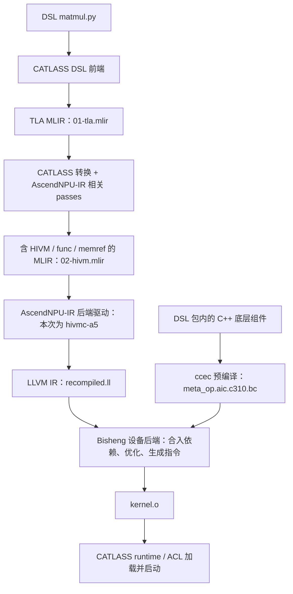

# 用同一个 matmul 看懂 CATLASS C++ 与 DSL 的编译

本文配套 [可运行实验](../examples/catlass_compile_walkthrough/README.md)。
阅读前只需知道 C++ 的源码、头文件、编译和链接。
代码与产物都来自本实验，不再用普通 CPU 加法代替 CATLASS 算子。

## 先确定我们到底在计算什么

两个实现都计算 `C = A @ B`：

- A、B 都是 16×16 的 FP16 矩阵，GM 中按行连续存放。
- Cube 使用 FP32 累加，C 是 16×16 的 FP32 矩阵。
- 启动一个 Cube 核，覆盖整个 C；没有 bias、激活或累加旧 C。
- 两边使用同一份输入生成器。零矩阵、单位矩阵、带正负值矩阵三个用例均已上板验证。

[C++ 文件](../examples/catlass_compile_walkthrough/cpp/matmul.cpp)在 A2 上验证，
[DSL 文件](../examples/catlass_compile_walkthrough/dsl/matmul.py)在 Ascend 950 上验证。
硬件不同，这个实验用于比较编程和编译过程，不用于比较语言性能。
当前 CATLASS DSL 2.2.0 的产品范围是 Ascend 950PR/950DT；A2 支持范围以 C++ 模板实现为准。

## LLVM、MLIR、AscendNPU-IR 分别是什么

**LLVM 是一个编译器基础设施项目。** 它提供可以复用的程序优化、目标代码生成等组件。
LLVM IR 是 LLVM 定义的程序表示格式。官方现在把 LLVM 作为项目名称，而不是需要展开的缩写。
对本实验来说，LLVM 的作用是让编译工具继续处理矩阵乘法程序，最终生成 NPU 指令。
参考 [LLVM 官方介绍](https://llvm.org/)。

**MLIR 是编译器基础设施，允许程序在多个层次表达。**
例如先表达“把一个矩阵块从 GM 搬到 L1”，再表达具体的地址、参数和调用。
MLIR 中一组有明确语义的操作与类型叫 dialect；本例会遇到 TLA、HIVM、func、memref 等。
参考 [MLIR 官方介绍](https://mlir.llvm.org/)。

**AscendNPU-IR 是建立在 MLIR 上的昇腾编译项目。**
它提供 HIVM 等面向昇腾的操作、类型和转换能力。
所以“MLIR → AscendNPU-IR”不能理解成两种完全不相关的文件格式：
包含 HIVM 操作的文件仍然可以是 MLIR。
参考 [AscendNPU-IR 官方说明](https://github.com/Ascend/AscendNPU-IR/blob/master/README_zh.md)。

| 名称 | 在本例中的具体角色 |
| --- | --- |
| CATLASS C++ | 用 C++ 模板拼装 NPU matmul |
| CATLASS DSL | 用 Python 形式写张量、搬运和矩阵计算 |
| DSL 前端 | 读取 DSL 函数和参数类型，生成 TLA MLIR |
| MLIR | 承载上述程序操作，并供转换过程改写 |
| AscendNPU-IR | 提供昇腾相关 IR 和转换；本次后端驱动为 CANN 的 hivmc-a5 |
| LLVM IR | 更靠近目标代码生成的程序形式，本例可保存成 .ll |
| Bisheng / ccec | 参与 Ascend C 编译、BC 依赖编译及最终设备代码生成 |

TLA 全称 Tensor Layout Abstraction，描述张量形状、步长、布局等。
C++ 有对应数据结构，DSL 也有对应类型和操作；`tla` 这个名字本身不代表一个独立的编译器。
参考 [TLA Layouts](https://catlass.readthedocs.io/zh-cn/latest/2_Design/02_tla/01_layout/)。

## C++ 版：哪些代码才是 CATLASS 算子

打开 [cpp/matmul.cpp](../examples/catlass_compile_walkthrough/cpp/matmul.cpp)，先看这部分：

```cpp
using AType = Catlass::Gemm::GemmType<half, Catlass::layout::RowMajor>;
using BType = Catlass::Gemm::GemmType<half, Catlass::layout::RowMajor>;
using CType = Catlass::Gemm::GemmType<float, Catlass::layout::RowMajor>;
using Policy = Catlass::Gemm::MmadAtlasA2Pingpong<true>;
using Tile = Catlass::GemmShape<16, 16, 16>;
using BlockMmad = Catlass::Gemm::Block::BlockMmad<Policy, Tile, Tile, AType, BType, CType>;
using Scheduler = Catlass::Gemm::Block::GemmIdentityBlockSwizzle<1, 0>;
using Kernel = Catlass::Gemm::Kernel::BasicMatmul<BlockMmad, void, Scheduler>;
using DeviceGemm = Catlass::Gemm::Device::DeviceGemm<Kernel>;
```

这里选择了矩阵类型、流水策略、L1/L0 tile、块内乘法、任务调度和完整 kernel。
`Policy` 内部选定 A2 架构；`void` 表示本例不增加额外 epilogue。
模板实例化把选定组件的实现组合进本例的设备程序。

在 host 准备好设备内存后，用以下代码启动：

```cpp
Kernel::Arguments args{Catlass::GemmCoord{16, 16, 16},
                       deviceA.ptr, deviceB.ptr, deviceC.ptr};
DeviceGemm gemm;
gemm.Initialize(args);
gemm(runtime.stream, 1);
```

完整代码还检查状态码并等待 stream 完成。
`DeviceGemm` 内部通过 `KernelAdapter<Kernel><<<...>>>` 启动 NPU 程序。
文件中的 ACL 内存管理和文件读写负责喂入数据、取回结果；矩阵运算在 CATLASS 设备代码中完成。

真实构建主线是：

```text
matmul.cpp + CATLASS 头文件
    │ CMake 把文件标为 ASC，调用 Bisheng
    ├─ host 侧编译产物：matmul-host-aarch64-unknown-linux-gnu.o
    ├─ Cube 设备产物：matmul-cce-...-dav-c220-cube.o
    └─ Vector 配套产物：matmul-cce-...-dav-c220-vec.o
    │ ASC 编译驱动打包、链接
    ▼
matmul.cpp.o → matmul_cpp 可执行程序
    │ CPU 执行 main，准备参数、启动 kernel
    ▼
NPU 执行 CATLASS 矩阵乘法
```

`matmul_cpp` 在本次 A2 机器上是 ARM aarch64 ELF 可执行程序；
设备 `.o` 是 `elf64-hiipu`。两者虽然都经过 C++ 工具链，但执行位置不同。
Vector 配套产物是本次模板/驱动组合的实际输出，不表示本例把矩阵乘法改为 Vector 计算。

[真实构建日志](../examples/catlass_compile_walkthrough/evidence/cpp-build.txt)中可以找到：

```text
bisheng ... --npu-arch=dav-2201 ... -c --asc-aicore-lang .../matmul.cpp
```

本实验没有直接导出这条 C++ 路线的 LLVM IR。
当前 CANN 9.2.0 的 ASC 驱动对尝试的 `-emit-llvm` 组合报“不支持”；
不能把普通 clang++ 的命令照搬过来，并宣称已经拿到了该 kernel 的 IR。
这里列出的 C++ 中间文件以真实构建目录为准。

## DSL 版：显式写出搬运、同步和矩阵乘法

[DSL 文件](../examples/catlass_compile_walkthrough/dsl/matmul.py)在 kernel 中明确写出：

```text
GM 中的 A、B
   ↓ tla.copy + 对应的同步
L1 中的 A、B
   ↓ tla.copy + 对应的同步
L0A 中的 A、L0B 中的 B
   ↓ tla.mmad
L0C 中的 FP32 结果
   ↓ tla.copy
GM 中的 C
```

核心计算语句是：

```python
tla.mmad(c_l0, a_l0, b_l0, init_c=True)
```

它在这一份具体实现中对应 C++ 模板里的 Cube 矩阵乘法。
C++ 版把搬运和同步封装在选定的 BlockMmad 等组件中；
DSL 示例把这些步骤展开在 kernel 源文件中。

| 工作 | 本例 C++ 版 | 本例 DSL 版 |
| --- | --- | --- |
| 表达输入输出类型 | GemmType 和 RowMajor | tla.Tensor、from_dlpack、RowMajor |
| 分配设备内存 | ACL host 代码 | torch NPU Tensor |
| 片上搬运和同步 | CATLASS 块/Tile 组件内部实现 | tla.allocate/copy/set_flag/wait_flag |
| 矩阵计算 | BlockMmad 选择的 TileMmad | tla.mmad |
| 启动设备程序 | DeviceGemm | tla.compile 返回值的调用 |

这个表对应本实验两份代码的组织方式；不能推导成 C++ 只能高层封装、
DSL 只能手写所有底层步骤。

## DSL 的真实编译主链，AscendNPU-IR 在这里



这里的 pass 就是编译器的一步程序转换，例如把 `tla.copy` 转成具体搬运函数调用。
AscendNPU-IR 的相关转换既被 CATLASS 的编译模块使用，也出现在后端工具链中。
不是每个箭头都对应一次 shell 命令；一些步骤在同一个编译进程内完成。

实测 `hivmc-a5 --version` 显示 AscendNPU-IR 版本信息及 LLVM 19.1.7。
本次记录使用的后端工具是 `hivmc-a5`，不能把不同版本文档中的
`hivmc`、`bishengir-compile` 和它视为可随意替换的命令。

### 为什么这条 DSL 链路里仍然出现 C++

这里的 C++ 是 **DSL 编译器使用的底层依赖实现**，
不是把上面的 `cpp/matmul.cpp` 拿来执行，也不是把整个 DSL kernel 翻译成那份 C++ 文件。

例如，DSL 编译后会调用 `mmad_half_half_float`、`copy_gm_RowMajor_to_l1_zN_half`。
这些调用所需的实现，通过 DSL 包中的 C++ helper 预编译成 `.bc` 提供。
`hivmc-a5` 的实际命令包含 `--link-aicore-bitcode=...`，
在后续编译时把实现合入当前 kernel。

因此，AscendNPU-IR 主链和 C++ 组件复用可以同时存在。
前者负责程序转换；后者提供部分操作的实现。
参考 [CATLASS BC 后端接入说明](https://catlass.readthedocs.io/zh-cn/latest/4_CATLASS_DSL/dsl_development/feature_development/bc_backend_integration/)。

## 把同一条矩阵乘法追到三个真实文件里

下面为便于阅读省略长类型和参数，`...` 是讲解用省略号。
完整、实际生成的文件在链接中。

**第一份：[TLA MLIR](../examples/catlass_compile_walkthrough/evidence/dsl-01-tla.mlir)。**

```mlir
"tla.mmad"(%12, %10, %11, %13, %14) ... -> ()
```

可以读成：对 %10 和 %11 表达的矩阵执行乘法，结果写到 %12。
这些 %名字表示编译器程序中的值；文件中记录的是操作、类型和布局，
运行时 A、B 的全部数值并没有写进这份 IR。

**第二份：[HIVM 等 dialect 组成的 MLIR](../examples/catlass_compile_walkthrough/evidence/dsl-02-hivm.mlir)。**

```mlir
hivm.hir.wait_flag[<PIPE_MTE1>, <PIPE_M>, <EVENT_ID0>]
call @mmad_half_half_float(...) : (...) -> ()
```

现在已经明确了等待哪个 pipe 的事件、调用哪个具体矩阵乘法实现。
前后两份都是 MLIR，只是表达的细节层次不同。

**第三份：[LLVM IR](../examples/catlass_compile_walkthrough/evidence/dsl-03-llvm.ll)。**

```llvm
define dso_local void @matmul_kernel(ptr addrspace(1) %0, ...) {
  ...
  call void @mmad_half_half_float(..., i64 16, i64 16, i64 16, i1 true, i8 0)
  ...
}
```

`define` 是函数定义，`call` 是调用，`i64 16` 是类型为 64 位整数的常量 16。
它仍然描述同一个 16×16×16 GEMM，只是参数传递等细节已经展开。
此时尚有 helper 调用；后续合入 BC、优化、生成设备指令，得到 `kernel.o`。

这份 `.ll` 来自同一 MLIR 的诊断重编译；重编译二进制与已经上板执行的二进制
SHA-256 完全一致。复现命令是：

```bash
python dsl/dump_backend.py build/dsl/artifacts.json
```

## 最后只记住这些文件

| 文件 | 内容 | 谁继续使用 |
| --- | --- | --- |
| cpp/matmul.cpp | CATLASS 模板组装和 host 启动逻辑 | Bisheng |
| dsl/matmul.py | CATLASS DSL 算子和 host 编译/启动逻辑 | Python 与 DSL 前端 |
| 01-tla.mlir | 高层 TLA 操作 | CATLASS 转换流程 |
| 02-hivm.mlir | 昇腾相关操作、内存描述和函数调用 | hivmc-a5 |
| recompiled.ll | LLVM IR 文本 | 后端编译过程 |
| meta_op.aic.c310.bc | C++ helper 编译得到的 LLVM bitcode | 后端合入实现 |
| kernel.o | NPU 设备代码 | runtime 加载并在 NPU 启动 |
| cpp_output.bin / dsl_output.bin | 实际计算出的矩阵数据 | CPU 精度检查 |

`.ll` 和 `.bc` 是 LLVM IR 的文本与二进制编码形式；
这里的 helper `.bc` 与 kernel 的 `.ll` **不是同一个模块的两份编码**，
它们分别来自底层依赖和本次 kernel，稍后合并。
`.bin` 输出则是矩阵数据，与“编译中间产物”分属两类。

建议阅读顺序：先运行两份实现，再从 `tla.mmad` 搜到三份 IR 中的对应操作，
最后看 `backend-command.txt` 中的 `--link-aicore-bitcode`。
无需先掌握整个 MLIR pass 框架。

本仓 [开发者指南](开发者指南.md)、
[离线编译与使用指南](离线编译与使用指南.md)、
[适配层设计](architecture/适配层设计.md)
解释的是把算子集成、构建和分发到 FLA 的工程流程。
本实验只讲独立 CATLASS kernel 的编译和启动，先学到这里即可。
