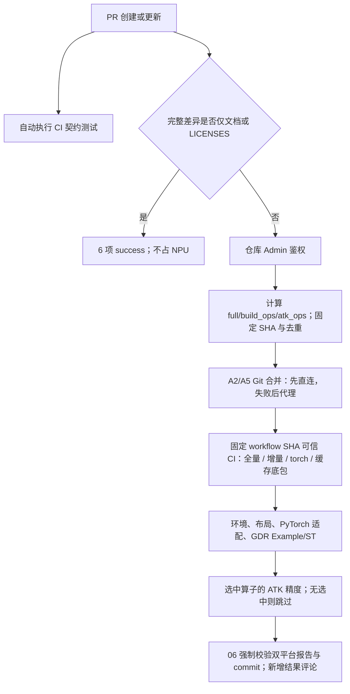

# 仓库规则

## 分支创建

仅以下 GitHub 账号允许在主仓库创建分支：

- `juyangokok`
- `weinachuan`
- `weiwei-612`（Sun Weiwei）
- `woey`
- `zhangshuolei-hfut`
- `chen-linxin`

其他成员请 fork 本仓库到个人仓库，并从个人仓库向主仓库提交 Pull Request。

`.github/workflows/repository-rules.yml` 中的 `仓库规则 / 分支创建权限检查` 会在主仓库出现未授权新分支时自动删除该分支，并提示提交者走 fork + PR 流程。

## 合入检视

PR 合入前仍需要 2 个 approval。该要求由 GitHub 分支保护原生能力处理，不再设置自定义检视 status。仓库管理员应在分支保护中配置 required approvals 为 `2`，并保留 stale review dismiss 和 last push approval。

`.github/CODEOWNERS` 用于 GitHub 原生 Code Owners review。全仓默认请求维护账号检视，ABI 敏感路径会在 `CODEOWNERS` 末尾覆盖为仅 `@weinachuan`。

## ABI 兼容性

如果 PR 修改了算子 `def`、`aclnn` 接口入参类型、返回值、必选/可选属性，或修改了 `torch` 接口入参类型等可能导致 ABI 不一致的内容，仍必须由 `weinachuan` 检视确认。该要求通过 GitHub 原生 Code Owners review 生效，不再由自定义检视 workflow 自动阻塞。

需要重点关注的 ABI 风险区域：

- `fla/ops/**/op_host/*_def.cpp` 中的 `Input` / `Output` / `Attr` / dtype / format / required / optional 等定义
- `fla/ops/**/op_host/op_api/aclnn_*.h` 和 `aclnn_*.cpp` 中的 aclnn 接口签名、入参类型和返回相关声明
- `torch_custom/fla_npu/csrc/src/stable_*.cpp` 中的 dispatcher schema、适配函数及 ACLNN 调用
- `torch_custom/fla_npu/csrc/include/stable/**` 中的公共 ABI、boxed 参数与 tensor 描述符契约
- `torch_custom/fla_npu/fla_npu/ops/ascendc/_stable.py` 中的公共 Python 签名及参数转换

如果 PR push 了新 commit，相关 ABI 检视也应重新确认。

## NPU CI 门禁

PR 创建、重开或更新 commit 时，`CI 契约测试` 自动在 GitHub-hosted runner 执行 Python/Node 契约测试和分阶段 Shell 集成测试。`NPU CI 默认状态` 读取完整修改列表，按下面的规则计算设备验证范围。重命名同时检查原、新路径；文件列表缺失、重复或被 GitHub 截断时直接报错，不能按文档改动放行。每个 PR 按自身 base/head 差异判断，文档快捷成功不能跨 PR 复用，更换目标分支会重新判断。

### 触发权限与命令

触发 NPU CI 需要仓库 Admin 权限。评论分发、执行准备和 Actions 重跑分别校验；实际重跑人使用 `github.triggering_actor` 校验。权限读取失败时拒绝执行。

```text
/run-npu-ci
/run-npu-ci quick
/run-npu-ci quick atk-ops=chunk_fwd_o,recurrent_kda device-id=0
/run-npu-ci quick atk-ops=null
/run-npu-ci full
/run-npu-ci full atk-ops=chunk_fwd_o
/run-npu-ci quick ops=causal_conv1d,chunk_bwd_dv_local
/update-package
/update-package ci_ref=<CI定义分支>
```

| 参数 | 行为 |
| --- | --- |
| `quick`（默认） | 按完整文件差异选择全量、增量、仅 torch_custom 或底包，不减少正式验证阶段 |
| `full` | 强制全量 wheel 构建，并运行全部 PyTorch 适配测试 |
| `atk-ops=a,b` | 追加 ATK 精度验证算子；与自动计算的 ATK 集合去重合并 |
| `atk-ops=null` | 显式跳过所有 ATK 验证，覆盖算子代码、ATK 文件变化自动选中的集合；不改变编译、GDR 或其他阶段 |
| `device-id=N` | 指定两个 runner 各自的宿主机物理 NPU 编号；须为非负整数，省略则自动择卡；容器内映射为逻辑设备 `0` |
| `ops=a,b` | 独立编译诊断：仅编译显式算子，只执行 01/02，不运行 ATK，不满足正式门禁；不能与 `full` 或 `atk-ops` 组合 |
| `ci_ref=<branch>`（别名 `branch=`） | 选择 Actions 调度定义分支；默认使用 PR 目标分支 |

Actions → `NPU CI` → `Run workflow` 提供对应的 `pr_number`、`ci_mode`、`ops`、`atk_ops`、`device_id` 输入。评论分发还传递内部 `requested_by`，所选 CI 定义分支必须提供同一 `workflow_dispatch` 输入契约。`/update-package` 单独触发底包缓存刷新，详情见下文。

每次触发结论、拒绝原因及最终结果都新增评论，历史评论不覆盖。同一 PR 请求先排队，再按 head、目标分支名、base/workflow SHA、模式、编译计划、ATK 集合和设备号去重；仅完全相同的请求可复用完整双平台成功结果或正在执行的任务。目标分支名不同，即使暂时指向同一 SHA，也不能复用另一分支的 Daily 执行计划。

### 修改文件与执行计划

所有 `.md`（不区分扩展名大小写）、`docs/` 和 `LICENSES/` 下的修改都视为文档；这些路径与其他修改混合时，不扩大编译或 ATK 范围。只有文档改动的 PR 自动通过 6 项 NPU 状态，不调度设备；仍可通过显式 `full`、`atk-ops` 或诊断 `ops` 要求实际运行。

普通 `quick` 正式请求依次汇总以下规则：

| 修改路径 | 编译影响 | ATK 影响 |
| --- | --- | --- |
| `common/`、`cmake/`，以及 AscendC 公共目录或组级文件 | 全量 | 保留其他规则选中的算子 |
| 非 Markdown 的 `ci/`、`.github/` | 本身不触发编译 | 不自动增加算子 |
| `fla/ops/ascendc/` 下非 Markdown 算子代码，按 PR head 树中最近的有效 `op_host/CMakeLists.txt` 定位算子根 | 无全量条件时增量编译该算子；支持任意层分组，无法确定时全量 | 验证实际算子，包括因其他修改而转为全量时；`atk-ops=null` 可显式跳过 |
| `tests/atk/<op>/` 下非 Markdown 文件 | 本身不触发编译 | 验证该算子 |
| `tests/atk/common/`、`tests/atk/run_test_cpu.sh` 等根级共享文件 | 本身不触发编译 | 验证 PR 当前所有 ATK 算子目录 |
| `torch_custom/` | 与算子代码同时修改时完整 wheel 构建，确保当前 OPP 和 adapter 一起重建；无其他编译时仅编译 torch_custom | 保留选中集合 |
| `examples/`、`tests/` 其他部分 | 本身不触发编译，使用底包 | 保留选中集合 |
| 上述之外的其他非 Markdown 修改 | 全量 | 保留选中集合 |

全量条件优先于增量算子；算子与 `torch_custom` 混合修改同样触发全量，避免沿用 Daily 中的旧 adapter。最终产生 `full_build`、`build_ops`、`atk_ops` 和 `build_kind=full/incremental/torch/base`：全量时 `build_ops` 为空；ATK 集合通常是修改算子代码、修改 ATK 算子目录及手动 `atk-ops` 的并集，可以为空。`atk-ops=null` 覆盖整个集合，且不能与算子名混写（如 `null,chunk_fwd_o`）。省略参数仍按差异自动选择。`full` 不会自动把 ATK 扩大为全仓测试；quick 因混合修改而全量构建时，仍保持 quick 的测试范围。

设备 runner 在合并固定 base/head 后，将 `ci/` 替换为本次固定 workflow SHA 中的可信 CI 脚本；仅保留合并后 PR 的 `ci/example_st_cases.json` 用例数据。该文件须为合法 JSON 常规文件，不能通过符号链接读取。PR 作者身份不改变脚本来源；修改 CI 执行逻辑时须选用包含该变更的 CI 定义分支。

取消可信 CI、独立用户名触发名单，以及 CI 文件修改需 Admin 显式确认这三项策略变更在 [独立权限与 CI 来源策略 PR #1046](https://github.com/flashserve/flash-linear-attention-npu/pull/1046) 中维护。本文描述当前 Admin 权限和固定 workflow SHA 可信 CI 的流程；部署其他策略分支时，以所选 workflow 的实际实现为准。

### A2/A5 源码与包准备

`prepare` 固定 base SHA、PR head SHA 和所选 workflow SHA。A2、A5 共用同一 Git 流程：检出固定 base，拉取并核对 PR head，寻找 merge-base，合并 PR 后测试。首次清空继承的代理并直连，失败后启用宿主机代理重试；SHA 不匹配或合并冲突均失败。

包准备按执行计划只做一次：

| `build_kind` | 包准备方式 |
| --- | --- |
| `full` | 通过 `python scripts/build_wheel.py` 构建并安装当前 PR 的完整目标 SOC wheel，构建并行度上限 16 |
| `incremental` | 获取缓存中的匹配完整 Daily 底包，使用 `build.sh --pkg --soc=<soc> --ops=<ops> -j16` 构建修改算子，通过 `fla_npu_opp_manage --overlay` 叠加 delta 并校验 ABI，保留未修改的完整底包内容 |
| `torch` | 安装完整 Daily 底包，仅重新构建当前 PR 的 torch_custom wheel 并保留底包 OPP，校验 ABI |
| `base` | 仅安装完整 Daily 底包，不编译 |

Daily 下载沿用 [PR #1037](https://github.com/flashserve/flash-linear-attention-npu/pull/1037) 的华为云 nightly 发布源，按 PR **目标分支、SOC、CPU 架构和 Python wheel 标签**严格选择：`main` 使用 `0.dev...+main.<SHA>`，维护分支 `vX.Y.Z` 使用对应的 `X.Y.Z.dev...`；A2/A5 分别使用 `flash-linear-attention-npu-a2/a5`。下载禁用其他 index 回退，并检查版本、wheel 元数据、Stable 库及目标 SOC kernel/config。匹配版本缺失、分支无映射或 ABI 不兼容均失败，建议补发对应 Daily 或改用 `/run-npu-ci full`，不会使用其他分支或平台的包。

底包缓存在每台宿主机的 `/home/huangjunzhe/ci/pkg-cache`，可通过 `CI_PACKAGE_CACHE` 指定；容器中挂载为 `/ci-pkg-cache`。按目标分支、SOC、CPU、Python/ABI 兼容标签、发布源和指定版本隔离。北京时间每日第一次需要底包的 CI 下载远程最新匹配包，日内校验 SHA256 和 wheel 元数据后复用；全量编译无需下载底包。刷新使用进程锁、临时下载和原子发布；失败不会记录当天刷新成功，也不会回退到旧日底包。

仓库 Admin 可在 PR 评论 `/update-package` 强制刷新该 PR 目标分支的底包，可选 `ci_ref=<CI定义分支>`；也可在 Actions → `更新 Daily 底包缓存` 中指定 `base_ref`。任务分别调度一个 A2 runner 和一个 A5 runner，只下载、校验各自宿主缓存，不编译、不安装、不运行 NPU 测试。存在多台同平台机器时，此命令只刷新实际选中的 runner，其余机器在各自当天首次需要底包的 CI 中自动刷新。直接调用包准备时，`CI_UPDATE_PACKAGE=true` 强制刷新；仅刷新可运行 `python ci/prepare_ci_package.py --update-package`。

包准备结果及选中的底包版本写入 artifact。后续 Python/ATK 进程启动前加载实际安装包的 `set_env.bash`；布局检查、适配检查和精度测试不再重复构建其他 wheel。

### 验证阶段与汇总



保留以下 6 个 status context，以兼容现有分支保护；第 02 项名称中的“全量”是既有 context 名，实际执行按 `build_kind` 选择包准备方式。

| 状态 context | 实际检查 |
| --- | --- |
| `NPU CI / A2+A5 / 01 环境、wheel 与运行时契约` | wheel 环境、Stable 覆盖与 ABI、OPP 布局/ABI、运行时设备和 mutation 契约 |
| `NPU CI / A2+A5 / 02 全量 OPP 构建` | 执行计划指定的完整 wheel、增量 overlay、仅 torch_custom 或底包准备 |
| `NPU CI / A2+A5 / 03 torch_custom wheel 与 OPP 布局` | 检查已安装 wheel 与 OPP/overlay 布局，不重复编译 |
| `NPU CI / A2+A5 / 04 OPP 安装与 PyTorch 适配` | 校验实际包环境和 Python 依赖；`full` 追加全部 PyTorch 适配测试 |
| `NPU CI / A2+A5 / 05 GDR Example/ST` | 执行 `ci/example_st_cases.json` 中全部启用用例，生成完整精度报告 |
| `NPU CI / A2+A5 / 06 报告与 commit 校验` | 核对 A2/A5 阶段、GDR 和选中 ATK 报告，校验平台/SOC/head/run/attempt 身份并发布最终状态 |

ATK 是 GDR 后的独立设备阶段 `atk-accuracy`，结果并入第 06 项，不新增分支保护 context。CI 只通过 `tests/atk/run_test_cpu.sh -op=<op> -scope=accuracy -ci=true` 调用 ATK，参数、资产检查和报告格式由 ATK 入口维护。每个选中算子必须有至少 **200 个独立精度 case、1 个 perf case 和 1 个 mss case**；文件缺失、格式错误、case id 重复或数量不足直接失败。perf/mss 在此作为资产完备性门禁，CI 实际执行选中算子的全部精度用例。

ATK 入口将进程树限制到最多 16 个 CPU，使用 `--max_task 16 --bind_cpu_type 0`，数值库每任务 1 线程，禁止 CI 用 case 子集缩减精度验证。失败评论和 Summary 展示具体算子、期望/实际数量或运行错误，并给出补齐用例、修复环境/实现及入口复现命令的建议；关键诊断和 ATK 报告保留在 artifact，完整执行日志可在 Actions job 中查看。

| 正式流程差异 | `quick` | `full` |
| --- | --- | --- |
| 编译 | 按文件计划选择四种包准备方式 | 强制完整 wheel |
| 环境、已安装布局、GDR Example/ST | 全部执行 | 相同 |
| ATK 集合与门禁 | 自动集合加手动 `atk-ops` | 相同，不自动扩大集合 |
| 全量 PyTorch 适配测试 | 默认不运行 | 额外运行 |

因此，除编译选择外，`full` 额外执行全部 PyTorch 适配测试；ATK 和 GDR 不因 quick/full 改变覆盖范围。`ops=` 诊断仅执行 01/02，发布独立的 `NPU CI / A2+A5 / 定向诊断`，不运行后续布局、适配、GDR 或 ATK，也不改写 01-06 正式状态。

两个平台并行，每个平台内部顺序执行；前置阶段失败后，后续标记未执行。矩阵启用 fail-fast，一个平台失败会取消另一平台仍在排队或运行的任务；缺席、阶段失败、被选中 ATK 未执行、精度失败或报告身份不符均不能通过。运行期间监控 PR head，最终发布前再次核对 head 和目标分支，旧 commit/base 的结果不能放行当前 PR。

同一 PR 以 `cancel-in-progress: false` 排队，runner 通过共享 NPU 文件锁防止抢卡。A2 使用 ARM64 runner、`fla-npu-ci:9.1.0-910b`；A5 使用 x64 runner、预置 `fla-npu-ci:9.1.0-950`。平台、目录、代理、Daily 源和 ATK 环境配置见 [部署教程](Fla-npu仓CI部署教程.md)。合入要求当前 head 的上述 6 项、`CI 契约测试` 及分支保护要求的 2 个 approval 全部满足。

## 强行合入

`weinachuan` 的强行合入权限需要在 GitHub 分支保护中配置 PR bypass allowance。仓库管理员可使用以下脚本应用 `main` 分支保护：

```sh
GITHUB_TOKEN=<admin-token> scripts/github/apply_branch_protection.sh main
```

该 token 需要具备仓库 administration 写权限。脚本会要求上述 6 个 NPU CI 分项状态和 `CI 契约测试` 都通过，并配置 2 个 approval、Code Owners review、stale review dismiss、Admin 也必须遵守分支保护，以及仅 `weinachuan` 具备 bypass。
