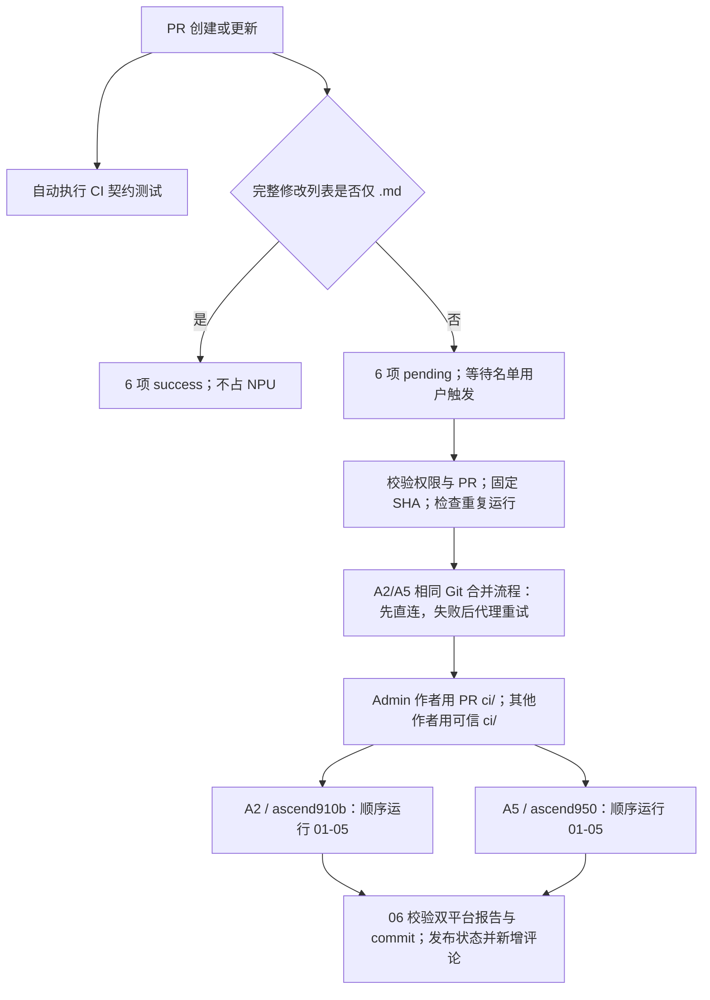

# 仓库规则

## 分支创建

仅以下 GitHub 账号允许在主仓库创建分支：

- `juyangokok`
- `weinachuan`
- `weiwei-612`（Sun Weiwei）
- `woey`
- `zhangshuolei-hfut`
- `chen-linxin`

其他成员请 fork 本仓库到个人仓库，并从个人仓库向主仓库提交 Pull Request。

`.github/workflows/repository-rules.yml` 中的 `仓库规则 / 分支创建权限检查` 会在主仓库出现未授权新分支时自动删除该分支，并提示提交者走 fork + PR 流程。

## 合入检视

PR 合入前仍需要 2 个 approval。该要求由 GitHub 分支保护原生能力处理，不再设置自定义检视 status。仓库管理员应在分支保护中配置 required approvals 为 `2`，并保留 stale review dismiss 和 last push approval。

`.github/CODEOWNERS` 用于 GitHub 原生 Code Owners review。全仓默认请求维护账号检视，ABI 敏感路径会在 `CODEOWNERS` 末尾覆盖为仅 `@weinachuan`。

## ABI 兼容性

如果 PR 修改了算子 `def`、`aclnn` 接口入参类型、返回值、必选/可选属性，或修改了 `torch` 接口入参类型等可能导致 ABI 不一致的内容，仍必须由 `weinachuan` 检视确认。该要求通过 GitHub 原生 Code Owners review 生效，不再由自定义检视 workflow 自动阻塞。

需要重点关注的 ABI 风险区域：

- `fla/ops/**/op_host/*_def.cpp` 中的 `Input` / `Output` / `Attr` / dtype / format / required / optional 等定义
- `fla/ops/**/op_host/op_api/aclnn_*.h` 和 `aclnn_*.cpp` 中的 aclnn 接口签名、入参类型和返回相关声明
- `torch_custom/fla_npu/csrc/src/stable_*.cpp` 中的 dispatcher schema、适配函数及 ACLNN 调用
- `torch_custom/fla_npu/csrc/include/stable/**` 中的公共 ABI、boxed 参数与 tensor 描述符契约
- `torch_custom/fla_npu/fla_npu/ops/ascendc/_stable.py` 中的公共 Python 签名及参数转换

如果 PR push 了新 commit，相关 ABI 检视也应重新确认。

## NPU CI 门禁

PR 创建、重开或更新 commit 时，`CI 契约测试` 自动在 GitHub-hosted runner 执行：运行 `ci/tests` 下的 Python/Node 契约测试和分阶段 Shell 集成测试，保护 CI 自身的权限、源码准备、调度和报告逻辑。

`NPU CI 默认状态` 同时读取完整 PR 修改列表。**只有全部修改路径均为 `.md` 时，直接将下表 6 个状态置为 success，不调度 NPU。** 重命名同时检查原路径和新路径；列表不完整或读取失败时不能按纯文档改动放行。每个 PR 按自身 base/head 差异判断，其他 PR 对同一 commit 的纯文档放行不能复用。其他 PR 的新 head commit 初始写入 6 个 pending 状态，等待获授权用户触发；更换目标分支也会重新检查并重置门禁。

### 触发权限与命令

触发名单独立保存在默认分支的 [`.github/npu-ci-users.json`](../.github/npu-ci-users.json)。评论分发和实际执行准备均读取该文件校验用户名，**不要求触发人具有仓库 Admin 权限**。Actions 手动重新运行还会校验实际操作人 `github.triggering_actor`，该用户也必须在名单中。初始名单沿用原有 12 位管理员；后续可通过 PR 增删任何 GitHub 用户名，合入默认分支后生效。待测 PR 自身对名单的修改不会授予触发权限。

名单中的用户可在 PR 评论区发送：

```text
/run-npu-ci
/run-npu-ci quick
/run-npu-ci full
/run-npu-ci quick ops=causal_conv1d,chunk_bwd_dv_local
```

也可在 GitHub `Actions` → `NPU CI` → `Run workflow` 选择 CI 定义分支、填写 PR 编号和 `quick/full` 模式。正式门禁不填写 `ops`。

评论由默认分支的 `NPU CI 评论分发` 校验并转发到 PR 目标分支（`pr.base.ref`）的 `.github/workflows/ci.yml`。需要临时使用其他 CI 定义分支时，可追加：

```text
/run-npu-ci quick ci_ref=release-v2
```

所选分支必须提供 `workflow_dispatch` 及相同的 `pr_number`、`ci_mode`、`ops`、`requested_by` 输入契约。

每次触发在准备阶段追加一条评论，记录开始执行、已通过、已在运行或纯文档跳过的结论；执行结束再追加独立结果评论。历史评论不查找、不覆盖。同一 PR 的请求先排队，再由 `prepare` 去重；只有 head、模式、算子列表、base SHA、workflow SHA 均相同，才复用已有完整双平台成功结果或进行中的任务，并在新评论中链接已有运行。

### 源码准备与 CI 脚本选择

`prepare` 再次校验权限、PR 状态和完整修改列表，固定 base SHA、PR head SHA、所选 workflow SHA。纯 `.md` 请求直接通过 6 项并结束；其余请求调度 A2、A5。

**A2、A5 使用相同的 Git 流程：检出固定 base，拉取并核对 PR head，寻找 merge-base，合并 PR 后测试。第一次源码获取清空继承的代理配置并直连；失败后才启动宿主机代理，重试同一流程。** 任一 SHA 不匹配或合并冲突均失败。两平台不再分别实现 Git 与 API 归档路径。

CI 脚本选择根据 **PR 作者** 的仓库权限判断，与触发名单分开：

- PR 作者具有仓库 Admin 权限：直接保留合并后 PR 中的 `ci/`，使 CI 脚本变更可以在合入前验证。
- 其他作者：使用固定 workflow SHA 中的可信 `ci/`；仅保留合并 PR 中的 `ci/example_st_cases.json`，让新增启用用例参与验证。

该选择只影响 runner 执行的 `ci/`，Actions 调度定义仍来自所选 CI 分支。运行期间监控 PR head，最终发布前再次核对 head 和目标分支，旧提交或旧目标分支的结果不能放行当前 PR。

### A2/A5 执行与汇总



| 状态 context | 实际检查 |
| --- | --- |
| `NPU CI / A2+A5 / 01 环境、wheel 与运行时契约` | wheel 环境、Stable 覆盖与 ABI 一致性、OPP 布局/ABI、Stable runtime/build policy、ctypes ABI、设备与 mutation 契约 |
| `NPU CI / A2+A5 / 02 全量 OPP 构建` | 准备依赖缓存，使用目标 SOC 构建 OPP `.run` 包，构建并行度 `-j16` |
| `NPU CI / A2+A5 / 03 torch_custom wheel 与 OPP 布局` | 构建并检查独立 `torch_custom` wheel 及 OPP 安装布局 |
| `NPU CI / A2+A5 / 04 OPP 安装与 PyTorch 适配` | 安装 OPP、确认 Python 依赖、构建安装适配 wheel；`full` 追加全部 PyTorch 适配测试 |
| `NPU CI / A2+A5 / 05 GDR Example/ST` | 执行 `ci/example_st_cases.json` 中启用的用例，生成完整精度报告 |
| `NPU CI / A2+A5 / 06 报告与 commit 校验` | GitHub-hosted 汇总任务核对双平台报告、精度结果及平台/SOC/head/run/attempt 身份，发布最终状态 |

`quick`、`full` 均执行这 5 个设备阶段和第 06 项汇总；`full` 在第 04 项增加单算子适配测试。带 `ops=` 时只执行 01 和 02 的指定算子构建，发布独立的 `NPU CI / A2+A5 / 定向诊断`，不执行后续安装/精度，也不改写 01-06 正式状态。

两个平台并行启动，每个平台内部顺序执行；前置阶段失败后，后续阶段标记未执行。矩阵启用 fail-fast，一个平台失败后取消另一平台仍在排队或运行的任务。汇总仍检查完整双平台结果：缺席、阶段失败/未执行、精度失败、报告身份不符均不能通过。失败评论和 Summary 给出关键错误及带 `CI_STAGE=<分项>`、模式和 SOC 的容器复现命令；详细日志及逐 Tensor 指标保留在 Actions 日志和 artifact。

同一 PR 使用 workflow concurrency 排队，`cancel-in-progress: false` 保留正在执行的任务；runner 通过共享 NPU 文件锁防止任务抢卡。A2 使用 ARM64 runner、`fla-npu-ci:9.1.0-910b`；A5 使用 x64 runner、`fla-npu-ci:9.1.0-950`，且必须预置镜像。平台版本、缓存/目录、代理、日志与设备配置见 [部署教程](Fla-npu仓CI部署教程.md)。

PR 合入要求当前 head 的上述 6 项和 `CI 契约测试` 全部成功，以及 GitHub 分支保护要求的 2 个 approval。管理员应将这 7 个精确名称配置为必需检查。纯 `.md` PR 的 6 项由文件检查直接通过；其他 PR 更新 commit 或更换目标分支后需名单用户重新触发。旧版或单平台状态不满足双平台门禁。

## 强行合入

`weinachuan` 的强行合入权限需要在 GitHub 分支保护中配置 PR bypass allowance。仓库管理员可使用以下脚本应用 `main` 分支保护：

```sh
GITHUB_TOKEN=<admin-token> scripts/github/apply_branch_protection.sh main
```

该 token 需要具备仓库 administration 写权限。脚本会要求上述 6 个 NPU CI 分项状态和 `CI 契约测试` 都通过，并配置 2 个 approval、Code Owners review、stale review dismiss、Admin 也必须遵守分支保护，以及仅 `weinachuan` 具备 bypass。
