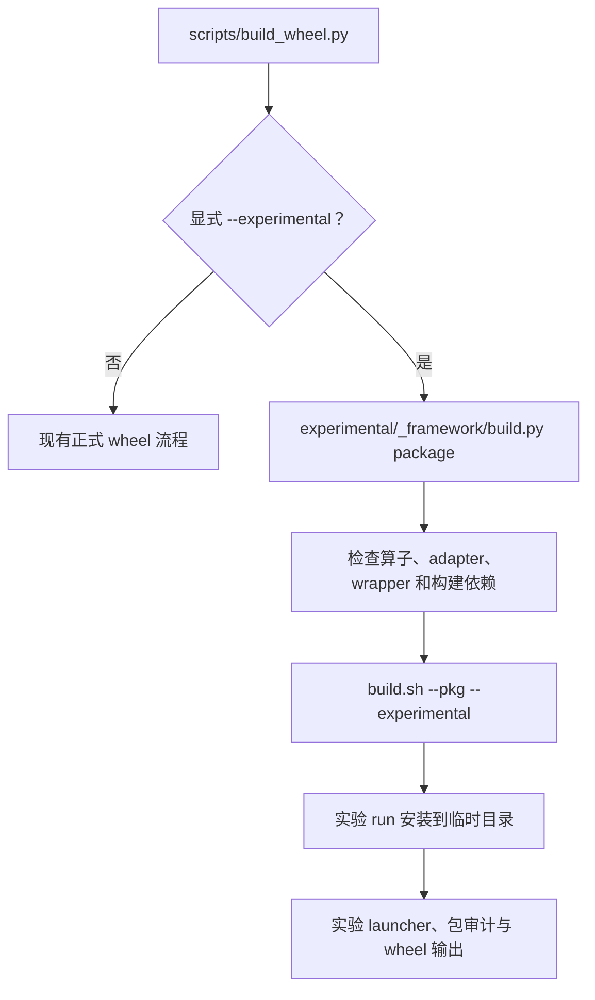

# experimental 目录收敛与转正式设计

作者：zzy1205。更新：2026-11-13。代码基线：main `7065b0cd`，包含已合入的 PR #1177 和 #1148。

**状态：目录迁移、一键编包、通用增量接入、当前环境 base 自动定位和完整制品内容版本均已实现。**
A2 最新补测通过五种增量场景、共 15 条 NPU/CPU reference 对拍；全量精度和隔离结果按验证记录区分历史批次。
执行命令见 [README](../../README.md)，验证范围和结果见 [验证记录](../../validation.md)。

## 1. 设计要求

1. **正式与实验构建严格双向隔离。** `build.sh` 只有显式传入 `--experimental` 才启用实验模式；否则始终为正式模式，全量构建也不包含实验算子。正式编包不得包含实验算子，实验编包不得包含正式算子。源码发现、依赖闭包、torch adapter、Python 入口、注册单元以及最终 run/wheel 内容都受此限制；不能只隔离 kernel。
2. **实验资产放在一级 `experimental/` 下。** 算子源码统一位于 `experimental/ops/<op>/`；实验构建、安装、测试和 Python 工具继续保留在 `experimental/` 下原有子目录。公共 CMake 可保留必要接入，根 `build.sh` 和一键入口 `scripts/build_wheel.py` 只保留模式选择及分发。
3. **实验算子不跑 CI。** 不增加 workflow、suite 参数、job、必需状态或正式 CI 中的实验调用；实验测试仅手动执行。
4. **实验包沿用通用增量安装能力。** 不额外实现“实验不支持增量”的限制，也不增加实验专属安装模式、base 类型检查、状态机或恢复分支。开发者须在实验算子增量安装前自行保证 base wheel 是实验包，而非正式包；正式增量也不得选择实验 base。
5. **快速转正式以源码迁移为主。** 给出文件映射和注册步骤，不新增自动迁移工具。保留 kernel、host、reference 和用例，补正式入口后重新构建验证。

实验保留独立 vendor、run/wheel、Python 包和 dispatcher。正常构建、打包及独立安装不覆盖正式制品。
构建集合隔离由代码强制；增量安装的 base 归属由开发者保证，不承诺安装器识别或阻断跨集合误装。
这不放宽通用增量安装原有的 ABI、清单和兼容性检查，也不支持进程内热更新或正式/实验同进程混用。

## 2. 目录布局

```text
experimental/
├── docs/architecture/experimental 构建适配设计.md  # 本文位置
├── README.md / validation.md                     # 保持现有位置
├── scripts/                                     # 原根 scripts/ 中的实验专属逻辑
│   └── experimental_manifest.py
├── tests/                                       # 原根 tests/ 中的实验测试
│   └── atk/
│       ├── common/experimental_isolation_trace.py
│       └── fused_recurrent_rwkv8/                # 原有内部结构不变
├── cmake/scripts/experimental/                  # 实验安装脚本、帮助文本
├── torch_custom/                                # 从公共文件提取的实验编译/桥接逻辑
├── _framework/ / _python/ / _tests/              # 已在实验目录内，保持现有布局
├── _common/                                     # 实验共享文件，保持现有位置
└── ops/                                        # 实验算子发现根
    └── fused_recurrent_rwkv8/
        ├── CMakeLists.txt
        ├── op_host/ / op_kernel/ / adapter/
        └── tests/ / examples/ / docs/ / README.md
cmake/                                           # 保留必要的公共构建接入
build.sh                                         # 模式选择及分发
scripts/build_wheel.py                            # 一键编包参数、分发和公共日志/输出
```

仅扫描 `experimental/ops/` 的直接子目录，每个算子必须含 `CMakeLists.txt`；依赖也只从该目录解析，
不回退查找旧的 `experimental/<op>/` 或正式目录。`ops/` 内仍保留原有名称限制：`_` 开头及
`scripts/tests/cmake/torch_custom/docs` 不参与发现。正式发现根保持 `fla/ops/ascendc/`，不扫描实验树。
实验构建可以复用既有公共头、运行时和 ABI 工具，但不能引入正式算子的实现、adapter 或注册集合。

### 2.1 文件处理清单

| 当前内容 | 重构动作 |
| --- | --- |
| `scripts/experimental_manifest.py` | 移至 `experimental/scripts/experimental_manifest.py`，调整引用 |
| `cmake/scripts/experimental/` | 移至 `experimental/cmake/scripts/experimental/`；增量安装复用通用实现，不保留实验专属 overlay 禁止分支 |
| `scripts/check_build_ops.py` 的实验发现分支 | 提取至 `experimental/scripts/`，正式脚本恢复主干 |
| `tests/atk/fused_recurrent_rwkv8/` | 移至 `experimental/tests/atk/fused_recurrent_rwkv8/`，保留内部结构，手动入口显式选择该目录 |
| `tests/atk/common/experimental_isolation_trace.py` | 移至 `experimental/tests/atk/common/experimental_isolation_trace.py`；通用 ATK 工具继续复用 |
| 本设计文档 | 原路径增加 `experimental/` 前缀，更新链接，不保留两份正文 |
| `torch_custom/fla_npu/csrc/build_stable.py` 中本 PR 抽取的编译 helper | 实验编排提取至 `experimental/torch_custom/`，正式 builder 恢复主干；不复制整套正式构建器 |
| `torch_custom/fla_npu/csrc/src/runtime.cpp` 中实验宏分支 | 改由实验目录内的桥接传递通用运行时所需路径，正式 runtime 恢复主干；不复制整份 runtime |
| `scripts/build_wheel.py` | 增加显式 `--experimental`，在正式 launcher 编译之前分流；实验编排位于 `experimental/_framework/build.py` |
| `scripts/stable_build_policy.py` | 保持正式逻辑，不引入实验模式判断 |
| `tests/test_stable_gates.py` 中本 PR helper 的测试 | 随实验逻辑移入 `experimental/tests/`，正式测试恢复主干 |
| `build.sh` 的实验分支 | 只保留必要分发；具体处理进入实验目录或 CMake，删除无效的实验 PR 定向构建分支 |
| RWKV8 算子目录 | 整体移至 `experimental/ops/fused_recurrent_rwkv8/`，adapter、PTA 和算子文档随目录移动；共享 wrapper、reference 保持原位 |

公共文件只提取实验逻辑，不把完整的 `scripts/`、`tests/` 或 `torch_custom/` 复制成第二套实现。
通用增量接口如需补充目标路径、包名等参数，应是通用配置，不得变成识别 experimental 类型的专用分支。

## 3. 构建、安装和运行边界

### 3.1 build.sh 参数兼容边界

**先由显式 `--experimental` 选择集合，再在该集合内应用 `--ops`。** 不根据算子名称、环境变量、旧配置或残留产物自动启用实验模式。

`--experimental` 沿用根 `build.sh` 已有参数：解析后设置 `ENABLE_EXPERIMENTAL=TRUE`，
通过 `-DENABLE_EXPERIMENTAL=TRUE` 传入 CMake。根 `CMakeLists.txt` 的同名 option 默认关闭；
开启后 `cmake/func.cmake` 只发现 `experimental/ops/` 下的算子，依赖解析和 wheel adapter 也使用该目录。

实验构建统一使用 `--soc=<soc>` 指定目标，不为历史参数 `-c/--compute-unit` 增加兼容处理。
若同时传入 `--soc` 和 `-c/--compute-unit`，调用者必须保证二者值一致；冲突组合不受支持，
不适用“最后指定者优先”。本方案仅明确使用约束，不新增别名转换或冲突校验。

| 命令条件 | 构建集合 |
| --- | --- |
| 未传 `--experimental`，省略 `--ops` 或使用 `--ops=all/ALL` | 全部正式算子，不含实验算子 |
| 未传 `--experimental`，指定 `--ops=...` | 选中的正式算子；出现实验算子名则报错 |
| 显式传 `--experimental`，省略 `--ops` 或使用 `--ops=all/ALL` | 全部实验算子，不含正式算子 |
| 显式传 `--experimental`，指定 `--ops=...` | 选中的实验算子；出现正式算子名则报错 |

“全量”只扩大当前集合内的选择范围，不切换模式，也不合并两个集合。
当前脚本没有独立的 `--all` 参数；实际全选写法是省略 `--ops` 或传 `--ops=all`，本方案不新增别名。

```bash
# 全编正式算子，不含实验算子；省略 --ops 效果相同。
bash build.sh --pkg --soc=ascend910b --ops=all
# 全编实验算子，不含正式算子；必须显式传 --experimental。
bash build.sh --pkg --experimental --soc=ascend910b --ops=all
# 只编指定实验算子；去掉 --experimental 后该实验算子名应被拒绝。
bash build.sh --pkg --experimental --soc=ascend910b --ops=fused_recurrent_rwkv8
```

以下兼容情况均在已经显式选择实验模式的前提下描述：

| 参数/能力 | 当前支持 |
| --- | --- |
| `--pkg --experimental --soc=<soc> --ops=<op>` | 支持 |
| `--ops=op_a,op_b`；不传或 `all/ALL` 全选实验集合 | 支持 |
| `--experimental --list-ops` | 支持 |
| `--list-ops --experimental` | 不支持 |
| `-j`、`-O`、`--build-type`、`--verbose`、`--bisheng_flags`、`--oom` | 支持 |
| `--kernel_template_input`，按主干单算子限制 | 支持 |
| 固定实验 vendor | 支持 |
| 自定义 vendor | 不支持 |
| 单 SoC 构建 | 支持 |
| `--static`、`--jit`、分目标构建、UT/示例、PR 定向构建 | 不支持 |

vendor 是 OPP 包在 `opp/vendors/` 下的逻辑名称，不是硬件厂商。自定义 vendor 指通过
`--vendor_name=my_ops` 改变该名称。当前正式模式固定为 `fla_npu`，实验模式固定为
`fla_npu_experimental`；对应目录分别为 `fla_npu_transformer`、`fla_npu_experimental_transformer`。

多 SoC 同包指一个包包含多个芯片型号的 kernel，例如以 `--soc=ascend910b,ascend950`
为同一批算子构建 A2 和 A5 两套二进制，不是一次编译多个算子。

**PR #878 合入前，标准 `build.sh --pkg` 入口已限制单 SoC；标准 wheel 也按单 SoC 产品档位构建。**
核对基线为 #878 合入提交 `fb3d47dd` 的父提交 `5beac1e0`，结论如下：

| 产物 | #878 合入前的能力 | experimental 设计要求 |
| --- | --- | --- |
| `build.sh --pkg` 生成的 `.run` | 多 SoC 参数被前置校验拒绝，只接受单 SoC | 沿用主干单 SoC 入口，不额外实现实验多 SoC 同包 |
| 标准 wheel | A2/A3/A5 分档，不提供跨档位多 SoC 通用 wheel | 沿用单 SoC/单档位打包规则，不扩展跨档位 wheel |
| 底层 CMake | 保留遍历 SoC 列表及分目录安装的代码 | 不能据此宣称标准编包入口已支持，不在本次扩展为公开能力 |

历史帮助文本及 `process_soc_input` 虽然接受逗号列表，但 `--pkg` 被归入 custom 编包分支，
该分支调用 `set_compute_unit_option()`，将整个 SoC 字符串与单个支持值比较。
`ascend910b;ascend950` 不匹配任何单值，返回错误；底层 CMake 不会被执行。
#878 没有修改这段校验，因此该限制早于 #878，不是 overlay 引入的回归。
对应源码为 [编包分支选择](https://github.com/flashserve/flash-linear-attention-npu/blob/5beac1e01cadce9f99d48d19b86f4cb5e2da32a1/build.sh#L1425)、
[单 SoC 校验](https://github.com/flashserve/flash-linear-attention-npu/blob/5beac1e01cadce9f99d48d19b86f4cb5e2da32a1/build.sh#L1646)、
[编包前调用校验](https://github.com/flashserve/flash-linear-attention-npu/blob/5beac1e01cadce9f99d48d19b86f4cb5e2da32a1/build.sh#L1883)、
[wheel 分档](https://github.com/flashserve/flash-linear-attention-npu/blob/5beac1e01cadce9f99d48d19b86f4cb5e2da32a1/scripts/fla_npu_artifacts.py#L125)。

独立执行历史解析和校验函数，单独 A2、单独 A5 均返回 0，`--soc=ascend910b,ascend950` 返回 1。
该核对不启动 CANN 编译，不代表真机验收。实验 run/wheel 均沿用主干单 SoC 规则，不新增限制，也不扩展多 SoC 功能。

历史限制的关键代码如下：`ASCEND_SOC_UNITS` 已被解析成分号列表，但这里仍将整体与单值比较。

```bash
for support_unit in "${SUPPORT_COMPUTE_UNIT_SHORT[@]}"; do
    lowercase_word=$(echo "$ASCEND_SOC_UNITS" | tr '[:upper:]' '[:lower:]')
    if [[ "$lowercase_word" == "$support_unit" ]]; then
        IS_SUPPORT_SOC_INPUT=true
        break
    fi
done
```

“支持多个型号”的文字来自当时 `build.sh` 的 [CLI 参数帮助](https://github.com/flashserve/flash-linear-attention-npu/blob/5beac1e01cadce9f99d48d19b86f4cb5e2da32a1/build.sh#L127)
和 [逗号分隔示例](https://github.com/flashserve/flash-linear-attention-npu/blob/5beac1e01cadce9f99d48d19b86f4cb5e2da32a1/build.sh#L352)，不是开发者指南对多 SoC 同包的承诺。

对照 ops-transformer 2026-11-12 的 master `6a8a564a873c42203b9fb46eaa6fae57871d8e9e`：
其 [build.sh](https://gitcode.com/cann/ops-transformer/blob/6a8a564a873c42203b9fb46eaa6fae57871d8e9e/build.sh)
自定义 `.run` 分支调用 `validate_soc_list` 逐项校验，再将整个列表交给 CMake，具备多 SoC 同包链路；
内置包分支则逐 SoC 调用构建和打包，生成多个包。
其 [构建文档](https://gitcode.com/cann/ops-transformer/blob/6a8a564a873c42203b9fb46eaa6fae57871d8e9e/docs/zh/install/build.md)
说明多个型号用逗号分隔、依次构建，并不表示所有模式均合成一个包。此项为源码核对，未在上游实编。

增量安装属于安装能力，单独按 §3.3 沿用通用机制，不再列为实验“不支持”项。
其他未支持的构建参数不在本次扩展。

### 3.2 双向构建与制品隔离

| 检查点 | 正式模式 | 实验模式 |
| --- | --- | --- |
| 启用条件 | 未传 `--experimental`，默认模式 | 必须显式传 `--experimental` |
| 算子发现与依赖 | 只选正式集合 | 只选实验集合及其实验依赖 |
| `--ops` 单选、多选、全选 | 只对正式集合生效；实验名报错 | 只对实验集合生效；正式名报错 |
| adapter、Python 入口和注册单元 | 不编译、注册或打包实验入口 | 不编译、注册或打包正式入口 |
| run/wheel 内容 | 只有选中正式算子及其依赖 | 只有选中实验算子及其依赖 |
| 构建目录与缓存复用 | 不继承实验编译列表和产物 | 不继承正式编译列表和产物 |

两种模式切换时，配置和打包校验必须排除另一集合的残留；不能依赖开发者手工清理来保证制品不混装。
复用通用构建工具不等于编入另一集合。默认正式 wheel、实验 wheel 和两类 run 的实际内容都需要手动检查。
独立包身份、普通安装目录和装载 namespace 保持隔离；实验私有打包器不得把产物放入正式包的路径。

### 3.3 增量安装：通用机制，开发者选择 base

增量安装按主干的 [OPP 增量设计](../../../docs/OPP叠加层增量设计.md) 和 [使用指南](../../../docs/Wheel增量安装指南.md) 执行。
experimental 不另建一套 overlay 协议、管理器、优先级、状态文件或卸载恢复流程，也不单独扩展主干尚未支持的组合。
增量是复用的公共能力，不为 experimental 额外增加“禁止增量”的代码及专属负例。

| 内容 | 责任与处理 |
| --- | --- |
| 实验增量的 base wheel | 开发者保证已安装并选中实验 base，不能是正式 base |
| 正式增量的 base wheel | 开发者保证使用正式 base，不能是实验 base |
| 安装目标及 Python 环境 | 开发者明确选择，不由安装器根据“实验/正式”自动纠正或切换 |
| ABI、协议、清单及通用兼容性 | 沿用通用增量机制，不绕过、不重复实现 |
| 实验身份专属防混装判断 | 不新增；现有实验专属 overlay 拦截在接入时移除 |
| 安装、移除、启用、回退与重新启动 | 使用通用机制及相同的启动时序 |
| 跨集合误选 base | 违反使用前提，不承诺专门识别、拒绝或自动恢复 |

因此，不能再将“实验 run/wheel 在任意增量安装目标上都必然被拒绝混装”作为验收条件。
严格隔离的构建结果仍必须保证；增量安装正确性在“开发者选对同一集合的 base”这一前提下验证。

通用管理器增加 `configure_layout(...)` 路径配置，默认正式行为不变。实验 wheel 打包同一份
`fla_npu_wheel_overlay.py`，由实验目录内的 `_layers.py` 配置包名、vendor、launcher 和 stamp 路径。
`fla_npu_experimental_manage` 只负责参数转发，不导入算子包或 NPU，也不另建安装状态机。
制品提供主干协议 1 的 layer 元数据和 ABI 清单，安装、pending/active、移除与恢复均调用通用管理器。

运行前 source 实验 base 的 `set_env.bash`，按通用选择设置 OPP 顺序。首次导入读取一次选择，
首次装载校验 ABI、launcher 指纹及 ACLNN 符号来源，并将 OPP 库路径显式传给公共 runtime。
增量 wheel 的 wrapper 与注册库一起装入独立 namespace；仅增量 `.run` 时继续使用原适配层。
部分更新时，base 只校验和注册未被覆盖的算子，增量适配层负责被覆盖的算子。
仅更新 `.run` 不改变适配层集合，仍须满足原适配层的 ABI。
每次调用只检查环境字符串及正式 Python 包混用，不读取清单、遍历文件元数据或扫描进程映射。
安装、移除、禁用和更新后均需重新 source 并启动新进程。

普通 `.run --install-path` 仍安装至独立空目录。增量 `.run` 由通用管理器解包到临时目录后
作为 OPP 组件安装，不使用实验专属 overlay 安装参数或 base 类型检查。

手动增量验证入口 `experimental/_tests/incremental.py` 不再提供 `--package`，处理顺序为：

1. 使用启动脚本的 Python 解释器查找 `fla_npu_experimental_manage`，取其同级的 `fla_npu_experimental/` 为 base；定位时不导入实验 runtime 或 NPU，未安装实验 base 则报错。
2. 安装和清理均向通用管理器传入同一个自动定位的 `--package-dir`；执行阶段使用同一解释器和 base 的 `set_env.bash`，每种场景启动新进程。
3. 依次验证 wheel、wheel+run、禁用、恢复、仅 run；结束或执行失败时清理该 base 的增量，成功后检查原始 base 文件未变化。

开发者通过激活 Python 环境选择验证目标，不支持另选一份解压目录。验证应使用可清理增量的实验环境；
脚本恢复到 base，不保留验证前已有的增量。删除的是验证脚本的 `--package`，通用管理器的
`--package-dir` 能力仍保留，产品安装接口不变。

### 3.4 与 #1177 的同步边界

本轮同步实际已合入的 #1177 `f87e0b38`，保留 `-fno-gnu-unique`、主干 layer 协议标记及 runtime 显式路径处理。
PR 正文中标为“本地待推送”的内容不是当前实现依据。目标方案复用通用增量能力，仍需按实际版本接入和手动验证。
正式主干行为保持；实验桥接放在实验目录内，复用公共运行时和通用层选择结果，不复制实现。

### 3.5 一键实验 wheel 编包

`python scripts/build_wheel.py --experimental` 自动完成实验 run 构建、临时安装、launcher 编译、
包审计和 wheel 输出。未传该参数时继续走正式流程；只在 `--build-args` 或 `FLA_NPU_BUILD_ARGS`
中传入 `--experimental` 会在构建前报错，不能隐式切换 wheel 类型。



| 参数/能力 | 当前支持 |
| --- | --- |
| 顶层 `--experimental` 选择实验一键编包 | 支持 |
| `FLA_NPU_SOC` 单 SoC、`FLA_NPU_OPS` 单选/多选/全选 | 支持 |
| `--wheel-dir`、`--no-progress`、`--debug`、`--sanitizer`、`--oom` | 支持 |
| `--build-args` / `FLA_NPU_BUILD_ARGS` 透传已有实验构建选项 | 支持，受 §3.1 边界约束 |
| 同一工作目录并行构建正式和实验包 | 不支持 |
| 自动安装到当前 Python 环境、自动运行精度或 CI | 不支持 |

环境变量提供默认 SoC/算子范围，透传参数可覆盖；同一选项重复指定时，以最后一次为准。
SoC 使用 `--soc`；若同时透传 `-c/--compute-unit`，必须与 `--soc` 的值一致，
不支持用二者的先后顺序解决冲突，也不新增兼容处理。
全量仅扫描 `experimental/ops/`；构建前检查所选算子的 adapter 和已登记 wrapper，
依赖闭包及最终注册集合继续由 CMake 和实验 wheel 审计校验。预检复用公共 `--build-only`
环境检查，不要求 NPU；缺少可选 ATK 只告警。

默认输出目录为 `dist/`，实验日志为 `fla-npu-experimental-build.log`。不能将 wheel 输出到
`build/`、`build_out/` 或 `output/`，因为 `build.sh` 会清理这些目录。每次只从独立临时目录
收集本次生成的实验 wheel，再移动到目标目录，旧 wheel 不参与选择。包名、vendor、launcher
及增量安装方式沿用既有实验规则，不进入正式发布流程。

### 3.6 wheel 内容版本与安装行为

一键编包和分步 `build.py wheel` 共用版本规则：组装完实验 Python 包、launcher、完整 OPP、
清单及同级管理入口后，按文件相对路径和文件内容计算 SHA-256，排序汇总后取内容指纹前 12 位，
形成 `0.1.0.dev0+<内容指纹>`。这里的完整内容指安装载荷，不包含随后生成的 wheel ZIP 和
`.dist-info` 元数据，避免版本参与自身计算。

适配层不变、只有 kernel/host 的已打包文件变化时，内容版本也随之变化；普通 pip 安装指定的新 wheel
即可更新 OPP。内容完全相同的包仍可能被 pip 跳过。内容指纹用于区分制品，不表示时间先后，
不作为包索引自动选择“最新构建”的依据；更新命令直接指定目标 wheel 文件。

| 安装命令 | 安装目标 | OPP 更新行为 |
| --- | --- | --- |
| `python -m fla_npu_experimental_manage --source /absolute/update.whl` | 当前实验 base 的增量组件目录 | 不因 wheel 版本相同跳过；按通用兼容性检查激活或进入 pending，base 文件不变 |
| `python -m pip install --no-deps /absolute/update.whl` | 当前 Python 环境的实验 base wheel | OPP 内容变化产生不同版本，安装新 base 及其 OPP；完全同内容、同版本可跳过 |
| `python -m pip install --force-reinstall --no-deps /absolute/update.whl` | 当前 Python 环境的实验 base wheel | 强制重新安装指定制品，包括其中的 OPP |

pip 更新 base 不等同于管理器安装或移除增量；已存在的 active 增量仍按通用规则选择，
需要验证新 base 时先移除或禁用增量。安装完成后均须重新 source 并启动新进程。
launcher 源码指纹和 ABI 清单保留各自的装载、兼容性检查，不由 wheel 内容版本替代；
版本变化本身不表示 ABI 不兼容。不修改 pip 自身、用户全局配置或正式 wheel 的版本规则。

## 4. 删除与保留清单

| 内容 | 决定 |
| --- | --- |
| 实验 CI、suite 参数、job、必需状态、自动用例发现 | 已删除；不恢复 |
| 实验专属 overlay 管理器、状态机、base 类型防混装和跨集合恢复矩阵 | 不建设；通用机制和开发者前提按 §3.3 执行 |
| 原先全面禁止 experimental overlay 的设计与拦截 | 已移除；使用通用增量入口 |
| 每次调用读取清单、遍历文件元数据、扫描进程映射及加载后篡改监控 | 已删除；必要检查在首次装载执行，更新后重启进程 |
| 新建按算子重排的目录层次和自动 `promote.py` 工具 | 取消；保留现有内部结构和人工迁移清单 |
| 正式/实验源码、依赖、adapter、注册和制品集合隔离 | 保留，必须双向强制执行 |
| 包身份、独立安装路径和 namespace | 保留；增量 base 选择不增加实验专属判断 |
| 首次装载的 ABI 和选中库来源检查 | 保留并复用公共能力，不能阻断合法的同集合增量路径 |
| 手动编译、精度与隔离用例 | 保留；调整过时用例，不把历史 22 项矩阵固定成新验收要求 |

## 5. 快速转正式

不开发自动迁移工具。转正式按文件映射执行移动，修改入口引用和必要注册，然后重新构建验证。
算子实现从 `experimental/ops/<op>/` 按下表迁入正式目录；实验框架本身不随算子迁移。
已有算子目录按正式分类落位，不能让正式源码反向依赖实验树。

| 实验资产 | 正式落点/动作 |
| --- | --- |
| `experimental/ops/<op>/CMakeLists.txt`、`op_host/`、`op_kernel/` | `fla/ops/ascendc/<group>/<op>/`，保留实现和私有头 |
| `experimental/ops/<op>/adapter/stable_<op>.cpp` | `torch_custom/fla_npu/csrc/src/stable_<op>.cpp` |
| adapter schema / implementation | 在正式 `torch_custom/fla_npu/csrc/src/stable_ops.cpp` 增加 include、`m.def` 和 `m.impl` |
| 实验包中的算子 wrapper | 接入 `torch_custom/fla_npu/fla_npu/ops/ascendc/_stable.py`，登记 `_ASCENDC_OPS`；保留签名、参数检查及 mutation 语义 |
| `experimental/tests/atk/<op>/` | `tests/atk/<op>/`，更新 DUT 为正式入口，保留用例和精度标准 |
| reference、PTA、示例和算子文档 | 随算子/测试迁移，调整引用，不改数学定义；共同依赖不能留在实验目录 |

转正式完成条件：

1. 移出实验集合，进入正式集合；正式全编包含该算子，实验全编不再包含。
2. 正式 wrapper/schema/adapter、ABI 与所需 layer 元数据检查通过。
3. 在正式包上用相同输入、reference 和精度标准重新验证；不能沿用实验包结果。
4. 遵守正式算子的准入和 CI；实验阶段不跑 CI 不代表转正式跳过门禁。

## 6. 实现与验证

### 6.1 当前状态

| 项目 | 状态 |
| --- | --- |
| 同步 main 与已合入 #1177、#1148 | 已完成，基线 `7065b0cd` |
| 按原结构下移实验专属文件，提取公共文件中的实验分支 | 已实现 |
| 双向构建与制品隔离 | 已实现 |
| 复用通用增量安装，开发者保证实验 base | 已实现 |
| 一键实验 wheel 编包 | 已实现 |
| 手动增量验证自动定位当前环境 base，统一安装、执行和清理目标 | 已实现 |
| 实验 wheel 按完整安装载荷生成内容版本 | 已实现 |
| run/wheel 的单 SoC 边界 | 已核对 #878 合入前的标准入口；沿用主干限制，不扩展多 SoC 同包 |
| 自动转正式工具 | 不实施；采用 §5 的文件映射与注册步骤 |
| 当前验证 | 见 [验证记录](../../validation.md) |

手动验收覆盖两种构建模式的单选/多选/全选和残留隔离、首次装载检查、精度对拍，
以及实验 base 加实验增量的安装、执行、禁用和恢复。实验不接 CI，不验证跨集合误选 base 的专属拦截。

### 6.2 RWKV8 直接 aclnn 的非连续输出限制

此项属于从 PR #446 迁入的 RWKV8 host 输出处理，独立于 experimental 的构建、安装和装载隔离。
需要区分两个入口：

| 调用入口 | 输出缓冲区由谁提供 | 当前影响 |
| --- | --- | --- |
| `fla_npu_experimental.fused_recurrent_rwkv8(...)` | Stable adapter 通过 `allocate_sizes` 新建连续输出；Python 签名没有 `out=` 参数 | 不触发此次非连续输出问题；已有 A2 手动精度验证覆盖此路径 |
| `aclnnFusedRecurrentRwkv8GetWorkspaceSize(..., out, sOut, saOut, ...)` | 调用方提供 aclTensor，可携带非连续 strides | `out` 非连续时已复现 workspace 阶段失败；`sOut/saOut` 有同类代码，但尚未分别实测 |

当前 host 将输出先转连续，再作为写回目的地：

```cpp
auto out_ = l0op::Contiguous(out, executorPtr);
auto viewCopyResult = l0op::ViewCopy(outRet, out_, executorPtr);
```

对非连续输入，生成连续临时张量供 kernel 读取是正常做法；对调用方的输出，写回目的地必须
仍是原始缓冲区。这里 `Contiguous` 为非连续 `out` 生成 executor 管理的连续临时张量，
随后 `ViewCopy` 的目标变为临时张量，而没有向原 `out` 写回。

A2 / CANN 9.1.0 补测中，相同合法 shape 和 FP32 零输入，连续输出执行正确；改用最后一维
stride 为 2 的非连续输出 view，`GetWorkspaceSize` 返回 `561103`，错误为 `Output tensor should not from workspace`。
该次调用在准备阶段失败，未启动计算，不是已证实的静默数值错误。具体复现条件和对照结果见
[验证记录](../../validation.md#2026-11-10-直接-aclnn-输出布局补测)。

接口文档目前没有声明输出必须连续，故将其记录为直接 aclnn 的实现限制，不能把现有 Python
精度通过扩大解释为任意 aclTensor 输出布局都可用。最小修复方向是直接
`ViewCopy(outRet, out, executorPtr)`，`sOut/saOut` 同理，并补三个输出的非连续 view 对拍、
未选中存储区域保持不变及原连续/可选/空输出回归。此处只记录问题与修复方向，代码尚未修改；
此问题独立于目录迁移；转正式前仍需按算子准入要求处理，不在本轮同步中修改。
